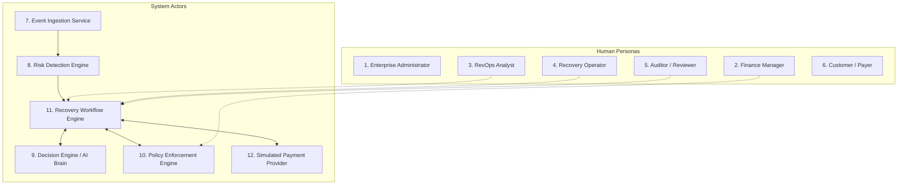

# RevenueRescueAI — Actors, Personas, and System Roles Specification

> **Document ID:** DOC-ACT-001  
> **Phase:** 0.2 (User Stories, Functional Requirements & Acceptance Criteria)  
> **Status:** Approved Baseline  
> **Audience:** Product Engineering, Architecture, QA, Security, Beginner Developers  

---

## 1. Executive Summary

In enterprise software engineering, security and operational stability depend on explicit boundaries around who—or what—can perform actions. In an AI-assisted financial recovery system, distinguishing human users from autonomous software components is critical to prevent accidental privilege escalation and runaway automation.

This document formally defines the twelve human and system actors operating within RevenueRescueAI. For each actor, it details responsibilities, operational goals, permitted actions, non-negotiable restrictions, dependencies, and their lifecycle status (Mandatory MVP vs. Future Enterprise Extension).

---

## 2. Actor Classification & Permissions Taxonomy

The system architecture partitions actors into two distinct types:
1. **Human Actors (Personas):** Individuals interacting through graphical dashboards, CLI tools, or audit exports.
2. **System Actors (Automated Services):** Software micro-components, background workers, and boundary adapters executing deterministic code or advisory model inference.

---

## 3. Comprehensive Actor Profiles

---

### 1. Enterprise Administrator (Human)
- **Actor Type:** Human
- **Primary Responsibility:** Oversees system-wide infrastructure, environment configuration, database maintenance, user provisioning, and credential rotation.
- **Goals:** Maintain platform availability (99.9% uptime), ensure zero secret leaks, manage deployment configurations, and oversee data retention lifecycles.
- **Information Accessed:** System health metrics (`/health`, `/ready`), deployment logs, error telemetry, connection pool metrics, configuration variables (with masked secrets).
- **Permitted Actions:** Updating non-secret system environment variables; triggering database schema migrations; provisioning and revoking operator credentials; viewing system observability feeds.
- **Restricted Actions:** Modifying immutable audit event logs; directly editing financial transaction amounts; triggering manual payment recovery actions without an audit event.
- **Dependencies:** Infrastructure hosting environment, database server, logging pipelines.
- **Relevant Use Cases:** System spin-up, migration execution, health monitoring, secret rotation.
- **MVP Status:** **Pragmatic MVP.** In local development, represented as the local terminal operator; full enterprise IAM/SSO is deferred.

---

### 2. Finance Manager (Human)
- **Primary Responsibility:** Manages business revenue integrity, monitors gross vs. net recovered cash flow, evaluates involuntary churn reduction, and sets global financial risk thresholds.
- **Goals:** Maximize recovered revenue, minimize payment gateway retry fees, ensure accurate balance-sheet reporting, and protect merchant processing reputation.
- **Information Accessed:** Executive command-center KPI cards (Confirmed Recovered Revenue, Revenue at Risk, Recovery Rate %), financial trend charts, baseline comparison reports.
- **Permitted Actions:** Setting macro retry budget limits; defining high-value human escalation monetary thresholds (e.g., cases >= $1,000); exporting financial reconciliation CSVs; viewing aggregate metrics.
- **Restricted Actions:** Altering raw webhook payloads; bypassing deterministic safety policies; directly invoking payment gateway charge APIs; deleting cases.
- **Dependencies:** Revenue Analytics Engine, Evaluation Reporting Service.
- **Relevant Use Cases:** Executive dashboard inspection, macro policy threshold adjustment, baseline ROI verification.
- **MVP Status:** **Mandatory MVP Role.** Primary consumer of dashboard KPIs and evaluation reports.

---

### 3. Revenue Operations (RevOps) Analyst (Human)
- **Primary Responsibility:** Analyzes payment failure patterns, monitors recovery queue throughput, evaluates AI recommendation accuracy, and tunes failure classification rules.
- **Goals:** Optimize recovery timing strategies (e.g., payday retry scheduling), reduce false-positive escalations, and benchmark recovery algorithms against deterministic baselines.
- **Information Accessed:** Full recovery case queue, granular failure telemetry (decline codes, BIN metadata), AI reasoning traces, policy check audit logs, batch evaluation lab results.
- **Permitted Actions:** Filtering and searching the recovery queue; triggering batch evaluation simulations (e.g., 500 scenarios under seed 42); previewing AI decision logic; inspecting end-to-end diagnostic traces.
- **Restricted Actions:** Disabling the deterministic policy gate; issuing unauthorized refunds; wiping database audit tables.
- **Dependencies:** Recovery Case Management API, Evaluation Engine, Diagnostic Trace Service.
- **Relevant Use Cases:** Queue analysis, batch simulation execution, strategy comparison, failure code trend analysis.
- **MVP Status:** **Mandatory MVP Role.** Core operational user for the recovery command center.

---

### 4. Recovery Operator (Human)
- **Primary Responsibility:** Handles edge cases, reviews ambiguous payment outcomes, and manually decides cases routed to the human escalation queue.
- **Goals:** Rapidly resolve high-risk, high-value, or uncertain payment cases while preventing customer double-charging.
- **Information Accessed:** Escalated case inbox, case history timeline, customer contact records, reconciliation status reports, provider transaction responses.
- **Permitted Actions:** Approving an escalated retry action; rejecting an unrecoverable case (`HALT_RECOVERY`); pausing active retries upon customer request; requesting manual provider reconciliation.
- **Restricted Actions:** Overriding hard safety rules (e.g., cannot force a retry if an invoice is already confirmed paid); deleting cases; viewing unmasked card numbers (PAN).
- **Dependencies:** Recovery Workflow Engine, Escalation Queue UI.
- **Relevant Use Cases:** Manual case review, resolving uncertain gateway timeouts, approving high-value transactions.
- **MVP Status:** **Mandatory MVP Role.** Essential safety valve for the human-in-the-loop escalation loop.

---

### 5. Auditor / Compliance Reviewer (Human / External)
- **Primary Responsibility:** Validates that financial recovery practices adhere to payment network rules (Visa/Mastercard), consumer protection laws, and financial accounting standards.
- **Goals:** Verify that 100% of reported "recovered revenue" is backed by authoritative settlement evidence, ensure zero duplicate charges occurred, and confirm that retry limits were strictly enforced.
- **Information Accessed:** Read-only access to immutable audit tables, webhook cryptographic receipt signatures, policy enforcement logs, metric derivation formulas.
- **Permitted Actions:** Querying and exporting audit trails; filtering audit records by correlation ID; generating compliance verification reports; verifying scenario reproducibility.
- **Restricted Actions:** Any mutation of database state; triggering any recovery action; modifying configuration parameters.
- **Dependencies:** Append-Only Audit Ledger, Verification Service.
- **Relevant Use Cases:** Audit log inspection, settlement verification check, policy compliance validation.
- **MVP Status:** **Mandatory MVP Role.** Verifies the trustworthiness of all project claims.

---

### 6. Customer / Payer (Human / External)
- **Primary Responsibility:** The subscriber or buyer who owes money for an invoice, subscription, or order.
- **Goals:** Maintain uninterrupted service access, receive clear non-deceptive communication, avoid accidental double-charges, and update payment credentials securely.
- **Information Accessed:** Hosted payment update portal, payment failure notification email/receipt.
- **Permitted Actions:** Entering updated payment method details via secure hosted fields; clicking single-click payment recovery links; opting out of commercial communications.
- **Restricted Actions:** Accessing internal recovery queues; viewing system diagnostics, failure codes, or risk scores.
- **Dependencies:** Payment Gateway Hosted Checkout / Elements.
- **Relevant Use Cases:** Receiving failure notice, updating expired card, opting out.
- **MVP Status:** **Simulated Context for MVP.** Simulated via synthetic customer metadata profiles; live customer messaging is out of scope.

---

### 7. Event Ingestion Service (System)
- **Primary Responsibility:** Serves as the perimeter gateway for incoming asynchronous webhooks from payment providers.
- **Goals:** Ingest events with sub-500ms acknowledgment, verify cryptographic HMAC signatures, validate payload schemas, and reject malformed or duplicate deliveries.
- **Information Accessed:** Inbound HTTP headers, raw webhook request body, webhook HMAC secrets, database idempotency index.
- **Permitted Actions:** Validating payload schemas; calculating payload SHA-256 hashes; querying idempotency tables; emitting validated event tokens to the risk detection pipeline; returning HTTP 200/400/401/409 responses.
- **Restricted Actions:** Mutating payment balances; initiating outbound network calls to external banks; bypassing signature verification.
- **Dependencies:** Fast API routing engine, Cryptographic Verification Library (HMAC-SHA256), Database Idempotency Table.
- **Relevant Use Cases:** Ingesting `payment.failed`, rejecting unauthenticated payloads, discarding duplicate webhook events.
- **MVP Status:** **Mandatory MVP Core Service.**

---

### 8. Risk Detection Engine (System)
- **Primary Responsibility:** Analyzes validated events, calculates exact nominal revenue at risk in integer minor units, and initializes a tracked `RecoveryCase`.
- **Goals:** Ensure 100% of legitimate payment failures are captured without data loss or rounding discrepancies.
- **Information Accessed:** Ingested event payload, customer account repository, invoice ledger.
- **Permitted Actions:** Querying existing case state; calculating nominal at-risk amount (`integer minor units`); instantiating new `RecoveryCase` records with state `DETECTED`; creating initial audit log entries.
- **Restricted Actions:** Triggering payment recovery tools; altering customer billing details; communicating externally.
- **Dependencies:** Event Ingestion Service, Case Persistence Store.
- **Relevant Use Cases:** Case creation, revenue-at-risk calculation, stale pending risk detection.
- **MVP Status:** **Mandatory MVP Core Service.**

---

### 9. Decision Engine / AI Brain (System)
- **Primary Responsibility:** Evaluates failure telemetry, customer history, and time context to diagnose the root cause and propose an optimal, allow-listed intervention strategy.
- **Goals:** Generate intelligent, context-aware recovery recommendations (e.g., delaying a balance-decline retry until payday) while remaining strictly within an allow-listed action taxonomy.
- **Information Accessed:** Case context (raw decline code, attempt count, customer tenure, invoice amount, currency, failure timestamp).
- **Permitted Actions:** Executing diagnostic heuristics; invoking structured LLM reasoning prompts or statistical classifiers (`deterministic-logistic-v1`); returning typed `InterventionProposal` objects containing action enum, execution delay, and explainable rationale.
- **Restricted Actions:** **STRICTLY PROHIBITED FROM INDEPENDENTLY EXECUTING ACTIONS.** Cannot call payment APIs; cannot spend money; cannot bypass policy rules; cannot invent unauthorized action names.
- **Dependencies:** Context Assembly Service, Prompt / Statistical Estimator Interface.
- **Relevant Use Cases:** Failure classification, retry schedule recommendation, recovery probability estimation.
- **MVP Status:** **Mandatory MVP Core Service.** Operates strictly as an untrusted advisory component.

---

### 10. Policy Enforcement Engine (System)
- **Primary Responsibility:** Acts as the non-negotiable code gatekeeper. Evaluates every proposal from the Decision Engine against deterministic business, safety, and legal invariants.
- **Goals:** Guarantee a 0.00% safety violation rate: block retries on already-paid invoices, enforce hard retry ceilings, enforce backoff delays, and halt execution on terminal declines.
- **Information Accessed:** `InterventionProposal`, current case state, attempt counters, customer opt-out flags, authoritative payment settlement status.
- **Permitted Actions:** Evaluating boolean policy rules; approving compliant proposals (`PolicyDecision: APPROVED`); rejecting non-compliant proposals (`PolicyDecision: REJECTED`); modifying case state to `POLICY_APPROVED`, `HALTED`, or `ESCALATED`.
- **Restricted Actions:** Executing external network calls; modifying the AI proposal; altering audit history.
- **Dependencies:** Policy Configuration Repository, Case Persistence Store.
- **Relevant Use Cases:** Pre-execution safety validation, retry budget enforcement, success protection check.
- **MVP Status:** **Mandatory MVP Core Service.** The authoritative security anchor of the application.

---

### 11. Recovery Workflow Engine (System)
- **Primary Responsibility:** Orchestrates the multi-step recovery state machine. Coordinates the transitions from detection to decision, policy approval, tool dispatch, outcome verification, and audit persistence.
- **Goals:** Maintain consistent state transitions, handle asynchronous timeouts gracefully, and ensure robust crash-recovery and resumability.
- **Information Accessed:** Case state machine, scheduler queue, tool contracts, audit log writer.
- **Permitted Actions:** Transitioning case states; scheduling future execution events; invoking the Simulated Payment Provider adapter with unique idempotency keys; triggering outcome verification; routing cases to operator queues.
- **Restricted Actions:** Executing tool calls without an explicit `POLICY_APPROVED` token; deleting in-flight state records.
- **Dependencies:** Case Persistence Store, Policy Enforcement Engine, Simulated Payment Provider, Audit Logger.
- **Relevant Use Cases:** End-to-end recovery orchestration, timeout handling, retry scheduling, escalation routing.
- **MVP Status:** **Mandatory MVP Core Service.**

---

### 12. Simulated Payment Provider (System)
- **Primary Responsibility:** Emulates external payment gateway rails (e.g., Stripe, Razorpay, Adyen) within an isolated, deterministic software envelope.
- **Goals:** Provide realistic, controllable payment processing responses (success, soft decline, hard decline, network timeout, ambiguous pending) without live banking dependencies or monetary costs.
- **Information Accessed:** Inbound adapter execution requests (amount, currency, customer reference, idempotency key).
- **Permitted Actions:** Returning typed gateway responses (`PaymentResult: SUCCEEDED | FAILED | PENDING`); maintaining an internal simulated transaction ledger; simulating configurable network latency and socket timeouts.
- **Restricted Actions:** Moving real money; connecting to real bank networks; logging unmasked synthetic card data.
- **Dependencies:** Local Python adapter interface, Deterministic Scenario Seed.
- **Relevant Use Cases:** Executing payment retries, querying transaction status, simulating network timeout edge cases.
- **MVP Status:** **Mandatory MVP Core Service.** Provides the external environment boundary for the entire project.

---

## 4. Permissions & Responsibility Matrix

The following matrix maps permitted and prohibited operations across all twelve actors:

| Actor | Ingest Webhook | Propose Action | Approve Policy | Execute Tool | Verify Settlement | Mutate Audit Log | View Dashboard | Run Evaluation |
|---|:---:|:---:|:---:|:---:|:---:|:---:|:---:|:---:|
| **Enterprise Admin** | No | No | No | No | No | **PROHIBITED** | Read-Only | Read-Only |
| **Finance Manager** | No | No | Thresholds | No | No | **PROHIBITED** | Full Access | Read-Only |
| **RevOps Analyst** | No | No | No | Review | No | **PROHIBITED** | Full Access | Full Access |
| **Recovery Operator**| No | No | Exception | Approve | No | **PROHIBITED** | Queue Only | No |
| **Auditor / Reviewer**| No | No | No | No | Inspect | **PROHIBITED** | Read-Only | Read-Only |
| **Customer / Payer** | No | No | No | Self-Update| No | **PROHIBITED** | **PROHIBITED**| **PROHIBITED** |
| **Event Ingestion Svc**| **YES** | No | No | No | No | Append | Internal | No |
| **Risk Detection Eng** | Consume | No | No | No | No | Append | Internal | No |
| **Decision Engine (AI)**| No | **PROPOSE** | **PROHIBITED** | **PROHIBITED** | No | Append | Internal | Internal |
| **Policy Engine** | No | No | **AUTHORIZE** | No | No | Append | Internal | Internal |
| **Workflow Engine** | No | No | Enforce | **DISPATCH** | Trigger | Append | Internal | Internal |
| **Simulated Provider** | No | No | No | Emulate | Authoritative | None | None | Emulate |

---

## 5. Architectural Safeguards for Actor Separation

To prevent privilege confusion during implementation:

1. **The Code-Gate Invariant:** The Decision Engine (AI) has **zero dispatch authority**. The Workflow Engine will physically throw a `UnauthorizedToolInvocationException` if an attempt is made to invoke the Payment Provider without a cryptographically verified or signed `PolicyDecision(status="APPROVED")` object.
2. **Immutable Audit Guarantee:** No human or system actor possesses permission to issue `UPDATE` or `DELETE` statements against the audit ledger. All audit logging is append-only.
3. **Least Privilege Isolation:** System workers run under isolated process privileges; database access is scoped to application schemas without administrative database superuser rights.
