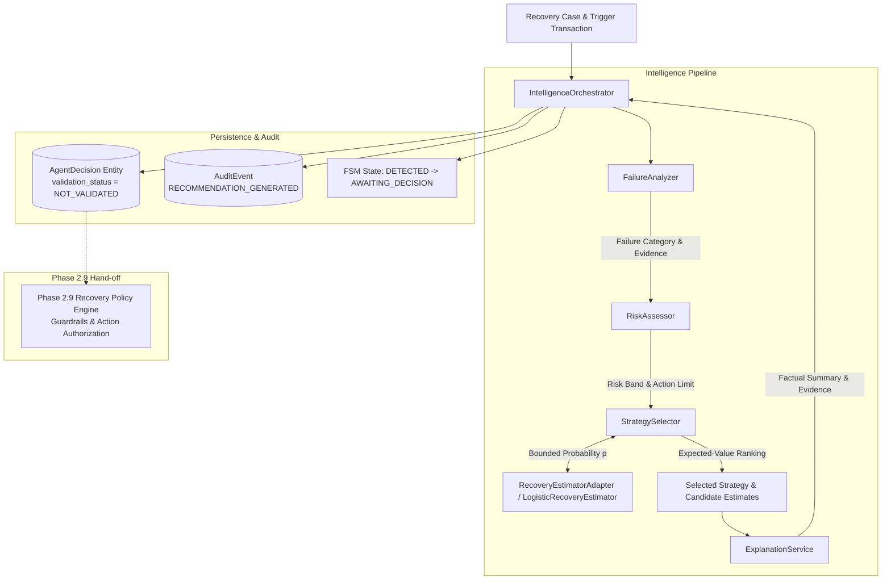

# Phase 2.8 — AI-Powered Recovery Intelligence Architecture

## 1. Executive Summary & Purpose

The **AI-Powered Recovery Intelligence Engine** is the core analytical brain of **RevenueRescueAI**. Its purpose is to answer five essential questions for every revenue-risk incident without executing unauthorized side effects:

1. **Why is this revenue case at risk?** (Failure analysis & diagnostic evidence extraction).
2. **What category of payment failure occurred?** (Normalized categorization).
3. **How likely is this transaction to be recovered?** (Calibrated probability estimation).
4. **Which recovery strategy is most economically viable?** (Expected net recovery value optimization).
5. **Why is that strategy recommended?** (Factual, human-readable explanations).

---

## 2. Core Architectural Principles & Strict Scope Boundaries

1. **AI Recommends, Policy Authorizes, Engine Executes**:
   - The AI Engine produces strictly advisory recommendations (`AgentDecision` with `validation_status = NOT_VALIDATED`).
   - It **never** triggers payment gateway retries, debits customer accounts, sends customer SMS/emails, or marks cases recovered.
   - Action authorization is deferred to **Phase 2.9 (Recovery Policy Engine)**.

2. **No Black-Box Hallucinations**:
   - The engine does not rely on opaque LLM prompts or fictitious accuracy claims.
   - It uses inspectable, mathematically reproducible logistic models and structured rule catalogues.

3. **Pluggable Architecture (`RecoveryEstimatorAdapter`)**:
   - The probability estimator adheres to a clean Abstract Base Class (`RecoveryEstimatorAdapter`). Future scikit-learn or XGBoost models can replace the estimator without rewriting business logic or REST contracts.

---

## 3. Component Responsibility Matrix

| Component | Class Name | Responsibility | Dependencies |
| :--- | :--- | :--- | :--- |
| **Failure Analyzer** | [`FailureAnalyzer`](file:///c:/Users/vanka/Downloads/RevenueRescueAI-main/RevenueRescueAI-main/backend/app/services/intelligence/failure_analyzer.py) | Parses gateway decline codes and normalized messages into 9 standard failure categories. | CanonicalEventType |
| **Risk Assessor** | [`RiskAssessor`](file:///c:/Users/vanka/Downloads/RevenueRescueAI-main/RevenueRescueAI-main/backend/app/services/intelligence/risk_assessor.py) | Computes a transparent 0–100 risk score, risk bands (`low`, `medium`, `high`), and action limits. | None |
| **Model Adapter** | [`RecoveryEstimatorAdapter`](file:///c:/Users/vanka/Downloads/RevenueRescueAI-main/RevenueRescueAI-main/backend/app/services/intelligence/model_adapter.py) | Defines the abstract interface contract for conditional recovery probability estimators. | ActionType |
| **Probability Estimator** | [`LogisticRecoveryEstimator`](file:///c:/Users/vanka/Downloads/RevenueRescueAI-main/RevenueRescueAI-main/backend/app/services/intelligence/probability_estimator.py) | Versioned (`deterministic-logistic-v1`) logistic model bounding $p \in [0.0100, 0.9900]$. | RecoveryEstimatorAdapter |
| **Strategy Catalogue** | [`StrategyCatalog`](file:///c:/Users/vanka/Downloads/RevenueRescueAI-main/RevenueRescueAI-main/backend/app/services/intelligence/strategy_catalog.py) | Approved registry of recovery strategies, preconditions, intervention costs, and domain actions. | ActionType, RecoveryStrategy |
| **Strategy Selector** | [`StrategySelector`](file:///c:/Users/vanka/Downloads/RevenueRescueAI-main/RevenueRescueAI-main/backend/app/services/intelligence/strategy_selector.py) | Calculates expected net recovery value ($\text{Amount} \times p - \text{Cost}$) and filters policy violations. | StrategyCatalog, RecoveryEstimatorAdapter |
| **Explanation Service** | [`ExplanationService`](file:///c:/Users/vanka/Downloads/RevenueRescueAI-main/RevenueRescueAI-main/backend/app/services/intelligence/explanation_service.py) | Compiles factual, non-hallucinated explanations citing verified transaction evidence. | None |
| **Intelligence Orchestrator** | [`IntelligenceOrchestrator`](file:///c:/Users/vanka/Downloads/RevenueRescueAI-main/RevenueRescueAI-main/backend/app/services/intelligence/orchestrator.py) | Orchestrates the end-to-end pipeline, persists `AgentDecision`, records audit logs, and transitions FSM state. | All components & Repositories |
