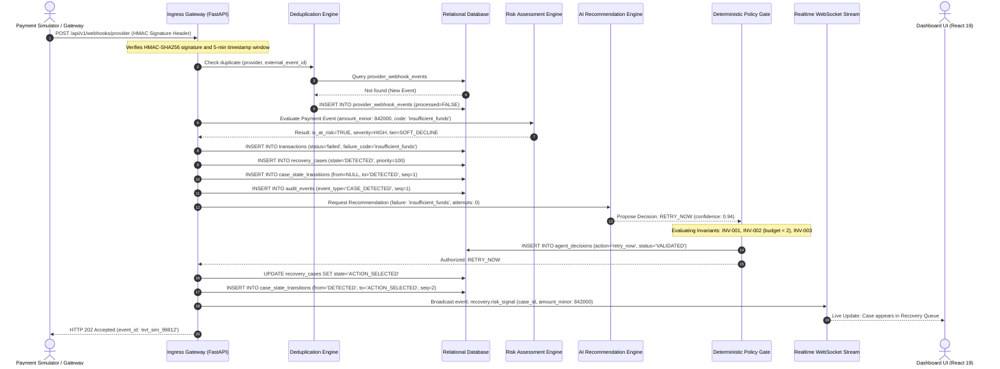
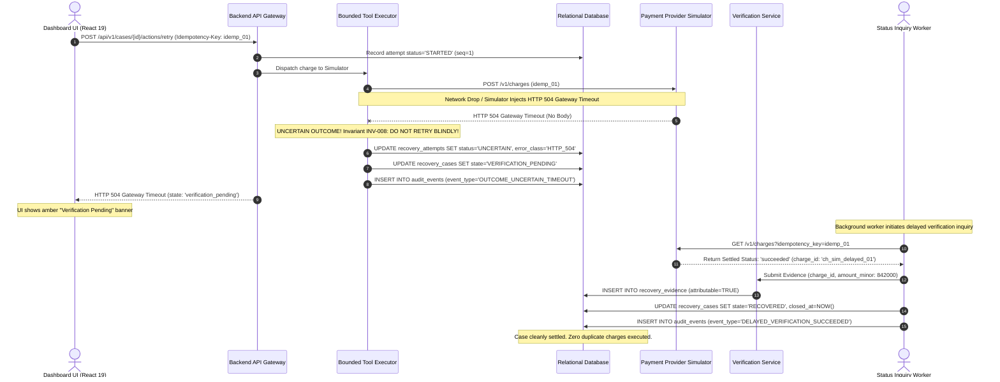
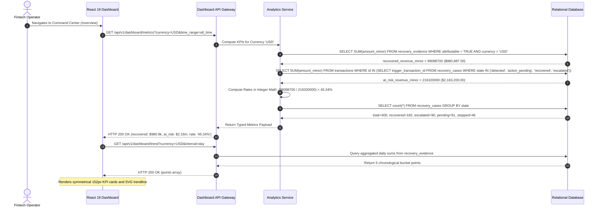

# RevenueRescueAI — API System Communication Sequence Diagrams
## Phase 1.3: End-to-End Interaction Models, Component Handshakes, and Failure Recovery

**Document Version:** 1.0.0  
**Status:** Approved Sequence Models  
**Primary Authors:** Senior Backend Architect, API Designer, Systems Engineer  

---

## 1. Flow 1: Inbound Payment Failure to Recovery Recommendation

This sequence traces an incoming failed payment webhook as it is authenticated, deduplicated, evaluated for revenue risk, diagnosed, and converted into a validated AI recommendation.



### Flow 1 Failure & Decision Summary:
- **Initiator:** External Gateway / Payment Simulator.
- **Decision Makers:** 
  1. `PaymentEventValidator` (decides structural validity).
  2. `RiskAssessmentEngine` (decides if revenue is at risk).
  3. `DeterministicPolicyGate` (authorizes action feasibility).
- **Storage:** Persisted in `provider_webhook_events`, `transactions`, `recovery_cases`, `agent_decisions`, and `audit_events`.
- **Failure Recovery:** If signature fails $\to$ HTTP 401. If duplicate $\to$ cached HTTP 200 returned. If AI times out $\to$ falls back to `deterministic-logistic-v1`.

---

## 2. Flow 2: Recommendation to Recovery Action Execution

This sequence models an operator triggering an approved recovery retry from the Command Center, verifying policy rules, executing against the provider simulator, and updating the audit log.

```mermaid
sequenceDiagram
    autonumber
    actor Operator as Dashboard UI (React 19)
    participant API as Backend API Gateway
    participant Policy as Deterministic Policy Gate
    participant Tool as Bounded Tool Executor
    participant DB as Relational Database
    participant Sim as Payment Provider Simulator
    participant Verify as Verification Service
    participant WS as Realtime WebSocket Stream

    Operator->>API: POST /api/v1/cases/{id}/actions/retry (Header: Idempotency-Key)
    API->>DB: SELECT * FROM recovery_cases WHERE id = :id FOR UPDATE
    DB-->>API: Return Case (state='ACTION_SELECTED', version=1)
    
    API->>Policy: Validate Action against Invariants (attempts < 2, not terminal)
    Policy-->>API: Verdict: ALLOWED (Attempt 1 of 2)
    
    API->>DB: INSERT INTO recovery_attempts (seq=1, status='STARTED', key=Idempotency-Key)
    API->>DB: UPDATE recovery_cases SET state='ACTION_PENDING', version=2
    API->>DB: INSERT INTO case_state_transitions (from='ACTION_SELECTED', to='ACTION_PENDING', seq=3)
    API->>DB: COMMIT TRANSACTION; -- Release database lock!
    
    API->>Tool: Dispatch retry_payment (amount: 842000, key: Idempotency-Key)
    Tool->>Sim: POST /v1/charges (amount: 842000, currency: 'USD')
    Sim-->>Tool: HTTP 200 OK (status: 'succeeded', charge_id: 'ch_sim_8F31_01')
    
    Tool->>DB: BEGIN TRANSACTION;
    Tool->>DB: UPDATE recovery_attempts SET status='SUCCEEDED', provider_reference='ch_sim_8F31_01'
    Tool->>Verify: Submit Evidence for Verification
    Verify->>Verify: Verify match (amount: 842000, customer match, <72h)
    Verify->>DB: INSERT INTO recovery_evidence (attributable=TRUE, amount_minor=842000)
    
    Tool->>DB: UPDATE recovery_cases SET state='RECOVERED', closed_at=NOW(), version=3
    Tool->>DB: INSERT INTO case_state_transitions (from='ACTION_PENDING', to='RECOVERED', seq=4)
    Tool->>DB: INSERT INTO audit_events (event_type='CASE_RECOVERED', seq=4)
    Tool->>DB: COMMIT TRANSACTION;
    
    API->>WS: Broadcast event: recovery.payment_recovered ($8,420.00)
    WS-->>Operator: Live Notification: Case marked RECOVERED
    API-->>Operator: HTTP 200 OK (state: 'recovered', recovered_minor: 842000)
```

---

## 3. Flow 3: Uncertain Recovery Outcome (HTTP 504 Timeout)

This sequence illustrates how the system prevents double-charging when an external gateway times out, transitions the case to `VERIFICATION_PENDING`, and safely resolves the transaction.



---

## 4. Flow 4: Dashboard Loading & Authoritative KPI Computation

This sequence illustrates how the React dashboard retrieves authoritative financial metrics without performing client-side math.


