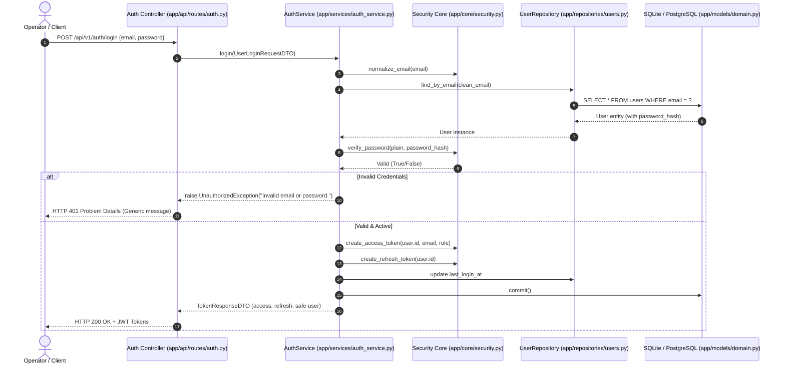

# RevenueRescueAI — Authentication Architecture
## Phase 2.4: Token-Based Authentication Design, Trust Boundaries, and Cryptographic Protocols

**Document Version:** 1.0.0  
**Status:** Approved Architecture  
**Author:** Senior Security Architect, API Engineer  

---

## 1. Authentication Architecture Overview

In RevenueRescueAI, authentication establishes the cryptographic identity of the caller. Because the system manages financial recovery operations and payment interventions, authentication must be stateless, horizontally scalable, immune to credential replay, and resistant to account enumeration.

The authentication architecture implements **JWT Bearer Token Authentication** using HMAC-SHA256 (`HS256`) signatures and one-way password hashing using **BCrypt** (work factor 12).

---

## 2. Authentication Protocol Standards

### 2.1 Access Tokens
- **Format:** JSON Web Token (RFC-7519).
- **Signing Algorithm:** HMAC-SHA256 (`HS256`).
- **Signature Secret:** Configured via `Settings.jwt_secret_key` (externalized from source code).
- **Expiration:** Short-lived: 60 minutes (`Settings.jwt_access_token_expire_minutes = 60`).
- **Header:** `Authorization: Bearer <access_token>`.
- **Payload Claims:**
  - `sub`: Canonical user UUID string (e.g. `"f65fae3e-4d45-42cf-9fae-d4c3ab871101"`).
  - `email`: Normalized user email address.
  - `role`: Assigned RBAC role string (e.g. `"ROLE_OPERATOR"`, `"ROLE_ADMIN"`).
  - `type`: `"access"`.
  - `jti`: Unique UUIDv4 token identifier ensuring cryptographic uniqueness across millisecond requests.
  - `iat`: UNIX timestamp when issued.
  - `exp`: UNIX timestamp when expired.

### 2.2 Refresh Tokens
- **Format:** JSON Web Token (RFC-7519).
- **Expiration:** Long-lived: 7 days (`Settings.jwt_refresh_token_expire_days = 7`).
- **Endpoint:** `POST /api/v1/auth/refresh`.
- **Payload Claims:**
  - `sub`: User UUID string.
  - `type`: `"refresh"`.
  - `jti`: Unique UUIDv4 string.
  - `iat` / `exp`: Timestamps.

---

## 3. Defense Against Common Authentication Attacks

| Attack Vector | Vulnerability Description | RevenueRescueAI Architectural Mitigation |
| :--- | :--- | :--- |
| **Account Enumeration** | Attacker probes login endpoint with email list to determine which accounts exist based on differing error messages ("User not found" vs "Wrong password"). | **Generic Error Messages:** Both missing accounts and incorrect passwords return the identical RFC-7807 error message: `"Invalid email or password."` with HTTP 401. |
| **Timing Side-Channel** | Measuring CPU response times during password verification to guess password length or validity. | **Constant-Time Verification:** BCrypt verification executes constant-time string comparisons. |
| **Privilege Escalation** | Client passes `{"role": "ROLE_ADMIN"}` during self-registration. | **Pydantic Strict Schemas (`extra="forbid"`):** Registration DTO strictly excludes `role` and `status`. The service layer hardcodes `default_role = UserRole.OPERATOR`. |
| **Credential Replay** | Replaying an old or stolen token indefinitely. | **Short Token Expiry & JTI:** Access tokens expire within 60 minutes; refresh tokens require active account status verification on every rotation. |
| **Mass-Assignment** | Injecting unapproved fields such as `"is_active": true` or `"verified": true`. | **DTO Decoupling:** Inbound payloads map to dedicated DTOs; entity attributes are updated only via explicit service mutations. |
