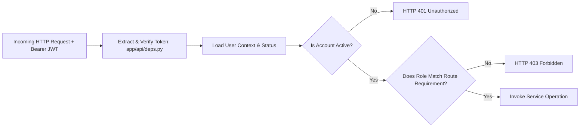

# RevenueRescueAI — Authorization & Role-Based Access Control (RBAC)
## Phase 2.4: Permission Models, Role Boundaries, and Backend Enforcement

**Document Version:** 1.0.0  
**Status:** Approved Architectural Standard  
**Author:** Senior Security Architect, API Engineer  

---

## 1. Zero-Trust Authorization Model

Authentication answers: **"Who are you?"**  
Authorization answers: **"Are you permitted to perform this specific action?"**

In RevenueRescueAI, authorization is governed by the principle of **Least Privilege**. No user receives permissions beyond what their operational duty requires.



### Critical Security Rule: Backend Supremacy
> **Never rely on frontend UI visibility for security.**

Hiding an "Execute Retry" button on a React/Vite dashboard is a user experience enhancement, **not a security boundary**. Any attacker with DevTools or `curl` can issue direct HTTP requests to `/api/v1/cases/{id}/actions/retry`. All permissions must be strictly verified on the backend by FastAPI dependency injection gates before application services are invoked.

---

## 2. Approved Role Hierarchy & Definitions

| Role | Token String | Intended Actor | Scope of Authorization |
| :--- | :--- | :--- | :--- |
| **System Administrator** | `ROLE_ADMIN` | DevOps, Lead Engineers | Full administrative authority: user management, role assignments, system status updates, evaluation batches. |
| **Fintech Operator** | `ROLE_OPERATOR` | Revenue Recovery Specialists | Operational authority: inspect queues, view recovery cases, trigger approved retry interventions, request operator review. |
| **Compliance Auditor** | `ROLE_AUDITOR` | Risk & Compliance Officers | Read-only authority: inspect cases, read append-only audit trail logs, verify evidence records. Cannot trigger payments. |
| **System Ingestor** | `ROLE_INGESTOR` | Webhook Gateways (Simulator/Stripe) | Ingestion authority: receive and record provider events. Blocked from human dashboard and recovery queues. |

---

## 3. RBAC Endpoint Matrix

| Endpoint Route | HTTP Method | Public | `ROLE_OPERATOR` | `ROLE_AUDITOR` | `ROLE_ADMIN` |
| :--- | :---: | :---: | :---: | :---: | :---: |
| `/health`, `/ready` | `GET` | **Yes** | Yes | Yes | Yes |
| `/api/v1/auth/register` | `POST` | **Yes** | Yes | Yes | Yes |
| `/api/v1/auth/login` | `POST` | **Yes** | Yes | Yes | Yes |
| `/api/v1/auth/refresh` | `POST` | **Yes** | Yes | Yes | Yes |
| `/api/v1/auth/me` | `GET`, `PATCH` | No | **Allowed** | **Allowed** | **Allowed** |
| `/api/v1/auth/change-password` | `POST` | No | **Allowed** | **Allowed** | **Allowed** |
| `/api/v1/users` | `GET` | No | *Blocked (403)* | *Blocked (403)* | **Allowed** |
| `/api/v1/users/{id}/role` | `PATCH` | No | *Blocked (403)* | *Blocked (403)* | **Allowed** |
| `/api/v1/users/{id}/status` | `PATCH` | No | *Blocked (403)* | *Blocked (403)* | **Allowed** |
| `/api/v1/cases` | `GET` | No | **Allowed** | **Allowed** | **Allowed** |
| `/api/v1/cases/{id}/actions/retry`| `POST` | No | **Allowed** | *Blocked (403)* | **Allowed** |
| `/api/v1/cases/{id}/audit-trail` | `GET` | No | *Blocked (403)* | **Allowed** | **Allowed** |

---

## 4. Implementation in FastAPI

Role gates are implemented as reusable dependencies in [`app/api/deps.py`](file:///c:/Users/vanka/Downloads/RevenueRescueAI-main/RevenueRescueAI-main/backend/app/api/deps.py):

```python
def require_roles(allowed_roles: list[UserRole]):
    def role_dependency(current_user: User = Depends(get_current_user)) -> User:
        if current_user.role not in allowed_roles:
            raise ForbiddenException(
                f"Access forbidden: required role in {[r.value for r in allowed_roles]}, "
                f"but user possesses '{current_user.role.value}'."
            )
        return current_user
    return role_dependency

require_admin = require_roles([UserRole.ADMIN])
require_operator = require_roles([UserRole.ADMIN, UserRole.OPERATOR])
require_auditor = require_roles([UserRole.ADMIN, UserRole.AUDITOR])
```

Routes declare their access level cleanly:
```python
@router.get("/api/v1/users", response_model=PaginatedResponse[UserResponseDTO])
def list_users(_admin: User = Depends(require_admin), db: Session = Depends(get_db)):
    ...
```
