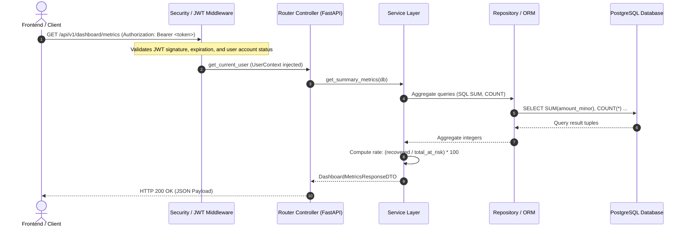

# Backend API Implementation — Phase 2.5

## 1. Overview and Architecture Context
In Phase 2.5, **RevenueRescueAI** successfully established its initial functional REST API layer, directly wiring database repositories, service business logic, and security middleware to HTTP endpoints. Rather than introducing speculative AI logic or premature recovery actions, this phase focuses on authoritative read operations, metrics calculation, and complete client-to-backend communication.

The backend implementation follows a strict 4-tier clean architecture:
1. **Controller / Routing Layer** ([`backend/app/api/routes/`](file:///c:/Users/vanka/Downloads/RevenueRescueAI-main/RevenueRescueAI-main/backend/app/api/routes)): HTTP parameter parsing, query normalization, dependency injection, and schema serialization.
2. **Service Layer** ([`backend/app/services/`](file:///c:/Users/vanka/Downloads/RevenueRescueAI-main/RevenueRescueAI-main/backend/app/services)): Business domain rules, transactional boundary enforcement, and financial integrity calculations.
3. **Repository / Query Layer** ([`backend/app/repositories/`](file:///c:/Users/vanka/Downloads/RevenueRescueAI-main/RevenueRescueAI-main/backend/app/repositories)): SQLAlchemy ORM queries with explicit joins (`joinedload`) to eliminate N+1 latency, and SQL aggregation functions (`func.sum`, `func.count`).
4. **Data Transfer Object (DTO) Layer** ([`backend/app/schemas/`](file:///c:/Users/vanka/Downloads/RevenueRescueAI-main/RevenueRescueAI-main/backend/app/schemas)): Pydantic v2 schemas providing strict compile-time and runtime serialization, masking internal database entity graphs and sensitive fields.

---

## 2. Implemented Endpoints Catalogue

| Endpoint Path | HTTP Method | Authentication | Required Roles | Description & Behavior |
| :--- | :--- | :--- | :--- | :--- |
| `/health` | `GET` | Public | None | Quick application liveness probe returning status `UP`. |
| `/api/v1/health` | `GET` | Public | None | Standard API health probe with uptime and database status indicator. |
| `/ready` | `GET` | Public | None | Application readiness probe validating that database connectivity is healthy. |
| `/api/v1/ready` | `GET` | Public | None | Standard readiness check for load balancers. |
| `/health/db` | `GET` | Public | None | Dedicated database diagnostic probe executing `SELECT 1` without exposing connection strings. |
| `/api/v1/users/me` | `GET` | Bearer Token | `ROLE_VIEWER`, `ROLE_OPERATOR`, `ROLE_ADMIN` | Authenticated user profile retrieval from server-side security context. |
| `/api/v1/auth/me` | `GET` | Bearer Token | `ROLE_VIEWER`, `ROLE_OPERATOR`, `ROLE_ADMIN` | Alias route for current user profile. |
| `/api/v1/dashboard/metrics` | `GET` | Bearer Token | `ROLE_VIEWER`, `ROLE_OPERATOR`, `ROLE_ADMIN` | Authoritative recovery KPI aggregates calculated in exact minor currency units. |
| `/api/v1/dashboard/summary` | `GET` | Bearer Token | `ROLE_VIEWER`, `ROLE_OPERATOR`, `ROLE_ADMIN` | Alias endpoint conforming with Phase 1.3 contract. |
| `/api/v1/dashboard/trend` | `GET` | Bearer Token | `ROLE_VIEWER`, `ROLE_OPERATOR`, `ROLE_ADMIN` | Time-series trend data grouped by date boundaries (defaults to 30 days). |
| `/api/v1/dashboard/revenue-trends`| `GET` | Bearer Token | `ROLE_VIEWER`, `ROLE_OPERATOR`, `ROLE_ADMIN` | Alias endpoint for revenue recovery time-series. |
| `/api/v1/dashboard/workflow-status`| `GET` | Bearer Token | `ROLE_VIEWER`, `ROLE_OPERATOR`, `ROLE_ADMIN` | Case count distribution across finite-state-machine (FSM) workflow states. |
| `/api/v1/cases` | `GET` | Bearer Token | `ROLE_VIEWER`, `ROLE_OPERATOR`, `ROLE_ADMIN` | Paginated recovery case listing supporting filtering by state and customer ID. |
| `/api/v1/cases/{case_id}` | `GET` | Bearer Token | `ROLE_VIEWER`, `ROLE_OPERATOR`, `ROLE_ADMIN` | Full case detail view with embedded customer and trigger transaction summaries. |

---

## 3. Request and Response Flow Architecture

---

## 4. Key Security & Resilience Controls
1. **Server-Side Identity Assurance**: The authenticated user is resolved exclusively from the cryptographic JWT `sub` claim and confirmed against active database status in [`backend/app/api/dependencies/auth.py`](file:///c:/Users/vanka/Downloads/RevenueRescueAI-main/RevenueRescueAI-main/backend/app/api/dependencies/auth.py). Client-supplied identity headers or route params are never trusted.
2. **Financial Precision Guarantee**: All monetary amounts are handled strictly as integer minor units (`amount_minor`, e.g., cents) in database queries and JSON payloads. No floating-point roundoff occurs on the server.
3. **Bounded Reads**: Case listings enforce maximum page sizes (`limit <= 100`) to prevent memory exhaustion and denial-of-service vulnerabilities.
4. **RFC-7807 Error Responses**: Unhandled exceptions, missing resources, and unauthorized requests return standardized structured error bodies with correlation tracking IDs.
