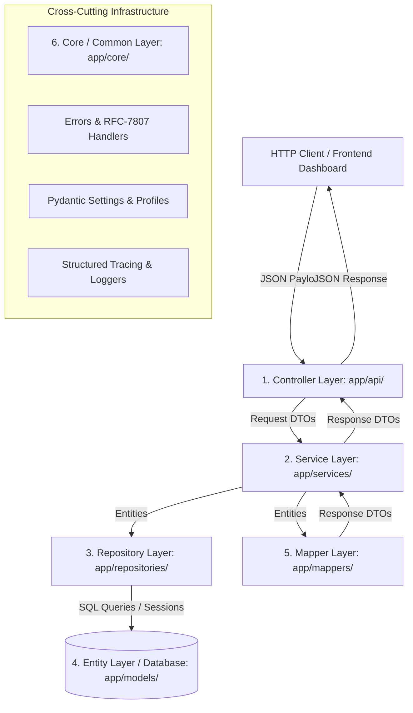

# RevenueRescueAI — Backend Layered Architecture Specification
## Phase 2.3: Architectural Boundaries, Separation of Concerns, and Data Flow

**Document Version:** 1.0.0  
**Status:** Approved Architecture  
**Author:** Senior Backend Architect, API Engineer  
**Target Audience:** Engineering Team, Code Reviewers, Student Interviewees  

---

## 1. Architectural Principles & Objectives

In RevenueRescueAI, financial safety, determinism, testability, and maintainability dictate our backend design. A critical failure in financial technology occurs when business logic, database queries, and HTTP formatting become entangled.

This architecture enforces strict **Separation of Concerns (SoC)** across seven distinct, single-responsibility layers:



---

## 2. Layer Responsibilities & Behavioral Invariants

| Layer | Package Location | Primary Responsibility | What It MUST NOT Do |
| :--- | :--- | :--- | :--- |
| **Controller Layer** | [`app/api/`](file:///c:/Users/vanka/Downloads/RevenueRescueAI-main/RevenueRescueAI-main/backend/app/api) | Receives HTTP requests, parses route/query parameters, calls application services, and returns HTTP responses with appropriate status codes. | **No business logic.** No direct SQL queries. No direct entity mutations. |
| **DTO Layer** | [`app/schemas/`](file:///c:/Users/vanka/Downloads/RevenueRescueAI-main/RevenueRescueAI-main/backend/app/schemas) | Defines external API contracts (Request & Response schemas), enforces input validation, string constraints, and integer minor monetary formats. | **No database awareness.** No persistence mappings. Never exposes internal entity relationships directly. |
| **Service Layer** | [`app/services/`](file:///c:/Users/vanka/Downloads/RevenueRescueAI-main/RevenueRescueAI-main/backend/app/services) | Coordinates application workflows, validates business preconditions, coordinates multiple repositories, manages transactions (`commit()` / `rollback()`), and maps entities to DTOs. | **Zero HTTP awareness.** Does not touch `Request`, `Response`, `HTTPException`, or query strings. Does not return raw JPA/SQLAlchemy entities to controllers. |
| **Repository Layer** | [`app/repositories/`](file:///c:/Users/vanka/Downloads/RevenueRescueAI-main/RevenueRescueAI-main/backend/app/repositories) | Relational persistence abstraction. Encapsulates all SQL execution, session additions, and queries using typed SQLAlchemy statements. | **No business decisions.** Repositories do not enforce workflow policy rules or decide whether a recovery attempt is allowed. |
| **Entity Layer** | [`app/models/`](file:///c:/Users/vanka/Downloads/RevenueRescueAI-main/RevenueRescueAI-main/backend/app/models) | Persisted domain models mapped to relational database tables. Defines primary keys, foreign keys, indexes, and database check constraints. | **No API knowledge.** Entities are never returned directly to API callers. Entities do not perform network calls or LLM prompts. |
| **Mapper Layer** | [`app/mappers/`](file:///c:/Users/vanka/Downloads/RevenueRescueAI-main/RevenueRescueAI-main/backend/app/mappers) | Pure, stateless conversion functions transforming entities into Response DTOs and Request DTOs into uncommitted entity instances. | **Zero database queries.** Mappers never query the database, never trigger lazy-loading cascades, and contain no business rules. |
| **Common Layer** | [`app/core/`](file:///c:/Users/vanka/Downloads/RevenueRescueAI-main/RevenueRescueAI-main/backend/app/core) | Shared infrastructure: configuration settings, dialect-aware engine pooling, global exception hierarchy, RFC-7807 problem handlers, structured logging, and observability middleware. | Specific business domain logic. |

---

## 3. End-to-End Data Flow Lifecycle

### 3.1 Inbound Write Request (e.g., Recording a Transaction)
1. **HTTP Client** submits `POST /api/v1/transactions` with payload `{"customer_id": "...", "amount_minor": 4900, "currency": "USD", "status": "failed"}`.
2. **Controller Layer** intercepts the request. FastAPI and Pydantic deserialize and validate the body against [`TransactionCreateDTO`](file:///c:/Users/vanka/Downloads/RevenueRescueAI-main/RevenueRescueAI-main/backend/app/schemas/transactions.py). If fields are negative or malformed, a 422 Problem Detail is returned immediately.
3. **Controller Layer** injects a database `Session` via FastAPI dependency injection and invokes `TransactionService(session).record_transaction(dto)`.
4. **Service Layer** executes business precondition checks:
   - Queries `CustomerRepository` to verify the customer exists. If not found, raises `EntityNotFoundException`.
   - Queries `TransactionRepository` to ensure the `(provider, external_transaction_id)` pair is unique. If duplicate, raises `DuplicateEntityException`.
5. **Service Layer** calls [`TransactionMapper.to_entity(dto)`](file:///c:/Users/vanka/Downloads/RevenueRescueAI-main/RevenueRescueAI-main/backend/app/mappers/transactions.py) to produce a detached `Transaction` model.
6. **Service Layer** calls `TransactionRepository.save(entity)` and commits the transaction via `session.commit()`.
7. **Service Layer** passes the saved entity to [`TransactionMapper.to_response(entity)`](file:///c:/Users/vanka/Downloads/RevenueRescueAI-main/RevenueRescueAI-main/backend/app/mappers/transactions.py) and returns a clean [`TransactionResponseDTO`](file:///c:/Users/vanka/Downloads/RevenueRescueAI-main/RevenueRescueAI-main/backend/app/schemas/transactions.py).
8. **Controller Layer** wraps the DTO in an HTTP 201 Created response.

### 3.2 Outbound Read Request (e.g., Querying a Customer)
1. **HTTP Client** issues `GET /api/v1/customers/{customer_id}`.
2. **Controller Layer** parses the UUID path parameter.
3. **Service Layer** calls `CustomerRepository.find_by_id(customer_id)`.
4. If missing, raises `EntityNotFoundException("Customer", str(customer_id))`.
5. If found, passes entity to `CustomerMapper.to_response(customer)`.
6. Pure response DTO returned to client. No lazy-loading relations or internal hashes are accessed.

---

## 4. Package Responsibility Directory Map

```text
backend/app/
├── api/                  # 1. CONTROLLER LAYER: HTTP request endpoints, routing, parameter extraction
│   ├── routes/
│   │   ├── health.py
│   │   ├── realtime.py
│   │   └── recovery_intelligence.py
│   └── __init__.py
├── schemas/              # 2. DTO LAYER: Request/Response Pydantic v2 schemas and validation
│   ├── common.py
│   ├── customers.py
│   ├── transactions.py
│   ├── recovery_cases.py
│   ├── recovery_attempts.py
│   ├── agent_decisions.py
│   ├── audit_events.py
│   ├── recovery_evidence.py
│   └── __init__.py
├── services/             # 3. SERVICE LAYER: Application services, transaction boundaries
│   ├── customer_service.py
│   ├── transaction_service.py
│   ├── recovery_case_service.py
│   ├── audit_service.py
│   ├── intelligence.py
│   ├── risk_detection.py
│   ├── verification.py
│   └── __init__.py
├── repositories/         # 4. REPOSITORY LAYER: SQL queries, session data access
│   ├── customers.py
│   ├── transactions.py
│   ├── recovery_cases.py
│   ├── recovery_attempts.py
│   ├── agent_decisions.py
│   ├── audit_events.py
│   ├── recovery_evidence.py
│   ├── webhook_events.py
│   └── __init__.py
├── models/               # 5. ENTITY LAYER: Persisted SQLAlchemy domain models & relationships
│   ├── domain.py
│   └── __init__.py
├── mappers/              # 6. MAPPER LAYER: Pure entity <-> DTO transformation
│   ├── customers.py
│   ├── transactions.py
│   ├── recovery_cases.py
│   ├── recovery_attempts.py
│   ├── agent_decisions.py
│   ├── audit_events.py
│   ├── recovery_evidence.py
│   └── __init__.py
└── core/                 # 7. COMMON LAYER: Errors, config, database engine, logging, enums
    ├── config.py
    ├── database.py
    ├── enums.py
    ├── errors.py
    ├── logging.py
    └── observability.py
```
