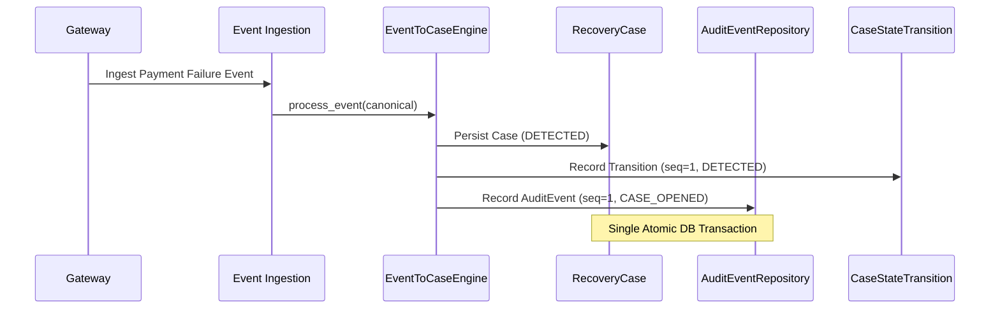

# Case History and Audit Trail

**Phase**: 2.7 — Recovery Case Management Engine  
**Author**: Karthikeya  
**Status**: APPROVED & VERIFIED  

---

## 1. Compliance Audit Trail Architecture

Financial recovery workflows require immutable, append-only traceability. RevenueRescueAI records all operations in two relational models:
1. `case_state_transitions`: Tracks formal finite-state machine progression.
2. `audit_events`: Comprehensive audit log recording lifecycle events, priority revisions, and operator interventions.

---

## 2. Standard Audit Event Types

| Event Type | Actor Type | Trigger Description | Payload Attributes |
| :--- | :--- | :--- | :--- |
| `CASE_OPENED` | `SYSTEM` | Automatic case generation from eligible failure | `source_event_id`, `amount_minor`, `currency`, `priority`, `risk_tier` |
| `CASE_UPDATED` | `SYSTEM` / `OPERATOR` | Subsequent failure event or operator metadata update | `failure_count`, `latest_failure_code`, `updated_priority` |
| `CASE_RECOVERED`| `PROVIDER` | Verified payment success resolving case | `source_event_id`, `payment_reference`, `recovered_amount_minor`, `currency` |
| `STATE_TRANSITION`| `OPERATOR` / `AGENT` | Explicit FSM lifecycle step | `reason_code`, `from_state`, `to_state`, `correlation_id` |

---

## 3. History Retrieval Invariants

- **Monotonic Ordering**: Audit events are strictly indexed and retrieved by `sequence_number.asc()`.
- **Traceability**: Every entry contains a `correlation_id` enabling end-to-end distributed tracing back to gateway ingress headers.
- **Data Protection**: Sensitive payment credentials (PAN, CVV, raw tokens) are never stored in audit payloads.
