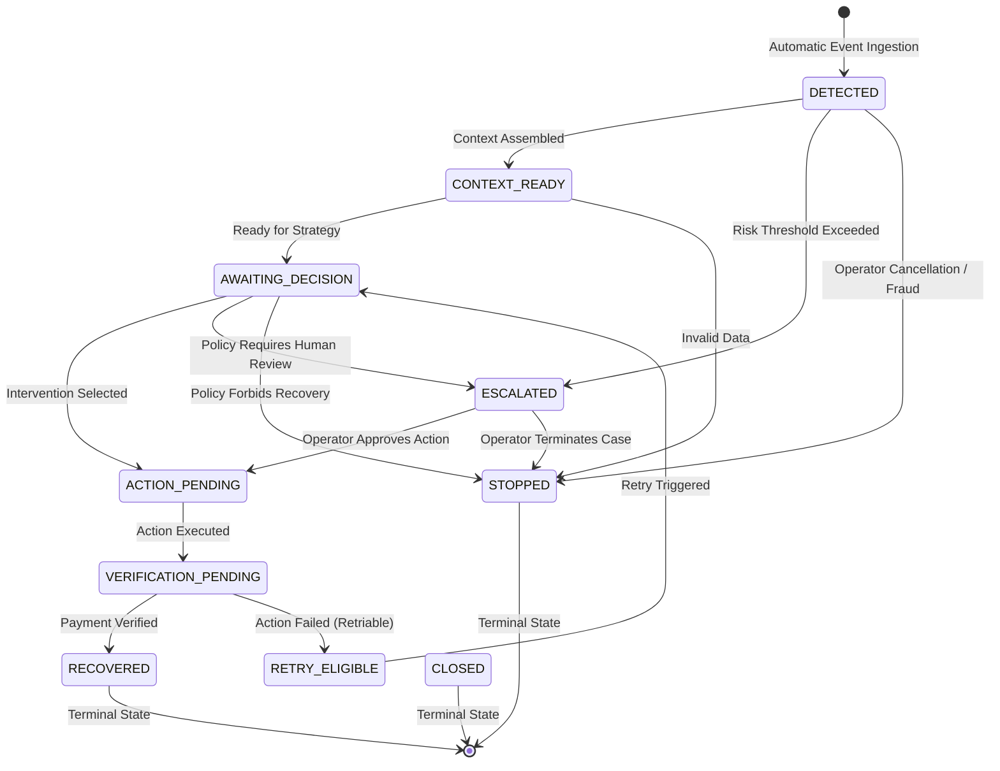

# Case Lifecycle and State Transitions

**Phase**: 2.7 — Recovery Case Management Engine  
**Author**: Karthikeya  
**Status**: APPROVED & VERIFIED  

---

## 1. Approved Finite State Machine (FSM)

The recovery case lifecycle is strictly governed by a Finite State Machine implemented in `RecoveryCaseService`.

---

## 2. State Definitions

| State | Classification | Description |
| :--- | :--- | :--- |
| `DETECTED` | Initial | Initial state assigned immediately upon automatic case creation from an event. |
| `CONTEXT_READY` | In-Flight | Associated customer profile, transaction history, and failure diagnostics assembled. |
| `AWAITING_DECISION` | In-Flight | Case is ready for AI strategy recommendation or operator intervention. |
| `ACTION_PENDING` | In-Flight | An approved recovery strategy (smart retry, reminder) is queued for execution. |
| `VERIFICATION_PENDING`| In-Flight | Recovery action has been initiated; awaiting payment gateway verification. |
| `RETRY_ELIGIBLE` | In-Flight | Previous intervention did not succeed, but case has remaining retry quota. |
| `ESCALATED` | In-Flight | High-value, complex, or high-risk case requiring human operator review. |
| `RECOVERED` | Terminal | Revenue verified as successfully collected. `closed_at` is stamped. Case is immutable. |
| `STOPPED` | Terminal | Recovery stopped due to policy restrictions, fraud, or operator cancellation. |
| `CLOSED` | Terminal | Case archived or closed administratively without financial recovery. |

---

## 3. Transition Invariants and Guardrails

1. **Terminal State Immutability**:
   Once a case enters `RECOVERED`, `STOPPED`, or `CLOSED`, it cannot transition to any other state. Attempting a transition on a terminal case raises `InvalidStateTransitionException` (HTTP 400/409).
2. **Identity Transition Rejection**:
   Self-transitions (`state -> state`) are forbidden to prevent phantom audit spam.
3. **Monotonic Transition Sequences**:
   Every state transition increments the case version and appends a `CaseStateTransition` with an incremented sequence number.
4. **Automated Resolution**:
   Ingestion of a `PAYMENT_SUCCEEDED` event for an active case immediately transitions it to `RECOVERED`, records `occurred_at = utc_now()`, and closes the case.
