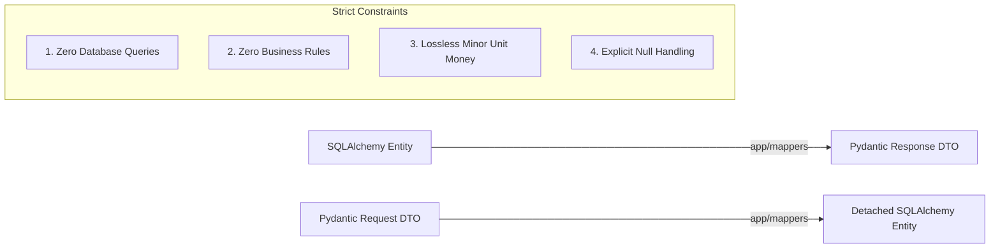

# RevenueRescueAI — Entity-to-DTO Mapping Guide
## Phase 2.3: Pure Transformation Strategy and Persistence Decoupling

**Document Version:** 1.0.0  
**Status:** Approved Architectural Standard  
**Author:** Senior Backend Architect, API Engineer  

---

## 1. Why a Dedicated Mapper Layer?

In simple frameworks, developers often call `.model_dump()` directly on database models or return ORM objects directly from controllers. In a financial system, this anti-pattern introduces severe risks:

1. **Information Leakage:** Internal database identifiers, password hashes, webhook HMAC secrets, or private customer records are accidentally leaked to clients.
2. **Lazy-Loading Crashes:** Accessing an un-joined relationship on a detached entity outside an active SQLAlchemy session causes `DetachedInstanceError`.
3. **N+1 Query Cascades:** Serializing nested entities triggers implicit SQL queries for every row in a collection.
4. **Coupling API to Storage:** Database schema refactoring immediately breaks external clients.

To eliminate these hazards, RevenueRescueAI introduces a dedicated **Mapper Layer** ([`app/mappers/`](file:///c:/Users/vanka/Downloads/RevenueRescueAI-main/RevenueRescueAI-main/backend/app/mappers)).

---

## 2. Invariants of the Mapper Layer



### Invariant 1: Zero Database Queries
Mappers **must never** accept a database `Session` or execute SQL queries. If an operation requires looking up related data, that lookup belongs in the **Service Layer** before passing the entities to the mapper.

### Invariant 2: Zero Business Decisions
Mappers do not evaluate policy rules, check customer balances, or determine whether an account should be blocked. They perform 1:1 structural translations only.

### Invariant 3: Lossless Minor Unit Preservation
Monetary values are mapped 1:1 as integers (`amount_minor: int`). No floating-point multiplication (e.g. `amount_minor / 100.0`) is permitted during mapping.

### Invariant 4: Explicit Null and Collection Handling
Mappers explicitly handle `None` values and provide default empty dictionaries for JSON metadata:
```python
metadata=dict(entity.metadata_json) if entity.metadata_json else {}
```

---

## 3. Mapper Implementation Catalogue

| Mapper Class | Source Entity | Target Response DTO | Target Inbound Entity |
| :--- | :--- | :--- | :--- |
| [`CustomerMapper`](file:///c:/Users/vanka/Downloads/RevenueRescueAI-main/RevenueRescueAI-main/backend/app/mappers/customers.py) | `Customer` | `CustomerResponseDTO`, `CustomerSummaryDTO` | `Customer` (from `CustomerCreateDTO`) |
| [`TransactionMapper`](file:///c:/Users/vanka/Downloads/RevenueRescueAI-main/RevenueRescueAI-main/backend/app/mappers/transactions.py) | `Transaction` | `TransactionResponseDTO`, `TransactionSummaryDTO` | `Transaction` (from `TransactionCreateDTO`) |
| [`RecoveryCaseMapper`](file:///c:/Users/vanka/Downloads/RevenueRescueAI-main/RevenueRescueAI-main/backend/app/mappers/recovery_cases.py) | `RecoveryCase` | `RecoveryCaseResponseDTO`, `RecoveryCaseSummaryDTO` | `RecoveryCase` (from `RecoveryCaseCreateDTO`) |
| [`RecoveryAttemptMapper`](file:///c:/Users/vanka/Downloads/RevenueRescueAI-main/RevenueRescueAI-main/backend/app/mappers/recovery_attempts.py) | `RecoveryAttempt` | `RecoveryAttemptResponseDTO`, `RecoveryAttemptSummaryDTO` | `RecoveryAttempt` (with sequence number) |
| [`AgentDecisionMapper`](file:///c:/Users/vanka/Downloads/RevenueRescueAI-main/RevenueRescueAI-main/backend/app/mappers/agent_decisions.py) | `AgentDecision` | `AgentDecisionResponseDTO` | `AgentDecision` (with version number) |
| [`AuditEventMapper`](file:///c:/Users/vanka/Downloads/RevenueRescueAI-main/RevenueRescueAI-main/backend/app/mappers/audit_events.py) | `AuditEvent` | `AuditEventResponseDTO` | `AuditEvent` (with sequence number) |
| [`RecoveryEvidenceMapper`](file:///c:/Users/vanka/Downloads/RevenueRescueAI-main/RevenueRescueAI-main/backend/app/mappers/recovery_evidence.py) | `RecoveryEvidence` | `RecoveryEvidenceResponseDTO` | `RecoveryEvidence` (from `RecoveryEvidenceCreateDTO`) |

---

## 4. Testing Mapper Behavior

All mappers are verified by comprehensive unit tests in [`backend/tests/test_mappers.py`](file:///c:/Users/vanka/Downloads/RevenueRescueAI-main/RevenueRescueAI-main/backend/tests/test_mappers.py), validating:
- Lossless preservation of large integers (e.g., $9,999.00 -> `999900` minor units).
- Default deterministic fallback values (e.g. automatic case key generation).
- Timestamp formatting and UTC timezone integrity.
- Safe serialization of JSON metadata maps without side effects.
