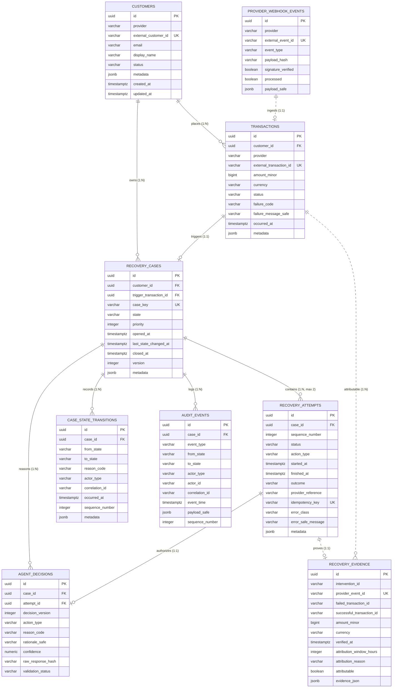

# RevenueRescueAI — Entity-Relationship Diagram & Association Model
## Phase 1.2: Relational Cardinalities, Foreign Key Ownership, and ER Model

**Document Version:** 1.0.0  
**Status:** Approved ER Architecture  
**Primary Authors:** Principal Database Architect, Senior Backend Engineer  

---

## 1. Visual Entity-Relationship Diagram (Mermaid)

The following Mermaid ER diagram illustrates the complete relational topology of RevenueRescueAI, showing primary keys (`PK`), foreign keys (`FK`), unique constraints (`UK`), and exact cardinalities.

---

## 2. Detailed Association Specifications

### 2.1 Relationship: `Customer` $\to$ `Transaction`
- **Relationship Type:** One-to-Many ($1:N$).
- **Cardinality:** Exactly one Customer owns zero or more Transactions ($1 \to 0..\*$).
- **Foreign Key:** `transactions.customer_id` references `customers.id`.
- **Optionality:** Mandatory on `Transaction` (`customer_id` is NOT NULL).
- **Referential Integrity Rule:** `ON DELETE RESTRICT`. A Customer with historical transactions cannot be deleted.
- **Business Meaning:** Captures all financial transactions executed by a customer.

---

### 2.2 Relationship: `Customer` $\to$ `RecoveryCase`
- **Relationship Type:** One-to-Many ($1:N$).
- **Cardinality:** Exactly one Customer owns zero or more Recovery Cases ($1 \to 0..\*$).
- **Foreign Key:** `recovery_cases.customer_id` references `customers.id`.
- **Optionality:** Mandatory on `RecoveryCase` (`customer_id` is NOT NULL).
- **Referential Integrity Rule:** `ON DELETE RESTRICT`. A Customer with an active or historical recovery case cannot be deleted.
- **Business Meaning:** Associates recovery cases with the customer for account cooling-off evaluations (Invariant INV-003).

---

### 2.3 Relationship: `Transaction` $\to$ `RecoveryCase`
- **Relationship Type:** One-to-One Trigger ($1:1$).
- **Cardinality:** One failed Transaction triggers at most one RecoveryCase ($1 \to 0..1$).
- **Foreign Key:** `recovery_cases.trigger_transaction_id` references `transactions.id`.
- **Optionality:** Mandatory on `RecoveryCase` (`trigger_transaction_id` is NOT NULL).
- **Referential Integrity Rule:** `ON DELETE RESTRICT`. A transaction cannot be deleted if a case was opened for it.
- **Business Meaning:** Guarantees that duplicate recovery cases cannot be created for the same failed transaction.

---

### 2.4 Relationship: `RecoveryCase` $\to$ `RecoveryAttempt`
- **Relationship Type:** One-to-Many ($1:N$, bounded by check constraint $N \in \{0, 1, 2\}$).
- **Cardinality:** One RecoveryCase contains zero, one, or two RecoveryAttempts ($1 \to 0..2$).
- **Foreign Key:** `recovery_attempts.case_id` references `recovery_cases.id`.
- **Optionality:** Mandatory on `RecoveryAttempt` (`case_id` is NOT NULL).
- **Referential Integrity Rule:** `ON DELETE CASCADE` (for test fixture isolation; in production, cases are never deleted).
- **Unique Constraint:** `(case_id, sequence_number)` ensures strictly ordered, unique attempts per case.
- **Business Meaning:** Enforces the bounded retry budget (Invariant INV-002).

---

### 2.5 Relationship: `RecoveryCase` $\to$ `CaseStateTransition`
- **Relationship Type:** One-to-Many ($1:N$).
- **Cardinality:** One RecoveryCase owns one or more State Transitions ($1 \to 1..\*$).
- **Foreign Key:** `case_state_transitions.case_id` references `recovery_cases.id`.
- **Optionality:** Mandatory on `CaseStateTransition` (`case_id` is NOT NULL).
- **Referential Integrity Rule:** `ON DELETE CASCADE`.
- **Unique Constraint:** `(case_id, sequence_number)` enforces strictly sequential FSM transition logs.
- **Business Meaning:** Records every formal lifecycle state transition from `DETECTED` to `RECOVERED`/`FAILED`.

---

### 2.6 Relationship: `RecoveryCase` $\to$ `AuditEvent`
- **Relationship Type:** One-to-Many ($1:N$).
- **Cardinality:** One RecoveryCase owns one or more Audit Events ($1 \to 1..\*$).
- **Foreign Key:** `audit_events.case_id` references `recovery_cases.id`.
- **Optionality:** Mandatory on `AuditEvent` (`case_id` is NOT NULL).
- **Referential Integrity Rule:** `ON DELETE CASCADE`.
- **Unique Constraint:** `(case_id, sequence_number)` prevents duplicate or out-of-order audit logs.
- **Business Meaning:** Immutable compliance trail for legal and financial accountability.

---

### 2.7 Relationship: `RecoveryCase` $\to$ `AgentDecision`
- **Relationship Type:** One-to-Many ($1:N$).
- **Cardinality:** One RecoveryCase owns zero or more Agent Decisions ($1 \to 0..\*$).
- **Foreign Key:** `agent_decisions.case_id` references `recovery_cases.id`.
- **Optionality:** Mandatory on `AgentDecision` (`case_id` is NOT NULL).
- **Referential Integrity Rule:** `ON DELETE CASCADE`.
- **Business Meaning:** Tracks proposed recommendations from the AI Advisor across all decision cycles.

---

### 2.8 Relationship: `RecoveryAttempt` $\to$ `AgentDecision`
- **Relationship Type:** One-to-One Optional ($1:1$).
- **Cardinality:** An executed RecoveryAttempt is authorized by exactly one validated AgentDecision ($1 \to 0..1$).
- **Foreign Key:** `agent_decisions.attempt_id` references `recovery_attempts.id`.
- **Optionality:** Nullable on `AgentDecision` (a decision that was vetoed by policy has no attempt).
- **Referential Integrity Rule:** `ON DELETE SET NULL`.
- **Business Meaning:** Proves that an executed financial action was authorized by an approved decision (Invariant INV-001).

---

### 2.9 Relationship: `Transaction` $\to$ `RecoveryEvidence`
- **Relationship Type:** One-to-Many ($1:N$).
- **Cardinality:** A failed transaction is resolved by at most one verified RecoveryEvidence record ($1 \to 0..1$ attributable).
- **Foreign Reference:** `recovery_evidence.failed_transaction_id` and `recovery_evidence.successful_transaction_id`.
- **Referential Integrity Rule:** Logical reference checked by `OutcomeVerificationService`.
- **Unique Constraint:** `recovery_evidence.provider_event_id` is globally unique.
- **Business Meaning:** Enforces Invariant INV-007 (Legitimate verified attribution within 72 hours).
