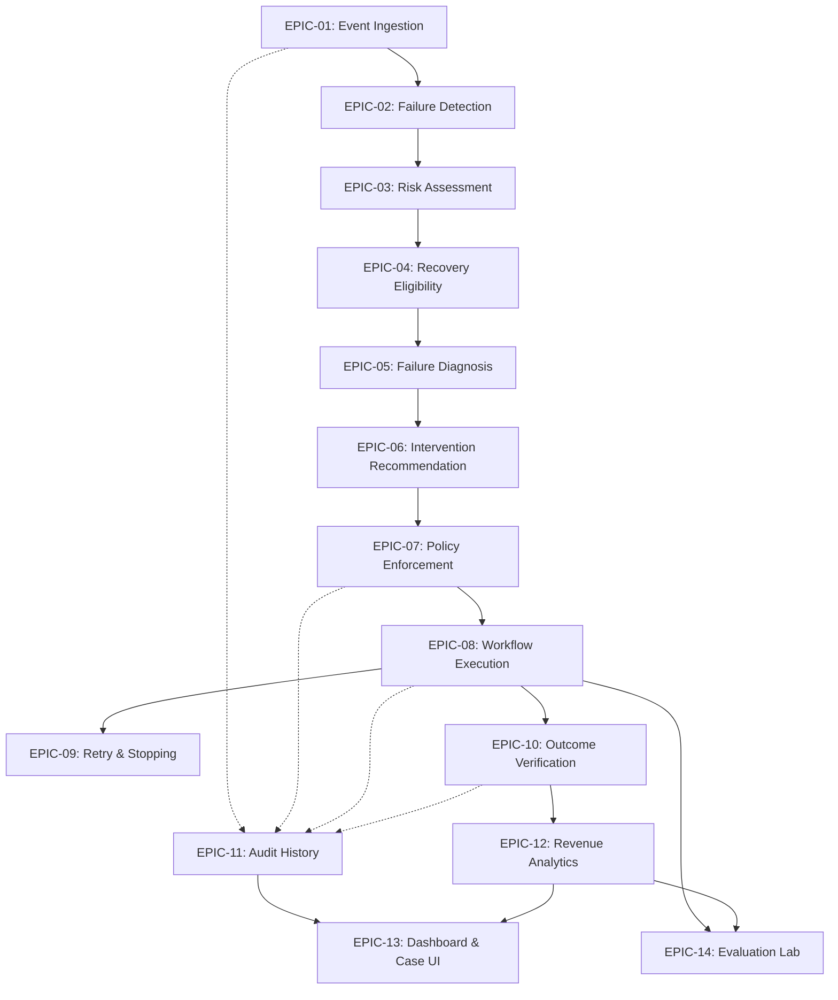

# RevenueRescueAI — Epic Specifications & Functional Grouping

> **Document ID:** DOC-EPC-002  
> **Phase:** 0.2 (User Stories, Functional Requirements & Acceptance Criteria)  
> **Status:** Approved Baseline  
> **Audience:** Product Engineering, Architecture, QA, Security, Beginner Developers  

---

## 1. Executive Summary

Epics represent high-level groupings of related business and technical capabilities that together deliver cohesive functionality. In RevenueRescueAI, epics structure the entire recovery lifecycle—from perimeter webhook ingestion to AI-assisted diagnosis, deterministic policy enforcement, resilient tool execution, authoritative verification, audit logging, dashboard presentation, and batch evaluation.

This document formally defines the fourteen core epics comprising the RevenueRescueAI system. Each epic specifies its business objective, participating actors, constituent capabilities, inter-epic dependencies, MoSCoW priority, and explicit Definition of Completion (DoC).

---

## 2. Master Epic Summary & Implementation Dependency Graph

| Epic ID | Epic Name | Priority | Core Responsibility |
|---|---|:---:|---|
| **EPIC-01** | Event Ingestion & Webhook Boundary | **MUST** | Ingest, authenticate, validate, and deduplicate inbound payment webhooks. |
| **EPIC-02** | Payment Failure Detection & Correlation | **MUST** | Detect payment declines and correlate events with customer/invoice records. |
| **EPIC-03** | Revenue Risk Assessment & Quantification | **MUST** | Quantify revenue at risk using exact integer minor units (zero float math). |
| **EPIC-04** | Recovery Eligibility & Pre-screening | **MUST** | Filter out ineligible, expired, or already-settled cases deterministically. |
| **EPIC-05** | Failure Classification & Diagnosis | **MUST** | Categorize raw gateway error codes into soft vs. hard decline taxonomies. |
| **EPIC-06** | Intervention Recommendation & Strategy | **MUST** | Contextually advise next best action within an allow-listed taxonomy. |
| **EPIC-07** | Safety & Deterministic Policy Enforcement | **MUST** | Authoritatively validate proposals against safety rules; veto violations. |
| **EPIC-08** | Recovery Workflow & Controlled Execution | **MUST** | Orchestrate state machine and dispatch actions via simulated provider. |
| **EPIC-09** | Bounded Retry & Stopping Management | **MUST** | Enforce maximum attempt ceilings (<= 3), backoffs (>= 24h), and stopping rules. |
| **EPIC-10** | Outcome Verification & Attribution | **MUST** | Verify settlement via authoritative receipts; prevent false attribution. |
| **EPIC-11** | Immutable Audit History & State Logging | **MUST** | Persist append-only audit trail with correlation IDs and payload hashes. |
| **EPIC-12** | Revenue Analytics & Metric Aggregation | **MUST** | Compute verified financial recovery KPIs without double-counting. |
| **EPIC-13** | Dashboard Command Center & Case Management| **MUST** | Render dark neon fintech UI with KPI cards, queue, and trace inspector. |
| **EPIC-14** | Batch Evaluation Lab & Baseline Comparison | **MUST** | Run reproducible 500-scenario batches benchmarking lift over baseline. |

---

## 3. Detailed Epic Specifications

---

### EPIC-01: Event Ingestion & Webhook Boundary
- **Business Objective:** Provide a secure, highly reliable gateway perimeter that receives, cryptographically authenticates, and validates incoming webhook events from payment providers without dropping transactions or allowing duplicate processing.
- **Primary Actors:** Event Ingestion Service, Enterprise Administrator.
- **Included Capabilities:**
  - Fast HTTP webhook listener (`POST /api/v1/webhooks/gateway`).
  - Cryptographic HMAC-SHA256 signature verification.
  - Pydantic schema validation for required fields (`id`, `amount`, `currency`, `event_type`).
  - SHA-256 payload hashing and idempotency key deduplication.
  - Rejection of malformed, unauthenticated, or replayed payloads.
- **Dependencies:** Core framework runtime, cryptography libraries.
- **Priority:** **MUST (Foundational).**
- **Definition of Completion:** Ingestion endpoint accepts valid synthetic webhooks, rejects invalid signatures with HTTP 401, returns HTTP 200 within 500ms, and absorbs duplicates without secondary processing.

---

### EPIC-02: Payment Failure Detection & Correlation
- **Business Objective:** Reliably detect when a financial transaction has encountered an interruption or failure, and bind the raw event to its corresponding internal customer, subscription, and invoice entities.
- **Primary Actors:** Risk Detection Engine, Event Ingestion Service.
- **Included Capabilities:**
  - Identifying `payment.failed`, `invoice.payment_failed`, and `payment.stale_pending` event types.
  - Resolving customer ID, invoice ID, and payment reference from incoming metadata.
  - Instantiating or updating a stateful `RecoveryCase` entity in database.
  - Recording initial `CASE_DETECTED` audit event.
- **Dependencies:** EPIC-01 (Event Ingestion), Data Persistence Layer.
- **Priority:** **MUST.**
- **Definition of Completion:** When a valid failure webhook is ingested, a `RecoveryCase` is created in state `DETECTED` correctly linked to customer and invoice records.

---

### EPIC-03: Revenue Risk Assessment & Quantification
- **Business Objective:** Measure the exact financial exposure of detected payment failures down to the non-divisible minor unit (cents/paise), eliminating floating-point rounding errors.
- **Primary Actors:** Risk Detection Engine, Finance Manager.
- **Included Capabilities:**
  - Converting decimal inputs into strict 64-bit integer minor units (e.g., $45.00 -> 4,500).
  - Validating ISO-4217 three-letter currency codes (e.g., USD, INR).
  - Storing `nominal_amount` and setting initial `revenue_at_risk` on the case.
  - Rejecting negative amounts, zero amounts, or unsupported currency payloads.
- **Dependencies:** EPIC-02 (Failure Detection).
- **Priority:** **MUST.**
- **Definition of Completion:** Every detected case has an integer minor-unit amount and valid currency code; zero floating-point columns exist in database.

---

### EPIC-04: Recovery Eligibility & Pre-screening
- **Business Objective:** Evaluate incoming cases against hard business prerequisites to ensure automated recovery efforts are focused strictly on recoverable, legally permitted transactions.
- **Primary Actors:** Policy Enforcement Engine, Recovery Workflow Engine.
- **Included Capabilities:**
  - Checking customer account status (active vs. closed/suspended).
  - Verifying invoice age against the maximum recovery window (case age <= 14 days).
  - Verifying customer communication and collection opt-out preferences.
  - **Success Protection Check:** Querying internal and provider ledgers to verify the invoice is not already paid/settled.
  - Transitioning cases to `ELIGIBLE` or `INELIGIBLE` (with explicit reason code).
- **Dependencies:** EPIC-03 (Risk Assessment).
- **Priority:** **MUST.**
- **Definition of Completion:** 100% of cases are correctly partitioned into `ELIGIBLE` or `INELIGIBLE` without false positives on settled or expired invoices.

---

### EPIC-05: Failure Classification & Diagnosis
- **Business Objective:** Analyze raw, noisy, gateway-specific error codes and map them into a standardized, explainable failure taxonomy that drives appropriate recovery strategies.
- **Primary Actors:** Decision Engine / AI Brain, RevOps Analyst.
- **Included Capabilities:**
  - Standardized failure taxonomy: `SOFT_DECLINE_TEMPORARY_BALANCE`, `SOFT_DECLINE_TECHNICAL`, `HARD_DECLINE_STOLEN_CARD`, `HARD_DECLINE_ACCOUNT_CLOSED`, `TRANSIENT_TIMEOUT`.
  - Mapping raw provider codes (e.g., Stripe `generic_decline`, Razorpay `BAD_REQUEST_ERROR`) to standard classes.
  - Tagging decline severity: Soft (retryable) vs. Hard (strictly non-retryable).
  - Attaching diagnostic confidence score (0.0 to 1.0) and explainability rationale.
- **Dependencies:** EPIC-04 (Recovery Eligibility).
- **Priority:** **MUST.**
- **Definition of Completion:** Classifier correctly categorizes 100% of standard decline fixtures into soft or hard classifications with attached rationales.

---

### EPIC-06: Intervention Recommendation & Strategy Proposal
- **Business Objective:** Evaluate case telemetry, historical recovery curves, and customer context to recommend the optimal recovery action and execution timing within a strictly bounded taxonomy.
- **Primary Actors:** Decision Engine / AI Brain.
- **Included Capabilities:**
  - Context assembly: compiling failure class, attempt number, customer tenure, time-of-day.
  - Allow-listed action taxonomy: `RETRY_PAYMENT`, `SCHEDULE_RETRY`, `SEND_PAYMENT_UPDATE_LINK`, `ESCALATE_TO_HUMAN`, `HALT_RECOVERY`.
  - Execution scheduling logic (e.g., delaying a balance-decline retry by 48 hours for payday effect).
  - Formulating typed `InterventionProposal` without side effects.
  - Graceful fallback to deterministic rule baseline if model inference fails or times out.
- **Dependencies:** EPIC-05 (Failure Diagnosis).
- **Priority:** **MUST.**
- **Definition of Completion:** Decision engine outputs valid, typed `InterventionProposal` matching allow-list; zero unhandled model exceptions or unauthorized tool names emitted.

---

### EPIC-07: Safety & Deterministic Policy Enforcement
- **Business Objective:** Provide an uncompromised, non-negotiable code gatekeeper that verifies every proposed action against business rules, legal constraints, and retry limits before execution.
- **Primary Actors:** Policy Enforcement Engine, Finance Manager.
- **Included Capabilities:**
  - Evaluating hard business rules (retry ceiling <= 3, backoff >= 24h, zero prior successful payments, allow-listed tool intent).
  - Enforcing absolute prohibition on retrying hard declines (stolen/fraudulent cards).
  - Veto authority: Emitting `PolicyDecision(status="APPROVED")` or `PolicyDecision(status="REJECTED", reason="...")`.
  - Halting workflows or routing to human escalation upon policy rejection.
- **Dependencies:** EPIC-06 (Intervention Recommendation).
- **Priority:** **MUST (Core Security Invariant).**
- **Definition of Completion:** Policy gate evaluates 100% of proposals; zero policy-violating actions are approved; safety violation rate is proven at exactly 0.00%.

---

### EPIC-08: Recovery Workflow Orchestration & Tool Execution
- **Business Objective:** Coordinate the stateful recovery lifecycle and execute authorized recovery actions exclusively through isolated, controlled tool boundaries.
- **Primary Actors:** Recovery Workflow Engine, Simulated Payment Provider.
- **Included Capabilities:**
  - Robust state machine management across all accepted lifecycle states.
  - Generating unique, deterministic idempotency keys (`idemp_{case_id}_{attempt_num}`).
  - Invoking the Simulated Payment Provider adapter with validated input contracts.
  - Handling asynchronous execution and network socket drops gracefully.
  - Transitioning case states with atomic persistence.
- **Dependencies:** EPIC-07 (Policy Enforcement).
- **Priority:** **MUST.**
- **Definition of Completion:** Workflow executes authorized tool actions via simulator using unique idempotency keys; in-flight states are persisted atomically.

---

### EPIC-09: Bounded Retry & Stopping Management
- **Business Objective:** Guarantee that recovery workflows terminate predictably, preventing infinite retry loops, runaway charges, and merchant account blacklisting.
- **Primary Actors:** Recovery Workflow Engine, Policy Enforcement Engine.
- **Included Capabilities:**
  - Maintaining an immutable integer attempt counter per case.
  - Enforcing hard stopping conditions: definitive success, permanent decline, budget exhaustion (3 attempts), or recovery window expiration (14 days).
  - Transitioning cases to terminal states: `RECOVERED`, `FAILED`, `HALTED_MAX_RETRIES`, or `CLOSED`.
  - Scheduling backoff timers using a testable Virtual Clock interface.
- **Dependencies:** EPIC-08 (Workflow Execution).
- **Priority:** **MUST.**
- **Definition of Completion:** Cases never exceed 3 attempts; terminal states are final; workflows stop immediately upon success or hard failure.

---

### EPIC-10: Payment Outcome Verification & Attribution
- **Business Objective:** Authoritatively confirm whether a dispatched recovery action resulted in real collected funds, enforcing strict attribution rules to prevent phantom revenue claims.
- **Primary Actors:** Recovery Workflow Engine, Simulated Payment Provider, Auditor.
- **Included Capabilities:**
  - Validating external provider settlement receipts against case parameters (transaction ID, exact minor units, currency).
  - **Three-Valued Uncertainty Logic:** Flagging network timeouts as `UNCERTAIN` / `VERIFICATION_PENDING` and freezing secondary actions.
  - Enforcing the 72-hour Attribution Window (rejecting organic payments occurring after window).
  - Marking cases as definitively `RECOVERED` only upon cryptographic verification of settlement receipt.
- **Dependencies:** EPIC-08 (Workflow Execution).
- **Priority:** **MUST.**
- **Definition of Completion:** 100% of cases marked `RECOVERED` possess an authoritative provider receipt matching amount, currency, and attribution window.

---

### EPIC-11: Immutable Audit History & State Logging
- **Business Objective:** Provide total, tamper-evident observability and compliance auditability for every operational decision, state transition, and tool execution.
- **Primary Actors:** Recovery Workflow Engine, Auditor / Reviewer, Enterprise Administrator.
- **Included Capabilities:**
  - Append-only relational audit table (zero `UPDATE` or `DELETE` permissions).
  - Capturing timestamp, case ID, correlation ID, actor/component, action, policy status, and payload SHA-256 hash.
  - Automated sanitization and masking of sensitive customer identifiers in log lines.
  - Queryable audit trail API endpoint (`GET /api/v1/cases/{id}/audit`).
- **Dependencies:** All previous epics.
- **Priority:** **MUST.**
- **Definition of Completion:** Every case transition writes an immutable audit record; audit history can be reconstructed sequentially from inception to resolution.

---

### EPIC-12: Revenue Analytics & Metric Aggregation
- **Business Objective:** Compute accurate, trustworthy business recovery metrics strictly from verified settlement records, avoiding double-counting and subjective estimation.
- **Primary Actors:** Finance Manager, RevOps Analyst.
- **Included Capabilities:**
  - Calculating Initial Revenue at Risk, Eligible Revenue, Confirmed Recovered Revenue.
  - Computing Case Recovery Rate (CRR) and Revenue Recovery Rate (RRR) side-by-side.
  - Calculating net recovery accounting for simulated gateway transaction fees.
  - Aggregating safety rate, duplicate action rate (0.00%), and escalation rate.
- **Dependencies:** EPIC-10 (Outcome Verification), EPIC-11 (Audit History).
- **Priority:** **MUST.**
- **Definition of Completion:** Analytics endpoints return aggregate metrics computed strictly from verified database records with zero floating-point discrepancies.

---

### EPIC-13: Dashboard Command Center & Case Management
- **Business Objective:** Provide operators with an enterprise-grade dark futuristic fintech command center to monitor live recovery pipelines, inspect cases, and resolve escalations.
- **Primary Actors:** Finance Manager, RevOps Analyst, Recovery Operator.
- **Included Capabilities:**
  - Executive KPI cards (Recovered Revenue, Revenue at Risk, Recovery Rate %, Active Cases, Blocked Violations).
  - Searchable, filterable Recovery Case Queue with status badges and risk amounts.
  - Case Detail Inspector / Drawer displaying end-to-end telemetry, AI rationale, policy check log, and verified receipt.
  - Operator escalation review modal (Approve / Halt).
- **Dependencies:** EPIC-12 (Revenue Analytics), Case Management REST APIs.
- **Priority:** **MUST.**
- **Definition of Completion:** React frontend renders responsive dark neon command center querying live FastAPI backend; operators can inspect case traces and filter cases.

---

### EPIC-14: Batch Evaluation Lab & Baseline Comparison
- **Business Objective:** Enable reproducible, scientific benchmarking of recovery strategies across standardized synthetic scenario cohorts against counterfactual baselines.
- **Primary Actors:** RevOps Analyst, Auditor / Reviewer.
- **Included Capabilities:**
  - Synthetic scenario cohort generation (500 scenarios) under fixed seeds (seed 42).
  - Counterfactual baseline execution: Do-Nothing, Always-Retry, Simple Rule-Based, and Oracle Upper Bound.
  - Measuring relative lift and net financial benefit over baselines.
  - Exporting serialized, reproducible evaluation reports (`artifacts/evaluation_report_500.json`).
  - Prominently labeling all fixtures as synthetic simulation benchmarks.
- **Dependencies:** EPIC-08 (Workflow Execution), EPIC-10 (Outcome Verification), EPIC-12 (Analytics).
- **Priority:** **MUST.**
- **Definition of Completion:** Evaluator CLI/script runs 500 scenarios deterministically under seed 42, generates identical metrics across repeated runs, and outputs comparative baseline report.
