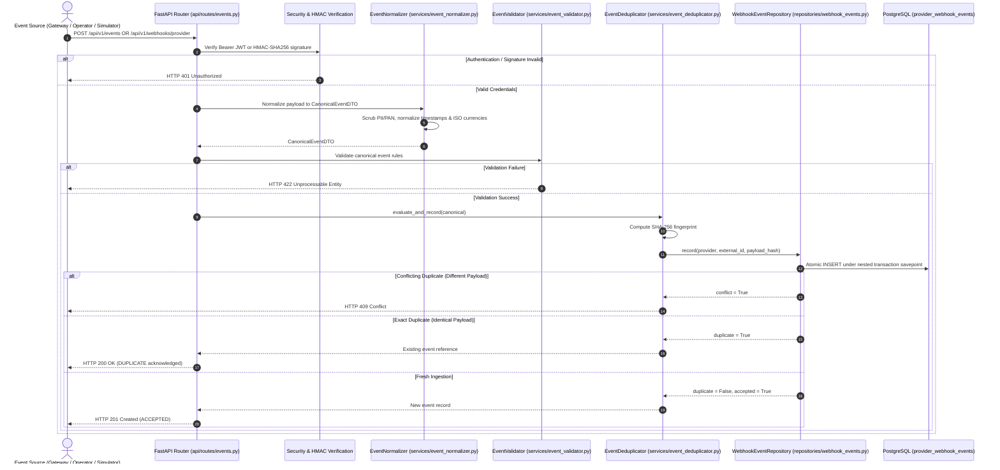

# Event Ingestion Architecture — Phase 2.6

## 1. Executive Summary & Architectural Role
Phase 2.6 introduces the core business event ingestion engine of **RevenueRescueAI**. While earlier phases established infrastructure, databases, authentication, and dashboard reporting, this phase provides the front-line ingress point where real or simulated revenue-risk events enter the system.

The ingestion engine is architected to guarantee:
1. **Zero Data Loss**: Every accepted revenue-risk event is durably recorded in PostgreSQL.
2. **Strict Financial Idempotency**: Duplicate payment failure notifications and network retry storms are recognized and suppressed before duplicate side effects or double-processing can occur.
3. **Payload Sanitization (PII Protection)**: Raw credentials, card numbers (PANs), and CVVs are scrubbed before storage.
4. **Canonical Uniformity**: Heterogeneous event formats (Stripe, Razorpay, direct API, simulator) are translated into a single canonical event model.

---

## 2. End-to-End Event Ingestion Flow

---

## 3. Component Responsibilities Matrix

| Component | Class / File | Primary Responsibility |
| :--- | :--- | :--- |
| **Ingestion Router** | [`events.py`](file:///c:/Users/vanka/Downloads/RevenueRescueAI-main/RevenueRescueAI-main/backend/app/api/routes/events.py) | Transport boundary; parses HTTP requests, extracts headers (`X-Signature-SHA256`, `X-Event-ID`), and serializes responses. |
| **Security Layer** | [`deps.py`](file:///c:/Users/vanka/Downloads/RevenueRescueAI-main/RevenueRescueAI-main/backend/app/api/deps.py) & `verify_webhook_hmac` | Authenticates callers via JWT Bearer claims or verifies raw body HMAC signatures. |
| **Normalizer** | [`event_normalizer.py`](file:///c:/Users/vanka/Downloads/RevenueRescueAI-main/RevenueRescueAI-main/backend/app/services/event_normalizer.py) | Converts heterogeneous gateway JSON into `CanonicalEventDTO`; strips PII/PAN. |
| **Validator** | [`event_validator.py`](file:///c:/Users/vanka/Downloads/RevenueRescueAI-main/RevenueRescueAI-main/backend/app/services/event_validator.py) | Enforces invariants (non-negative minor amounts, 3-letter currency, required fields). |
| **Deduplicator** | [`event_deduplicator.py`](file:///c:/Users/vanka/Downloads/RevenueRescueAI-main/RevenueRescueAI-main/backend/app/services/event_deduplicator.py) | Computes deterministic SHA-256 fingerprint; detects exact vs conflicting duplicates. |
| **Event Service** | [`event_service.py`](file:///c:/Users/vanka/Downloads/RevenueRescueAI-main/RevenueRescueAI-main/backend/app/services/event_service.py) | Application coordinator; manages transaction boundaries and query orchestration. |
| **Repository** | [`webhook_events.py`](file:///c:/Users/vanka/Downloads/RevenueRescueAI-main/RevenueRescueAI-main/backend/app/repositories/webhook_events.py) | Executes atomic SQL queries against `provider_webhook_events`. |

---

## 4. Downstream Integration Boundary (Hand-off to Phase 2.7)
In accordance with strict scope restrictions, the ingestion engine persists incoming events with `processed = False` and `ingestion_status = "ACCEPTED"`. It **does not** automatically trigger recovery case opening, AI decision trees, or payment retries in Phase 2.6.

In **Phase 2.7 (Recovery Case Management Engine)**, downstream worker modules will consume these validated events from `provider_webhook_events` and automatically transition them into active `RecoveryCase` workflows.
