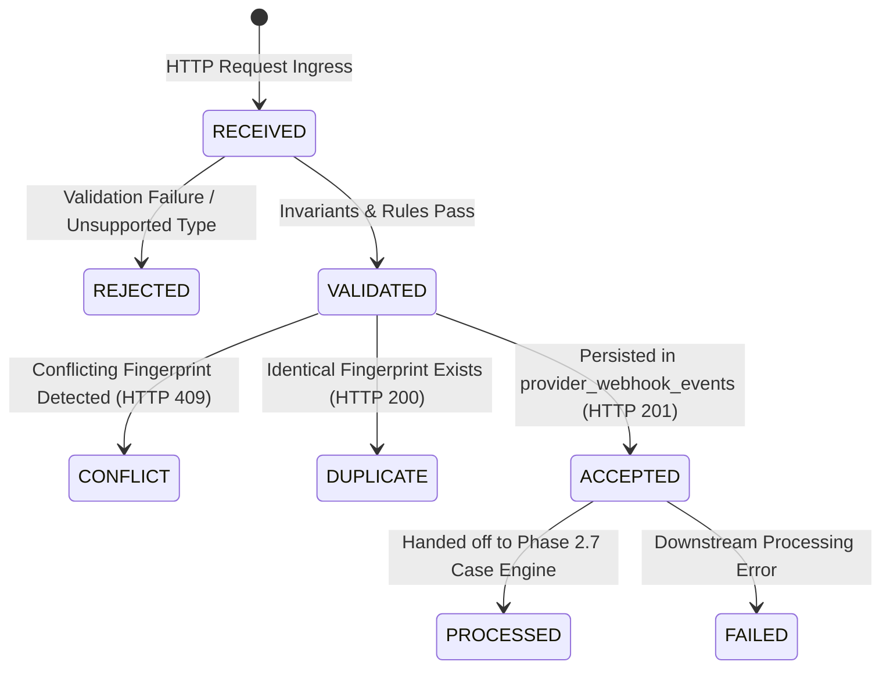

# Event Processing Lifecycle — Phase 2.6

## 1. Overview and State Hierarchy
Revenue-risk events transition through explicit, finite lifecycle states from arrival through normalization, deduplication, persistence, and eventual hand-off.

The lifecycle states are defined in [`EventProcessingStatus`](file:///c:/Users/vanka/Downloads/RevenueRescueAI-main/RevenueRescueAI-main/backend/app/core/enums.py):
- `RECEIVED`: HTTP request received and payload parsed.
- `VALIDATED`: Schema and domain rule checks successfully passed.
- `ACCEPTED`: Stored durably in database; ready for downstream consumption.
- `DUPLICATE`: Identical event recognized; suppressed from duplicate processing.
- `CONFLICT`: Conflicting duplicate rejected; original record retained.
- `REJECTED`: Malformed or invalid event rejected.
- `PROCESSED`: Downstream recovery case management has ingested the event.
- `FAILED`: Unrecoverable processing or database failure.

---

## 2. State Transition Matrix

| Current State | Next State | Triggering Condition | Responsible Component | HTTP Status |
| :--- | :--- | :--- | :--- | :--- |
| `[*]` | `RECEIVED` | Client initiates HTTP request. | FastAPI Route Controller | — |
| `RECEIVED` | `REJECTED` | Missing required fields, negative amount, or invalid currency. | `EventValidator` | 422 Unprocessable |
| `RECEIVED` | `REJECTED` | Signature HMAC check fails. | Security Middleware | 401 Unauthorized |
| `RECEIVED` | `VALIDATED` | Normalization and validation rules satisfied. | `EventNormalizer` & `EventValidator` | — |
| `VALIDATED` | `CONFLICT` | Same `(provider, event_id)` with differing payload hash. | `EventDeduplicator` | 409 Conflict |
| `VALIDATED` | `DUPLICATE`| Same `(provider, event_id)` with matching payload hash. | `EventDeduplicator` | 200 OK |
| `VALIDATED` | `ACCEPTED` | Newly inserted into `provider_webhook_events`. | `WebhookEventRepository` | 201 Created |
| `ACCEPTED` | `PROCESSED` | Downstream case engine creates `RecoveryCase`. | Case Management Engine (Phase 2.7) | Background Job |
