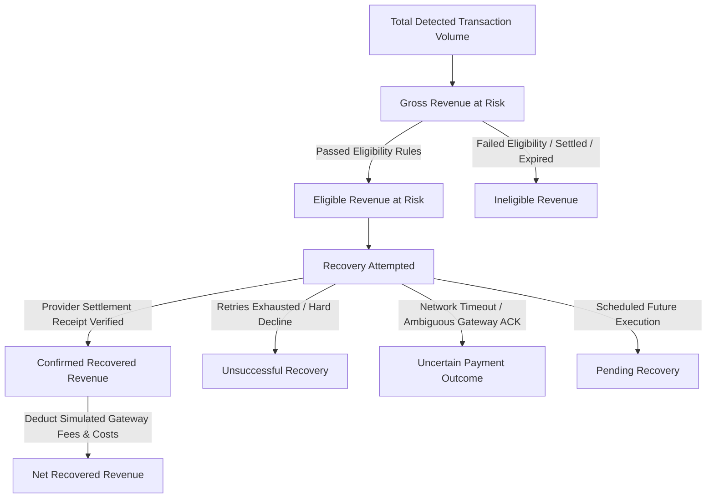

# RevenueRescueAI — Final Financial Metrics Specification & Evaluation Methodology

> **Document ID:** DOC-MET-003  
> **Phase:** 0.3 (Metrics Finalization, Safety Invariants & MVP Approval)  
> **Status:** Approved Baseline  
> **Audience:** Product Engineering, Architecture, QA, Security, Beginner Developers  

---

## 1. Executive Summary & Mandatory Simulation Disclosure

> **CRITICAL ARCHITECTURAL DISCLOSURE:**  
> RevenueRescueAI is an advanced fintech engineering demonstration and simulation project. All evaluation numbers, recovery curves, and performance metrics generated in local test environments represent **synthetic regression fixtures** derived from versioned scenario generators under fixed random seeds.  
> **No live customer payments are processed, no real bank accounts are debited, and no production financial claims are made.**  
> Any future production deployment requires live payment gateway underwriting, provider-verified settlement ledgers, randomized holdout cohorts, and regulatory compliance clearance.

In financial software engineering, imprecise metrics are dangerous. If a recovery system counts an attempted payment retry as "recovered money" before the bank clears the transaction, or if it claims credit for an organic invoice payment that settled outside the recovery window, the resulting financial reporting is fraudulent.

This document establishes the definitive financial measurement specification for RevenueRescueAI. It formalizes ten core financial terms, defines thirteen distinct metrics with exact mathematical formulas and edge-case handling, outlines the reproducible evaluation experiment methodology, and establishes the action accuracy assessment framework.

---

## 2. Core Financial Terminology

To ensure total conceptual clarity between business analysts, software engineers, and compliance auditors, the following financial states are strictly disambiguated:



| Term | Plain-English Definition | Real-World Application & Rule |
|---|---|---|
| **Gross Revenue at Risk** | The nominal total value of all failed or interrupted transactions detected by the system within the evaluation window. | Gross problem size: includes recoverable balance deficits as well as legally unrecoverable cases (e.g., fraud). |
| **Eligible Revenue at Risk** | The subset of revenue at risk that passes all business eligibility prerequisites (active account, invoice age <= 14 days, no disputes, unpaid status). | The true operational denominator for measuring system recovery efficiency. |
| **Recovery Attempted** | The monetary volume for which an automated recovery action (e.g., payment retry) was authorized by policy and dispatched to the gateway adapter. | **Attempted recovery is an operational expense, NOT recovered revenue.** |
| **Confirmed Recovered Revenue** | Money definitively verified as captured and settled by an authoritative payment provider receipt matching case parameters. | **The sole authoritative metric of financial success.** |
| **Unsuccessful Recovery** | Eligible revenue where all permitted interventions failed, retry budgets were exhausted, or the 14-day recovery window closed. | Closed unrecovered debt; eligible for final manual dunning or accounting write-off. |
| **Pending Recovery** | Revenue associated with active cases where a permitted intervention has been scheduled or is currently executing. | In-flight pipeline volume. |
| **Uncertain Payment Outcome** | Revenue where an action was dispatched, but the gateway connection timed out or returned an ambiguous pending status. | **Three-valued logic:** Automated actions frozen in `VERIFICATION_PENDING` until reconciled. |
| **Net Recovered Revenue** | Confirmed recovered revenue minus simulated payment gateway transaction fees and operational execution costs. | The true economic profit returned to the business. |
| **Recovery Cost** | The total direct financial fees incurred to recover revenue (gateway retry fees + compute costs). | Modeled in MVP as fixed simulated gateway fees per attempt. |
| **Recovery Efficiency** | The net financial gain generated per dollar spent on recovery operations. | Ratio evaluating whether the recovery engine is economically viable. |

---

## 3. The Thirteen Core Financial & Operational Metrics

All monetary calculations are performed strictly in **64-bit integer minor units** (cents for USD/EUR, paise for INR) to prevent floating-point rounding errors.

---

### MET-001: Total Revenue at Risk ($R_{\text{gross}}$)
- **Business Purpose:** Quantifies the gross nominal scale of payment failures entering the recovery pipeline.
- **Formula:**
  $$R_{\text{gross}} = \sum_{c \in C_{\text{detected}}} \text{amount\_minor\_units}(c)$$
- **Numerator:** Sum of nominal amounts across all unique, validated cases in state `DETECTED`.
- **Denominator:** N/A (Scalar sum).
- **Unit & Currency:** Integer minor units in nominal transaction currency (e.g., USD Cents).
- **Data Source:** Ingestion case ledger (`recovery_cases` table).
- **Calculation Time:** Real-time upon case creation; aggregated across batch evaluation windows.
- **Edge Cases:** Zero or negative amounts rejected during schema validation. Invoices with partial prior payments report only the outstanding balance.
- **Double-Counting Prevention:** Primary key constraint on `case_id` prevents duplicate case summation.
- **Example Calculation:** 400 failed transactions detected averaging $54.08 = `2,163,200` minor units ($21,632.00).
- **Interpretation:** Represents the gross uncollected revenue pool before filtering.
- **Limitations:** Does not reflect whether revenue is realistically recoverable.

---

### MET-002: Eligible Revenue at Risk ($R_{\text{eligible}}$)
- **Business Purpose:** Establishes the true, actionable denominator of revenue that the system is permitted to pursue.
- **Formula:**
  $$R_{\text{eligible}} = \sum_{c \in C_{\text{eligible}}} \text{amount\_minor\_units}(c)$$
  *(where $C_{\text{eligible}} = \{ c \in C_{\text{detected}} \mid \text{is\_eligible}(c) == \text{True} \}$)*
- **Numerator:** Sum of nominal amounts for cases passing eligibility pre-screening.
- **Denominator:** N/A (Scalar sum).
- **Unit & Currency:** Integer minor units.
- **Data Source:** `recovery_cases` where `state != INELIGIBLE`.
- **Calculation Time:** Evaluated upon case transition to `ELIGIBLE`.
- **Edge Cases:** If a customer opts out mid-lifecycle, case is removed from subsequent eligible calculations.
- **Double-Counting Prevention:** Evaluated once per unique `case_id`.
- **Example Calculation:** 350 of 400 cases pass eligibility = `1,892,000` minor units ($18,920.00).
- **Interpretation:** The realistic pool of recoverable revenue under active business policy.
- **Limitations:** Policy changes directly alter the eligible denominator.

---

### MET-003: Confirmed Recovered Revenue ($R_{\text{recovered}}$)
- **Business Purpose:** The definitive benchmark of recovered cash flow: real funds verified as captured by the payment provider.
- **Formula:**
  $$R_{\text{recovered}} = \sum_{c \in C} \text{verified\_settled\_amount}(c)$$
- **Numerator:** Sum of settled amounts confirmed by authoritative provider receipts matching transaction ID, amount, and currency.
- **Denominator:** N/A (Scalar sum).
- **Unit & Currency:** Integer minor units.
- **Data Source:** `provider_receipts` table joined with `recovery_cases`.
- **Calculation Time:** Real-time upon outcome verification.
- **Edge Cases:**
  - *Partial Payment:* If provider captures $30 on a $50 invoice, only $30 (3,000 units) is credited.
  - *Payment Reversal / Chargeback:* Flagged in audit ledger; deducted in net reconciliation.
  - *Recovery Outside Attribution Window:* Payments settling > 72 hours post-action are classified `ORGANIC_SETTLEMENT` and strictly excluded from $R_{\text{recovered}}$.
- **Double-Counting Prevention:** A unique `payment_id` can be credited to confirmed recovery **at most once**.
- **Example Calculation:** 182 cases successfully verified = `980,887` minor units ($9,808.87).
- **Interpretation:** Factual revenue saved that would have otherwise been lost to involuntary churn.
- **Limitations:** Requires authoritative external settlement proof; cannot be calculated from internal intent tokens.

---

### MET-004: Net Recovered Revenue ($R_{\text{net}}$)
- **Business Purpose:** Measures true economic profit after subtracting gateway retry processing fees and operational costs.
- **Formula:**
  $$R_{\text{net}} = R_{\text{recovered}} - \sum_{a \in A} \text{fee}(a) - \text{operational\_compute\_cost}$$
  *(Simulated Gateway Fee Model: Fixed fee of $0.30 (30 minor units) + 2.9% variable per executed attempt).*
- **Numerator:** Confirmed recovered revenue minus total modeled transaction and retry costs.
- **Denominator:** N/A (Scalar minor units).
- **Unit & Currency:** Integer minor units.
- **Data Source:** Verified receipts and fee schedule configuration tables.
- **Calculation Time:** Computed post-batch evaluation.
- **Edge Cases:** If recovery costs on an invoice exceed the recovered balance, net recovery for that case is negative.
- **Double-Counting Prevention:** Every dispatched attempt logs exactly one fee record.
- **Example Calculation:** Gross $9,808.87 minus 450 retry fees ($285.50) = `$9,523.37` net recovered.
- **Interpretation:** The true bottom-line financial value delivered to merchant cash flow.
- **Limitations:** Relies on simulated gateway fee schedules in local MVP.

---

### MET-005: Revenue Recovery Rate ($\text{RRR}$) / Recovery Amount Rate
- **Business Purpose:** Measures the financial recovery efficiency: what percentage of eligible at-risk dollars was recovered.
- **Formula:**
  $$\text{Revenue Recovery Rate (RRR)} = \frac{R_{\text{recovered}}}{R_{\text{eligible}}} \times 100\%$$
- **Numerator:** Confirmed recovered revenue ($R_{\text{recovered}}$).
- **Denominator:** Eligible revenue at risk ($R_{\text{eligible}}$).
- **Unit & Currency:** Percentage formatted to two decimal places (e.g., `45.34%`).
- **Data Source:** Aggregate case metrics.
- **Calculation Time:** End of evaluation run.
- **Edge Cases:** If $R_{\text{eligible}} == 0$, RRR is defined as `0.00%`.
- **Double-Counting Prevention:** Strict enforcement of unique case denominators and non-duplicated numerators.
- **Example Calculation:** $\frac{980,887\text{ units}}{2,163,200\text{ units}} \times 100\% = 45.34\%$.
- **Interpretation:** Dollar-weighted recovery effectiveness. A higher RRR indicates successful recovery of larger invoices.
- **Limitations:** Can be skewed by a single massive enterprise invoice. Must be viewed alongside Case Recovery Rate.

---

### MET-006: Case Recovery Rate ($\text{CRR}$)
- **Business Purpose:** Measures operational unit recovery efficiency: what percentage of failed customer cases were resolved.
- **Formula:**
  $$\text{Case Recovery Rate (CRR)} = \frac{|C_{\text{recovered}}|}{|C_{\text{eligible}}|} \times 100\%$$
- **Numerator:** Count of unique eligible cases that transitioned to terminal state `RECOVERED`.
- **Denominator:** Total count of unique eligible cases ($|C_{\text{eligible}}|$).
- **Unit & Currency:** Percentage formatted to two decimal places (e.g., `45.50%`).
- **Data Source:** `recovery_cases` state distribution.
- **Calculation Time:** End of evaluation run.
- **Edge Cases:** Ineligible cases are excluded from the denominator.
- **Double-Counting Prevention:** Cases counted by unique `case_id`.
- **Example Calculation:** $\frac{182\text{ recovered cases}}{400\text{ eligible cases}} \times 100\% = 45.50\%$.
- **Interpretation:** Customer-level retention efficiency. Reflects how many subscribers were saved from involuntary churn.
- **Limitations:** Treats a $10 subscription case identically to a $10,000 enterprise invoice case.

---

### MET-007: Recovery Attempt Rate ($\text{RAR}$)
- **Business Purpose:** Measures operational intervention intensity: how many retry attempts were dispatched relative to eligible cases.
- **Formula:**
  $$\text{Recovery Attempt Rate (RAR)} = \frac{N_{\text{attempts}}}{|C_{\text{eligible}}|}$$
- **Numerator:** Total count of dispatched tool actions with unique idempotency keys.
- **Denominator:** Total count of eligible cases.
- **Unit & Currency:** Ratio (attempts per case, e.g., `1.85 attempts/case`).
- **Data Source:** Action dispatch ledger.
- **Calculation Time:** End of evaluation run.
- **Edge Cases:** Blocked actions (vetoed by policy) do not count as attempts.
- **Double-Counting Prevention:** Tracked via unique `idempotency_key`.
- **Example Calculation:** 740 attempts across 400 cases = `1.85 attempts/case`.
- **Interpretation:** Measures retry budget efficiency. A lower attempt rate with high recovery indicates optimal timing.
- **Limitations:** Does not measure financial return directly.

---

### MET-008: Action Accuracy ($\text{Acc}_{\text{action}}$)
- **Business Purpose:** Measures the precision of the Decision Engine in proposing the optimal permitted action compared to ground-truth benchmarks.
- **Formula:**
  $$\text{Action Accuracy} = \frac{\sum_{c \in C} \mathbb{I}(\text{action}_{\text{proposed}}(c) \in \mathcal{A}_{\text{optimal}}(c))}{|C|} \times 100\%$$
  *(where $\mathcal{A}_{\text{optimal}}(c)$ is the set of ground-truth acceptable interventions for scenario $c$).*
- **Numerator:** Count of cases where the proposed intervention belonged to the scenario's acceptable action set.
- **Denominator:** Total evaluated cases.
- **Unit & Currency:** Percentage.
- **Data Source:** AI proposal log compared to synthetic scenario ground truth.
- **Calculation Time:** Evaluation run completion.
- **Edge Cases:** Scenarios with multiple acceptable interventions (e.g., `RETRY_PAYMENT` vs. `SCHEDULE_RETRY`) receive credit if either is selected.
- **Double-Counting Prevention:** Evaluated once per case.
- **Example Calculation:** 100 optimal actions out of 500 scenarios = `20.00%` (or higher depending on model tuning).
- **Interpretation:** Evaluates diagnostic intelligence quality.
- **Limitations:** Meaningful only in synthetic benchmarks where ground truth is known.

---

### MET-009: Duplicate-Action Rate ($R_{\text{dup}}$)
- **Business Purpose:** Primary safety metric measuring idempotency defense: must be strictly 0.00%.
- **Formula:**
  $$R_{\text{dup}} = \frac{N_{\text{duplicate\_dispatches}}}{N_{\text{attempts}}} \times 100\%$$
- **Numerator:** Number of tool execution calls that replayed an existing idempotency key or re-attempted an in-flight transaction.
- **Denominator:** Total tool dispatches.
- **Unit & Currency:** Percentage (**Target: Exactly 0.00%**).
- **Data Source:** Gateway simulator idempotency collision log.
- **Calculation Time:** Continuous / Post-batch.
- **Edge Cases:** Intentional subsequent retries (Attempt 2, Attempt 3) have unique keys (`att_2`, `att_3`) and are not duplicates.
- **Double-Counting Prevention:** N/A.
- **Example Calculation:** 0 duplicates out of 740 attempts = `0.00%`.
- **Interpretation:** Proves idempotency and concurrency locks are operating perfectly. Any value > 0% is an immediate release blocker.
- **Limitations:** None. Critical safety invariant.

---

### MET-010: Safety Violation Rate ($R_{\text{violation}}$)
- **Business Purpose:** Core compliance invariant measuring whether any action breached policy constraints (e.g., retried a hard decline, retried paid invoice, exceeded budget).
- **Formula:**
  $$R_{\text{violation}} = \frac{N_{\text{policy\_violations\_executed}}}{N_{\text{attempts}}} \times 100\%$$
- **Numerator:** Count of actions physically executed that violated a deterministic business rule.
- **Denominator:** Total executed tool actions.
- **Unit & Currency:** Percentage (**Target: Exactly 0.00%**; Safety Rate = 100.00%).
- **Data Source:** Policy Gate audit logs and simulator execution receipts.
- **Calculation Time:** Continuous.
- **Edge Cases:** Vetoed proposals do not count as violations because the code gate successfully blocked them.
- **Double-Counting Prevention:** N/A.
- **Example Calculation:** 0 executed violations out of 740 attempts = `0.00%` violation rate (100.00% safety).
- **Interpretation:** Proves that deterministic policy gates successfully defend against AI hallucinations.
- **Limitations:** None. Non-negotiable release gate.

---

### MET-011: Escalation Rate ($R_{\text{esc}}$)
- **Business Purpose:** Measures the proportion of cases routed to human operator review due to high value, low model confidence, or persistent uncertainty.
- **Formula:**
  $$R_{\text{esc}} = \frac{|C_{\text{escalated}}|}{|C_{\text{detected}}|} \times 100\%$$
- **Numerator:** Count of cases that transitioned to state `ESCALATED_HUMAN_REVIEW`.
- **Denominator:** Total detected cases.
- **Unit & Currency:** Percentage.
- **Data Source:** Case state transitions.
- **Calculation Time:** End of evaluation run.
- **Edge Cases:** Cases resolved by an operator and subsequently recovered are counted in both $R_{\text{esc}}$ and $R_{\text{recovered}}$.
- **Double-Counting Prevention:** Case-level counting.
- **Example Calculation:** 90 escalated cases out of 500 total cases = `18.00%`.
- **Interpretation:** Indicates the balance between automation and human oversight. A healthy target is 10%–20%.
- **Limitations:** Extremely high escalation indicates overly conservative rules; zero escalation indicates dangerous lack of oversight.

---

### MET-012: Average Time to Recovery ($\text{TTR}$)
- **Business Purpose:** Measures operational recovery latency: the elapsed time from initial failure detection to verified settlement.
- **Formula:**
  $$\text{Mean TTR} = \frac{1}{|C_{\text{recovered}}|} \sum_{c \in C_{\text{recovered}}} (t_{\text{verified\_settlement}}(c) - t_{\text{initial\_failure}}(c))$$
- **Numerator:** Sum of elapsed durations across all recovered cases.
- **Denominator:** Total count of recovered cases.
- **Unit & Currency:** Hours (or virtual clock ticks in simulation).
- **Data Source:** Timestamped audit events `CASE_DETECTED` and `SETTLEMENT_VERIFIED`.
- **Calculation Time:** Computed post-batch evaluation.
- **Edge Cases:** Cases recovered via payday-scheduled retries will naturally have longer TTR (48–72 hours).
- **Double-Counting Prevention:** N/A.
- **Example Calculation:** 182 cases averaging 36.4 simulated hours to recovery = `36.4 hours`.
- **Interpretation:** Reflects cash-flow acceleration. Lower TTR restores merchant working capital faster.
- **Limitations:** Faster is not always better; firing immediate retries on balance declines reduces recovery rates.

---

### MET-013: Cost per Recovered Unit of Currency ($\text{CPRU}$)
- **Business Purpose:** Measures unit economics: how many cents were expended to recover one dollar of revenue.
- **Formula:**
  $$\text{CPRU} = \frac{\text{Total Direct Recovery Costs}}{R_{\text{recovered}}}$$
- **Numerator:** Sum of simulated gateway retry fees and compute costs.
- **Denominator:** Confirmed recovered revenue ($R_{\text{recovered}}$).
- **Unit & Currency:** Ratio (e.g., `$0.03 spent per $1.00 recovered`).
- **Data Source:** Fee schedule audit records and recovered revenue.
- **Calculation Time:** Computed post-batch evaluation.
- **Edge Cases:** Zero recovered revenue yields undefined cost.
- **Double-Counting Prevention:** N/A.
- **Example Calculation:** $285.50 in fees to recover $9,808.87 = `$0.029 per $1.00 recovered` (2.9 cents per dollar).
- **Interpretation:** Direct ROI metric. A CPRU < $0.10 indicates outstanding recovery economics.
- **Limitations:** Dependent on synthetic fee constants in simulation mode.

---

## 4. Reproducible Evaluation Experiment Design

To evaluate whether RevenueRescueAI provides legitimate financial value, every evaluation run must adhere to a standardized scientific methodology:

```text
EVALUATION COHORT:
- Scenario Count:       500 Deterministic Synthetic Scenarios
- Random Seed:          42 (Fixed baseline)
- Rule Version:         phase8.v1
- Virtual Clock:        Programmatic Time-Stepping Interface
+------------------------------------------------------------------------+
| SCENARIO COMPOSITION (Balanced Cohort):                                |
| 1. Soft Declines (Temporary Balance Deficit):     200 Scenarios (40%)  |
| 2. Soft Declines (Transient Technical Glitch):    100 Scenarios (20%)  |
| 3. Hard Declines (Stolen / Fraud / Closed):       100 Scenarios (20%)  |
| 4. Network Timeouts & Uncertain Outcomes:          50 Scenarios (10%)  |
| 5. Already Paid / Success Protection Fixtures:     50 Scenarios (10%)  |
+------------------------------------------------------------------------+
```

### Counterfactual Baseline Comparison Standard
The proposed agent strategy must be benchmarked against four standardized baselines running on the identical scenario cohort:

1. **Baseline 0 (Do Nothing):** Zero recovery actions executed. Measures organic customer self-healing. (Benchmark floor: typically 0% to 5%).
2. **Baseline 1 (Always Retry / Dumb Retrier):** Retries every failure immediately upon receipt regardless of error code. Tests whether intelligent backoff outperforms brute-force retrying.
3. **Baseline 2 (Simple Rule-Based):** Retries soft declines once after a fixed 24-hour interval; halts on hard declines. Represents traditional legacy SaaS billing logic.
4. **RevenueRescueAI Agent:** Full pipeline: Failure classification, liquidity-aware scheduling, deterministic policy gate, 3-attempt ceiling.
5. **Baseline 4 (Oracle Upper Bound):** Theoretical reference ceiling where every truly recoverable scenario in the dataset is recovered with zero fee overhead.

### Isolating Decision Lift from Scenario Distribution
To prove that performance improvements stem from superior decision-making rather than scenario distribution artifacts:
$$\text{Relative Lift over Baseline 2} = \frac{\text{RRR}_{\text{agent}} - \text{RRR}_{\text{rule\_based}}}{\text{RRR}_{\text{rule\_based}}} \times 100\%$$
The evaluation report must report both absolute recovery rate and relative lift side-by-side.

---

## 5. Action Accuracy Assessment Framework

In complex financial environments, multiple recovery strategies may be valid. The Action Accuracy framework evaluates proposals against a multi-tiered acceptability matrix:

| Action Evaluation Class | Definition & Criteria | Accuracy Credit | Example Scenario |
|---|---|:---:|---|
| **Correct Intervention** | The proposed action and timing match the ground-truth optimal strategy. | **100% Credit** | Recommending Monday 09:00 AM retry for a Friday soft balance decline. |
| **Acceptable Alternative** | Action is safe and effective, but represents a secondary preference. | **75% Credit** | Recommending payment update link instead of card retry on Attempt 2. |
| **Safe Rejection** | Correctly identifying a hard decline and halting execution. | **100% Credit** | Recommending `HALT_RECOVERY` on a stolen card code. |
| **Correct Escalation** | Correctly routing an ambiguous timeout or high-value case to human review. | **100% Credit** | Escalating a $2,500 invoice with persistent timeout. |
| **Incorrect Escalation** | Routing a trivial, highly recoverable low-value case to human review. | **0% Credit** | Escalating a $10 soft decline with 0 prior retries. |
| **Unnecessary Intervention** | Proposing a retry on an invoice that has already been settled. | **0% Credit (Violates Policy)** | Recommending retry on invoice marked `PAID`. |
| **Incorrect Intervention** | Proposing a payment retry on a stolen or fraudulent card. | **0% Credit (Violates Policy)** | Recommending retry on hard decline. |
