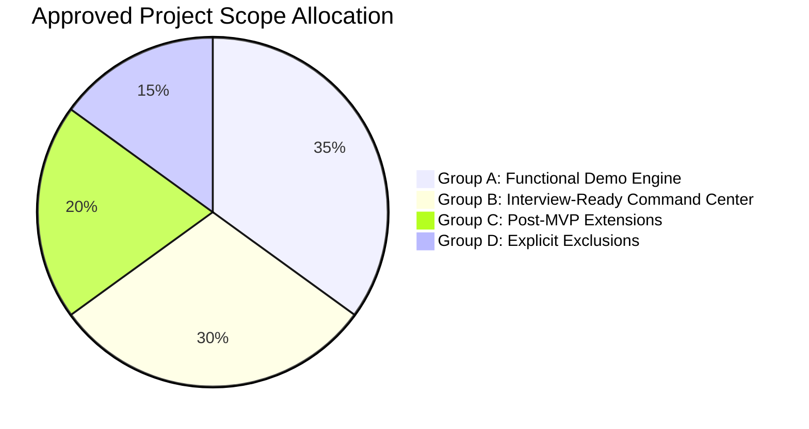

# RevenueRescueAI — Final Approved MVP Scope & Release Boundary

> **Document ID:** DOC-SCP-003  
> **Phase:** 0.3 (Metrics Finalization, Safety Invariants & MVP Approval)  
> **Status:** Approved Baseline  
> **Audience:** Product Engineering, Architecture, QA, Security, Beginner Developers  

---

## 1. Executive Summary

A successful engineering project requires ruthless scope discipline. Attempting to build a multi-agent swarm with telephony voice bots, real payment gateway contracts, and microservices in an initial release inevitably results in brittle software, missed delivery dates, and unverified claims.

This document establishes the definitive, approved MVP Scope for RevenueRescueAI. It stratifies capabilities into four non-negotiable boundaries:
1. **Group A: Mandatory Before First Functional Demonstration** (Core headless recovery engine, policy gates, simulator, and automated test suite).
2. **Group B: Mandatory Before Final Interview-Ready Release** (Dark neon fintech command center, explainable trace drawer, live REST APIs, and reproducible evaluation report export).
3. **Group C: Prioritized Post-MVP Enhancements** (Logical extensions deferred to future phases).
4. **Group D: Explicitly Excluded Features** (Capabilities prohibited from the project envelope).

---

## 2. Definitive Feature Boundary Matrix



---

### Group A: Mandatory Before First Functional Demonstration (Core Headless Engine)

These capabilities are mandatory to prove the fundamental recovery hypothesis in code and automated tests.

| Feature ID | Feature Name | Business Value | Dependencies | Priority | Relative Complexity | Reason for Inclusion |
|---|---|---|---|:---:|:---:|---|
| **FEAT-001** | **HMAC Webhook Ingestion & Deduplication** | Ingests, authenticates, and deduplicates provider failure webhooks. | None | **MUST** | Low | Foundation of event-driven architecture; prevents duplicate ingestion. |
| **FEAT-002** | **Integer Minor-Unit Risk Quantification** | Quantifies revenue at risk in 64-bit integer minor units (zero float math). | FEAT-001 | **MUST** | Low | Eliminates floating-point rounding errors on financial balance sheets. |
| **FEAT-003** | **Pre-Screening Eligibility & Success Protection** | Filters cases and enforces hard block on retrying settled invoices. | FEAT-002 | **MUST** | Medium | Non-negotiable safety invariant: prevents customer double charges (INV-001). |
| **FEAT-004** | **Failure Classification & Diagnostic Taxonomy** | Normalizes raw decline codes into soft vs. hard decline classes. | FEAT-003 | **MUST** | Low | Drives intelligent intervention selection; flags stolen cards as hard declines. |
| **FEAT-005** | **Allow-Listed Intervention Recommendation** | Formulates proposal within 5-action enum with explainable rationale. | FEAT-004 | **MUST** | Medium | Agentic decision advisor; applies payday liquidity retry delays. |
| **FEAT-006** | **Deterministic Code Policy Enforcement Gate** | Authoritatively validates proposals against hard rules; vetoes violations. | FEAT-005 | **MUST** | Medium | Core security anchor: guarantees AI cannot self-authorize financial execution (INV-005). |
| **FEAT-007** | **Simulated Payment Provider Adapter** | Emulates gateway payment debits with idempotency keys in isolated envelope.| FEAT-006 | **MUST** | Medium | Enables realistic execution testing without real-money financial liability. |
| **FEAT-008** | **Finite State Machine & Workflow Orchestration** | Enforces atomic transitions across 14 accepted states. | FEAT-007 | **MUST** | Medium | Guarantees deterministic lifecycle progression and crash resumability. |
| **FEAT-009** | **Retry Budget Ceiling & Stopping Rules** | Enforces 3-attempt ceiling and 14-day recovery window cutoff. | FEAT-008 | **MUST** | Low | Prevents infinite retry storms and card-scheme fraud penalties (INV-003). |
| **FEAT-010** | **Authoritative Settlement Verification** | Verifies recovery strictly via matching provider settlement receipts. | FEAT-007 | **MUST** | Medium | Eliminates phantom revenue claims; anchors metrics in factual receipts (INV-008). |
| **FEAT-011** | **Three-Valued Uncertainty Handling on Timeout** | Freezes automated retries in `VERIFICATION_PENDING` upon socket timeout. | FEAT-010 | **MUST** | Medium | Prevents double-charging customers during temporary network drops (INV-004). |
| **FEAT-012** | **Append-Only Immutable Audit Ledger** | Persists sequential event trail with correlation IDs and payload hashes. | All above | **MUST** | Low | Guarantees total compliance observability and forensic auditability (INV-013). |
| **FEAT-013** | **Offline Automated Test Suite (Pytest)** | Validates 100% of invariants and state transitions in < 10 seconds locally. | FEAT-012 | **MUST** | Low | Enables continuous regression testing for beginner developers. |

---

### Group B: Mandatory Before Final Interview-Ready Release (Command Center & Evaluation)

These capabilities are mandatory to present a polished, verifiable, and visually impressive project to interviewers and reviewers.

| Feature ID | Feature Name | Business Value | Dependencies | Priority | Relative Complexity | Reason for Inclusion |
|---|---|---|---|:---:|:---:|---|
| **FEAT-014** | **Executive KPI Cards & Financial Aggregation** | Computes and displays Confirmed Recovered, At-Risk, and Recovery Rate. | FEAT-010 | **MUST** | Medium | Delivers immediate situational awareness to finance leaders with tabular numbers. |
| **FEAT-015** | **Dark Neon Fintech UI Shell & Symmetrical Grid** | Renders responsive, balanced command center with selective multicolour glow.| FEAT-014 | **MUST** | Medium | Delivers a stunning, professional first impression aligned with design guidance. |
| **FEAT-016** | **Searchable & Filterable Recovery Case Queue** | Allows triaging active cases by state, failure code, amount, and customer. | FEAT-008 | **MUST** | Medium | Core tactical tool for RevOps analysts; demonstrates high-density UI design. |
| **FEAT-017** | **Case Diagnostic Trace Drawer (Explainability)**| Displays raw telemetry, AI reasoning, policy check log, and receipt proof. | FEAT-016 | **MUST** | Medium | Solves the AI "black box" problem; visually proves bounded execution to reviewers. |
| **FEAT-018** | **Operator Escalation Review & Approval Action** | Enables human operators to review and approve/halt high-value escalations. | FEAT-017 | **MUST** | Low | Closes the human-in-the-loop safety loop. |
| **FEAT-019** | **Reproducible 500-Scenario Evaluation Harness** | Runs deterministic batch simulation with seed 42 and Virtual Clock. | FEAT-008 | **MUST** | Medium | Scientifically benchmarks recovery performance against counterfactual baselines. |
| **FEAT-020** | **Baseline Lift Comparison & Artifact Export** | Generates `artifacts/evaluation_report_500.json` with baseline lift metrics. | FEAT-019 | **MUST** | Low | Mathematically proves intelligent recovery outperforms dumb retrying. |

---

### Group C: Prioritized Post-MVP Enhancements (Roadmap)

Valuable commercial capabilities deferred until the core engine and command center are complete.

| Feature ID | Feature Name | Business Rationale for Deferral | Implementation Priority |
|---|---|---|:---:|
| **FEAT-021** | Advanced Subscription & Dunning Lifecycle | Multi-tier grace periods and dunning cadences; direct logical extension. | Priority 1 (Phase 2) |
| **FEAT-022** | Payment Mandate Sequencing (UPI / SEPA) | Regional clearinghouse rules (RBI 24h pre-debit notifications / SEPA direct debit).| Priority 2 (Phase 3) |
| **FEAT-023** | Promise-to-Pay (PTP) Scheduling Portal | Self-service customer payment commitment tracking and automated calendar reminders. | Priority 3 (Phase 4) |
| **FEAT-024** | Multi-Gateway Dynamic Failover & Routing | Real-time rerouting of transactions when primary gateway degradation is detected. | Priority 4 (Phase 5) |
| **FEAT-025** | Production ML Model (Gradient Boosted) | Replaces statistical/rule estimator with ML model trained on real merchant data. | Priority 5 (Phase 6) |
| **FEAT-026** | Real Multi-Channel Messaging (SendGrid/Twilio)| Real transactional emails and SMS with delivery tracking and unsubscribe hooks. | Priority 6 (Phase 7) |
| **FEAT-027** | Enterprise SSO / RBAC / Multi-Tenancy | Okta/SAML enterprise authentication with tenant-isolated database schemas. | Priority 7 (Phase 8) |

---

### Group D: Explicitly Excluded Features (Prohibited Boundary)

The following capabilities are **strictly excluded** from the project envelope. Any attempt to introduce them represents scope creep.

| Feature ID | Excluded Capability | Justification for Strict Exclusion |
|---|---|---|
| **EXCL-001** | **Real Payment Gateway Processing** | Introduces real financial liability, merchant account underwriting, and PCI-DSS Level 1 compliance burdens. |
| **EXCL-002** | **Real Customer Telephony / SMS Sending** | Incurs carrier fees (A2P 10DLC / DLT registration), spam liability, and accidental real-world customer annoyance. |
| **EXCL-003** | **Production Customer Data / Unmasked PANs** | Storing real credit card numbers violates privacy and data security laws (GDPR, CCPA, PCI-DSS). |
| **EXCL-004** | **Unbounded Autonomous Financial Actions** | Permitting an AI to spend money or trigger charges without code policy approval is an intolerable financial hazard. |
| **EXCL-005** | **Hinglish Conversational Voice Bot** | Speech recognition latency, audio streaming complexity, and TRAI/FCC calling laws distract completely from recovery logic. |
| **EXCL-006** | **Multi-Agent Swarms (AutoGPT / CrewAI)** | Non-deterministic agent-to-agent chatter creates infinite loops, huge token costs, and debugging nightmares. |
| **EXCL-007** | **Microservices Architecture** | Premature distributed systems introduce network partitions, distributed transactions, and deployment friction. |
| **EXCL-008** | **Kubernetes Cluster Orchestration** | Immense DevOps overhead that provides zero benefit for local development or interview demonstration. |

---

## 3. Dependency-Aware Implementation Order (Sprints 1 to 6)

```text
SPRINT 1: Ingestion & Perimeter Foundation
  └── FEAT-001 (Ingestion & HMAC) -> FEAT-002 (Integer Minor Units) -> FEAT-012 (Audit Ledger)

SPRINT 2: Risk Detection & Eligibility Engine
  └── FEAT-003 (Eligibility & Success Protection) -> FEAT-004 (Failure Classification)

SPRINT 3: Diagnostic Intelligence & Policy Gate
  └── FEAT-005 (Allow-Listed Proposals) -> FEAT-006 (Deterministic Policy Gate)

SPRINT 4: Workflow Orchestration & Simulator Adapter
  └── FEAT-007 (Gateway Simulator) -> FEAT-008 (State Machine) -> FEAT-009 (Retry Limits) 
      -> FEAT-010 (Settlement Verification) -> FEAT-011 (Timeout Uncertainty) -> FEAT-013 (Test Suite)

SPRINT 5: Batch Evaluation Lab & Baseline Comparison
  └── FEAT-019 (500-Scenario Evaluation Harness) -> FEAT-020 (Baseline Lift & Report Export)

SPRINT 6: Dark Neon Command Center Dashboard
  └── FEAT-014 (KPI Aggregation) -> FEAT-015 (Dark Neon UI Shell) -> FEAT-016 (Case Queue) 
      -> FEAT-017 (Diagnostic Trace Drawer) -> FEAT-018 (Operator Review)
```
