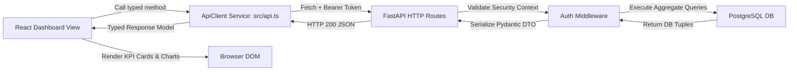

# Frontend-to-Backend Integration Guide — Phase 2.5

## 1. Overview
In Phase 2.5, RevenueRescueAI connected its React frontend to the backend REST APIs. The goal was to establish end-to-end communication, verify authentication flows, bind the dashboard to real backend data, and gracefully handle empty and loading states—while strictly maintaining the approved dark fintech visual identity.

---

## 2. Environment Configuration
The communication boundary is governed by standard environment configuration:

- **Frontend Development Server**: `http://localhost:5173` (Vite / React)
- **Backend API Gateway**: `http://localhost:8000` (FastAPI / Uvicorn)
- **API Base Prefix**: `/api/v1`

In [`frontend/.env.development`](file:///c:/Users/vanka/Downloads/RevenueRescueAI-main/RevenueRescueAI-main/frontend/.env.development):
```properties
VITE_API_BASE_URL=http://localhost:8000
```

---

## 3. Communication Architecture & Data Flow



---

## 4. Dashboard Visual Identity Preservation
The dashboard preserves all core design tokens established in Phase 0.3:
- **Backgrounds**: Deep navy and near-black canvas (`#0b0f19`, `#111827`).
- **Cards**: Symmetrical cards, subtle border glow (`rgba(56, 189, 248, 0.15)`), balanced flex layout.
- **Accents**: Cyan (`#38bdf8`), Electric Blue (`#3b82f6`), Emerald Green (`#10b981`), Amber (`#f59e0b`), Rose (`#f43f5e`).
- **Typography**: Clean tabular numbers and monospace currency alignments.

---

## 5. State Handling Strategy

| State | Visual Behavior | Implementation in `main.tsx` |
| :--- | :--- | :--- |
| **Loading** | Subtle shimmering skeleton card placeholders without layout shift. | `isLoading` state variable toggles skeleton placeholders. |
| **Empty State** | Professional fintech message: *"No recovery data available yet. Recovery cases will appear when payment failure events are ingested."* | Condition: `total_cases_count === 0`. No fake revenue or simulated curves are drawn. |
| **Active Data** | Real KPI values rendered in currency format with recovery rate badge and workflow distribution bars. | Exact values formatted from `amount_minor / 100`. |
| **Network Error** | Banner alert displaying connectivity diagnostic without breaking overall app shell. | Catch block populates `apiError` notification bar with retry button. |
