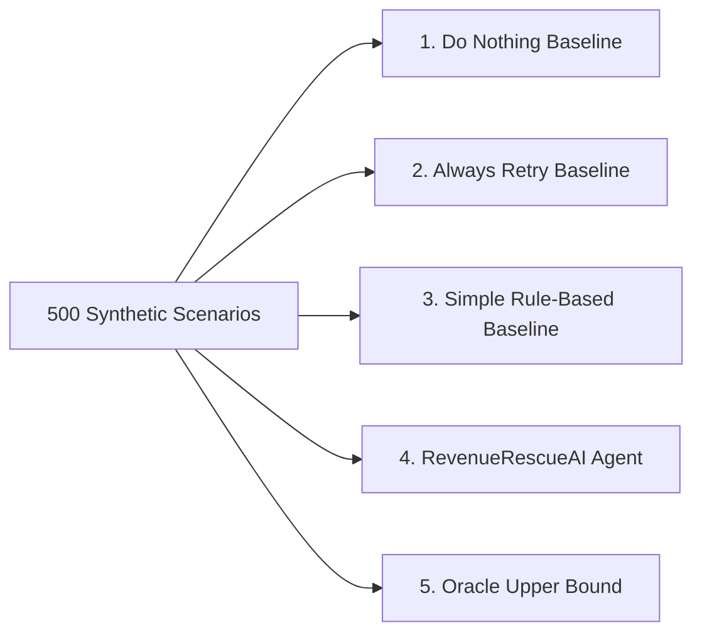

# RevenueRescueAI — Metrics Specification & Evaluation Methodology

> **Document ID:** DOC-MET-007  
> **Phase:** 0.1 (Problem Analysis & Use-Case Selection)  
> **Status:** Approved Baseline  
> **Audience:** Product Engineering, Architecture, QA, Security, Beginner Developers  

---

## 1. Executive Summary & Mandatory Disclosure

> **CRITICAL PHASE 0.1 NOTICE:**  
> This document defines the **mathematical formulas, data requirements, denominators, edge cases, and evaluation principles** for measuring revenue recovery performance.  
> **No live evaluation experiments were conducted, and no actual financial results were measured or claimed in this phase.**  
> Any evaluation numbers shown in previous repository reports (such as `evaluation_report_500.json`) represent prototype synthetic regression fixtures, not measured customer results. Real evaluation benchmarks must be generated, executed, and verified in later implementation phases under strict experimental controls.

In financial software engineering, sloppy metrics are dangerous. If an engineering team divides "recovered dollars" by "total processed volume," or counts an attempted retry as recovered revenue before bank settlement, the resulting metric is mathematically deceptive.

This document establishes rigorous mathematical definitions for twelve core recovery metrics, details strict anti-double-counting safeguards, and defines the counterfactual baseline comparison methodology.

---

## 2. Integer Minor Units Standard

To eliminate binary floating-point rounding errors (e.g., `0.1 + 0.2 = 0.30000000000000004`), all financial amounts in RevenueRescueAI are strictly represented and calculated as **integer minor units** (cents for USD/EUR, paise for INR, pence for GBP).

```text
1 US Dollar ($1.00) = 100 minor units
45 US Dollars ($45.00) = 4,500 minor units
1,250 US Dollars ($1,250.00) = 125,000 minor units
```
Floating-point numbers (`float` or `double`) are strictly prohibited in database columns, internal state models, and financial summation logic.

---

## 3. Detailed Specification of the Twelve Core Metrics

---

### Metric 1: Initial Revenue at Risk ($R_{\text{risk}}$)
- **Purpose:** Measures the total gross nominal value of failed transactions that entered the recovery pipeline within the evaluation period.
- **Mathematical Definition:**
  $$\text{Initial Revenue at Risk} = \sum_{c \in C} \text{nominal\_amount}(c)$$
  *(where $C$ is the set of all unique, validated recovery cases detected in the evaluation window).*
- **Numerator:** Sum of nominal amounts across all detected cases.
- **Denominator:** N/A (Absolute scalar sum).
- **Required Source Data:** Ingestion webhook records with validated unique payment IDs.
- **Unit & Currency:** Integer minor units in nominal currency (e.g., USD Cents).
- **Time Window:** Defined evaluation batch window (e.g., `batch_start` to `batch_end`).
- **Edge Cases:** Transactions with amount zero or negative (refunds) must be rejected during validation and excluded.
- **Known Limitations:** Represents the gross problem size, including cases that may be legally or operationally unrecoverable (e.g., fraud).

---

### Metric 2: Revenue Eligible for Recovery ($R_{\text{eligible}}$)
- **Purpose:** Measures the subset of at-risk revenue that passes all policy eligibility criteria (active customer, within recovery age window, no active disputes, not opted out).
- **Mathematical Definition:**
  $$\text{Revenue Eligible for Recovery} = \sum_{c \in C_{\text{eligible}}} \text{nominal\_amount}(c)$$
  *(where $C_{\text{eligible}} \subseteq C$ is the set of cases satisfying all eligibility boolean rules).*
- **Numerator:** Sum of nominal amounts across eligible cases.
- **Denominator:** N/A (Absolute scalar sum).
- **Required Source Data:** Case eligibility evaluation records.
- **Unit & Currency:** Integer minor units.
- **Time Window:** Evaluated at case ingestion timestamp.
- **Edge Cases:** Customer opts out mid-lifecycle (must be excluded from subsequent eligible calculations).
- **Known Limitations:** Dependent on business policy definition; changing policy rules alters the eligible denominator.

---

### Metric 3: Recovery Attempts ($N_{\text{attempts}}$)
- **Purpose:** Measures the total operational volume of external recovery actions physically executed.
- **Mathematical Definition:**
  $$N_{\text{attempts}} = \sum_{c \in C} \text{dispatched\_action\_count}(c)$$
- **Numerator:** Total count of dispatched tool executions with unique idempotency keys.
- **Denominator:** N/A (Integer count).
- **Required Source Data:** Gateway simulator tool execution logs.
- **Unit & Currency:** Count of actions.
- **Time Window:** Full evaluation scenario duration.
- **Edge Cases:** Retries blocked by policy gate do not count as attempts. Actions that time out at network socket layer DO count as dispatched attempts.
- **Known Limitations:** A high attempt count without corresponding recoveries indicates inefficient, noisy retry strategies.

---

### Metric 4: Confirmed Recovered Revenue ($R_{\text{recovered}}$)
- **Purpose:** The single most authoritative measure of system effectiveness: real money definitively verified as collected and settled by the payment provider.
- **Mathematical Definition:**
  $$\text{Confirmed Recovered Revenue} = \sum_{c \in C} \text{verified\_settled\_amount}(c)$$
- **Numerator:** Sum of settled amounts confirmed by authoritative provider receipts matching case parameters.
- **Denominator:** N/A (Absolute scalar sum).
- **Required Source Data:** Authoritative provider settlement receipts with matching transaction ID and currency.
- **Unit & Currency:** Integer minor units.
- **Time Window:** Within the defined Case Attribution Window ($t_{\text{settled}} \le t_{\text{action}} + 72\text{ hours}$).
- **Edge Cases:** Partial captures (only the verified captured portion is credited).
- **Known Limitations:** Requires reliable provider webhook or ledger access. Does not account for later customer chargebacks.

---

### Metric 5: Net Recovered Revenue ($R_{\text{net}}$)
- **Purpose:** Measures the true economic benefit to the business after deducting simulated payment gateway transaction fees and operational execution costs.
- **Mathematical Definition:**
  $$R_{\text{net}} = R_{\text{recovered}} - \sum_{\text{attempts}} (\text{fixed\_fee} + \text{variable\_rate} \times \text{amount}) - \text{agent\_operational\_cost}$$
  *(Simulated gateway fee model: e.g., 2.9% variable + $0.30 fixed per attempt).*
- **Numerator:** Confirmed recovered revenue minus total modeled transaction costs.
- **Denominator:** N/A (Integer minor units).
- **Required Source Data:** Confirmed settlement receipts and fee schedule tables.
- **Unit & Currency:** Integer minor units.
- **Time Window:** Cohort settlement window.
- **Edge Cases:** When retry costs exceed recovered amount (negative net recovery for a specific case).
- **Known Limitations:** In local MVP, fees are modeled via synthetic cost constants.

---

### Metric 6: Case Recovery Rate ($\text{CRR}$) & Revenue Recovery Rate ($\text{RRR}$)
- **Purpose:** Measures the efficiency of the recovery system across cases and across dollar volume.
- **Mathematical Definitions:**
  $$\text{Case Recovery Rate (CRR)} = \frac{|C_{\text{recovered}}|}{|C_{\text{eligible}}|} \times 100\%$$
  $$\text{Revenue Recovery Rate (RRR)} = \frac{R_{\text{recovered}}}{R_{\text{eligible}}} \times 100\%$$
- **Numerator (CRR):** Count of eligible cases with confirmed recovery.
- **Denominator (CRR):** Total count of eligible cases.
- **Numerator (RRR):** Confirmed recovered revenue (minor units).
- **Denominator (RRR):** Total eligible revenue at risk (minor units).
- **Required Source Data:** Case state ledger and settlement receipts.
- **Unit & Currency:** Percentage (0.00% to 100.00%).
- **Time Window:** Batch evaluation window.
- **Edge Cases:** Denominator is zero (defined as 0.00%).
- **Known Limitations:** CRR treats a $10 case the same as a $10,000 case; RRR correctly reflects dollar impact. Both must always be reported side-by-side.

---

### Metric 7: Action Accuracy ($\text{Acc}_{\text{action}}$)
- **Purpose:** Measures how accurately the diagnostic intelligence selected the optimal recovery action relative to ground truth.
- **Mathematical Definition:**
  $$\text{Action Accuracy} = \frac{\sum_{c \in C} \mathbb{I}(\text{action}_{\text{proposed}}(c) == \text{action}_{\text{optimal}}(c))}{|C|} \times 100\%$$
- **Numerator:** Number of cases where the AI's proposed action matched synthetic ground-truth optimal action.
- **Denominator:** Total evaluated cases.
- **Required Source Data:** AI recommendation log and synthetic scenario ground truth.
- **Unit & Currency:** Percentage.
- **Time Window:** Evaluation run.
- **Edge Cases:** Scenarios where multiple actions could succeed (ground truth must specify valid action set).
- **Known Limitations:** In real production data, true "optimal action" is never directly observable without randomized control trials (A/B testing).

---

### Metric 8: Duplicate-Action Rate ($R_{\text{dup}}$)
- **Purpose:** Safety metric measuring the failure rate of idempotency controls (must be strictly 0.00%).
- **Mathematical Definition:**
  $$\text{Duplicate-Action Rate} = \frac{N_{\text{duplicate\_dispatches}}}{N_{\text{attempts}}} \times 100\%$$
- **Numerator:** Count of tool dispatches where an identical idempotency key or invoice was submitted while an existing attempt was in-flight or already settled.
- **Denominator:** Total attempted tool dispatches.
- **Required Source Data:** Tool boundary dispatch logs.
- **Unit & Currency:** Percentage (Must be 0.00%).
- **Time Window:** Entire evaluation lifecycle.
- **Edge Cases:** Intentional retries on failed attempts (these use distinct attempt keys: `att_1`, `att_2` and are NOT duplicates).
- **Known Limitations:** Any value greater than 0.00% constitutes an immediate critical regression.

---

### Metric 9: Safety Violation Rate ($R_{\text{violation}}$)
- **Purpose:** Evaluates whether any action violated deterministic safety rules (retry limits, success protection, hard decline prohibition).
- **Mathematical Definition:**
  $$\text{Safety Violation Rate} = \frac{N_{\text{policy\_violations}}}{N_{\text{attempts}}} \times 100\%$$
- **Numerator:** Count of actions executed that breached a safety invariant.
- **Denominator:** Total attempted tool dispatches.
- **Required Source Data:** Policy audit records and tool invocation logs.
- **Unit & Currency:** Percentage (Must be exactly 0.00%).
- **Time Window:** Full evaluation lifecycle.
- **Edge Cases:** None.
- **Known Limitations:** In a properly architected system, the policy gate intercepts violations before dispatch, guaranteeing a 0.00% execution violation rate.

---

### Metric 10: Escalation Rate ($R_{\text{esc}}$)
- **Purpose:** Measures the proportion of cases that required human operator intervention due to ambiguity, high risk, or policy rejection.
- **Mathematical Definition:**
  $$\text{Escalation Rate} = \frac{|C_{\text{escalated}}|}{|C|} \times 100\%$$
- **Numerator:** Count of cases transitioned to `ESCALATED_HUMAN_REVIEW`.
- **Denominator:** Total detected cases.
- **Required Source Data:** Case state transition records.
- **Unit & Currency:** Percentage.
- **Time Window:** Evaluation window.
- **Edge Cases:** Cases escalated and subsequently resolved by human operator.
- **Known Limitations:** A 0% escalation rate is not necessarily good (it may mean the system is recklessly automating high-risk cases); an optimal rate is typically 5% to 15%.

---

### Metric 11: Time to Confirmed Recovery ($\text{TTR}$)
- **Purpose:** Measures operational speed: the elapsed time from initial failure detection to verified settlement.
- **Mathematical Definition:**
  $$\text{Mean TTR} = \frac{1}{|C_{\text{recovered}}|} \sum_{c \in C_{\text{recovered}}} (t_{\text{verified\_settlement}}(c) - t_{\text{initial\_failure\_detected}}(c))$$
- **Numerator:** Sum of elapsed durations across all recovered cases.
- **Denominator:** Count of recovered cases.
- **Required Source Data:** Timestamped audit records for `CASE_DETECTED` and `VERIFIED_RECOVERY`.
- **Unit & Currency:** Hours / Days (or simulated clock ticks).
- **Time Window:** Cohort lifecycle.
- **Edge Cases:** Cases requiring multiple scheduled backoff retries.
- **Known Limitations:** Faster is not always better; optimal recovery for payday-related balance declines often requires waiting 48–72 hours.

---

### Metric 12: Cost per Recovered Unit of Currency ($\text{CPRU}$)
- **Purpose:** Measures unit economics: how many cents were spent to recover one dollar of revenue.
- **Mathematical Definition:**
  $$\text{CPRU} = \frac{\text{Total Operational Costs}}{\text{Confirmed Recovered Revenue}}$$
- **Numerator:** Gateway retry fees + infrastructure/model compute costs.
- **Denominator:** Confirmed recovered revenue (same currency).
- **Required Source Data:** Operational cost logs and recovered revenue ledger.
- **Unit & Currency:** Ratio (e.g., $0.06 spent per $1.00 recovered).
- **Time Window:** Batch evaluation window.
- **Edge Cases:** Zero recovered revenue yields undefined/infinite cost.
- **Known Limitations:** In MVP, relies on synthetic fee schedule constants.

---

## 4. Rigorous Double-Counting & False-Attribution Safeguards

To ensure metric integrity, the evaluation engine enforces three strict safeguards:

1. **Anti-Double-Counting Invariant:** A payment ID can be counted toward confirmed recovery **at most once**. If a payment undergoes two successful events due to gateway replay, the verifier deduplicates them using the unique payment reference.
2. **Attribution Window Constraint:** A successful transaction is credited to a recovery case **only** if its provider settlement timestamp occurs within 72 hours of an authorized recovery action. If a customer settles an invoice 6 months later via an independent bank wire, the recovery engine does not take credit.
3. **Execution vs. Outcome Separation:** Dispatched retries are tracked strictly as **attempts**. An attempt is never added to recovered revenue until an independent provider receipt with status `succeeded` is cryptographically validated.

---

## 5. Counterfactual Baseline Comparison Principles

To evaluate whether the AI-assisted recovery engine provides meaningful value, every evaluation run must compare its performance against four standard counterfactual baselines using the exact same synthetic scenario fixtures:



1. **Do-Nothing Baseline:** Assumes zero interventions. Measures natural organic self-healing (if any). Represents the lower bound.
2. **Always-Retry Baseline (Dumb Retrier):** Blindly retries every failed transaction immediately without diagnosis or backoff. Tests whether intelligent scheduling outperforms brute force.
3. **Simple Rule-Based Baseline:** Retries soft declines once after a fixed 24-hour interval; ignores customer context or optimal timing. Represents traditional legacy dunning.
4. **RevenueRescueAI Agent:** Evaluates telemetry, failure classification, customer history, and optimal scheduling under policy constraints.
5. **Oracle Upper Bound:** A theoretical reference ceiling where every truly recoverable transaction in the synthetic dataset is magically recovered.

### Reporting Standard
Every evaluation report must report comparative lift over baseline:
$$\text{Relative Lift} = \frac{\text{RRR}_{\text{agent}} - \text{RRR}_{\text{baseline}}}{\text{RRR}_{\text{baseline}}} \times 100\%$$
If the agent does not outperform the simple rule-based baseline while maintaining 100% safety, the intelligent components cannot be considered effective.
