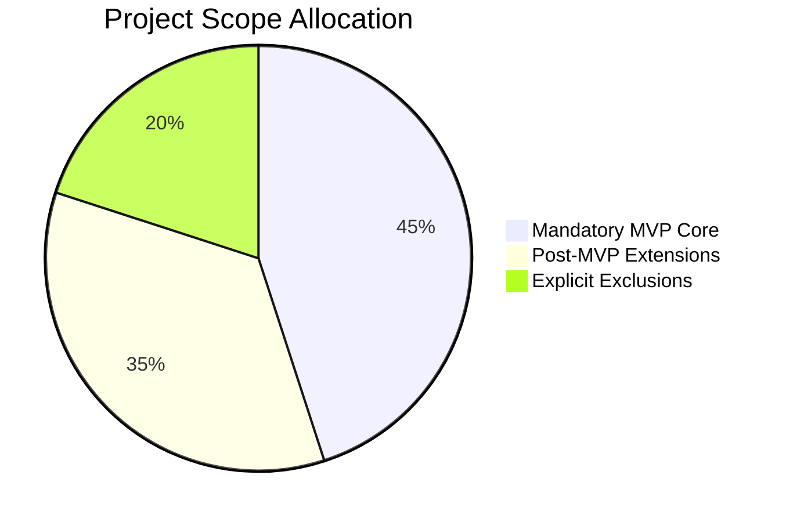

# RevenueRescueAI — MVP Scope & Boundary Definition

> **Document ID:** DOC-SCP-006  
> **Phase:** 0.1 (Problem Analysis & Use-Case Selection)  
> **Status:** Approved Baseline  
> **Audience:** Product Engineering, Architecture, QA, Security, Beginner Developers  

---

## 1. Executive Summary

A primary reason early-stage engineering projects fail is scope creep—the gradual expansion of requirements until the system becomes unbuildable, untestable, and fragile. To succeed, an MVP (Minimum Viable Product) must be **radically bounded**: it must include only what is strictly necessary to prove the core hypothesis while ruthlessly excluding distractions.

The core hypothesis of RevenueRescueAI is:  
> *An AI-assisted, policy-governed recovery agent can recover failed revenue reliably with zero safety violations, verifiable settlement evidence, and reproducible baseline comparisons.*

This document establishes the definitive, non-negotiable scope boundary for the MVP, defines prioritized post-MVP extensions, and catalogs explicit exclusions with reasoned justifications.

---

## 2. Three Explicit Scope Lists



---

### List 1: Mandatory MVP Scope

The following capabilities are **mandatory**. Omitting any of these prevents the project from proving its core hypothesis.

| Capability | Description & Rationale | Acceptance Verification |
|---|---|---|
| **1. Synthetic Payment Events** | Ingestion of deterministic, synthetic `payment.failed` and `payment.succeeded` webhook payloads representing real-world payment decline scenarios. | Ingestion endpoint accepts valid synthetic payloads and rejects malformed ones. |
| **2. Failed-Payment Detection** | Immediate identification of failure events, correlation with customer and invoice entities, and instantiation of a `RecoveryCase`. | Cases transition from ingestion to `DETECTED` state. |
| **3. Basic Failure Classification** | Mapping raw decline codes into a standardized taxonomy (Soft Decline: Temporary Balance, Technical Glitch; Hard Decline: Stolen Card, Account Closed). | Classifier correctly categorizes 100% of standard decline fixtures. |
| **4. Revenue-at-Risk Calculation** | Calculating and storing the exact at-risk amount in integer minor units (e.g., $45.00 -> 4,500 cents) without floating-point rounding errors. | Integer currency stored; zero floating-point representation. |
| **5. Recovery Eligibility Engine** | Evaluating business rules (active customer, invoice age < 14 days, opt-out status, zero prior successful payments) to determine eligibility. | Cases flagged `ELIGIBLE` or `INELIGIBLE` based on deterministic rules. |
| **6. Deterministic Intervention Selection** | Proposing allow-listed recovery actions (`RETRY_PAYMENT`, `SEND_UPDATE_LINK`, `SCHEDULE_LATER`, `ESCALATE_HUMAN`, `HALT`). | System selects only from the pre-approved action taxonomy. |
| **7. Simulated Payment Actions** | Interacting with an isolated payment provider simulator that responds with realistic success, failure, or timeout behaviors. | Actions execute against the simulator; zero real money moved. |
| **8. Bounded Retries** | Enforcing strict retry budgets (maximum 3 retries) and mandatory backoff intervals (minimum 24 hours between attempts). | Policy rejects any retry attempt exceeding the configured budget. |
| **9. Stopping & Escalation Rules** | Deterministic termination on permanent declines or budget exhaustion; automated routing to human review for anomalies or high value. | Case transitions to `HALTED` or `ESCALATED` upon rule violation. |
| **10. Duplicate-Event Protection** | Enforcing idempotency keys across webhooks and retry actions to prevent double-charging or duplicate case creation. | Replaying the same webhook payload produces zero side effects. |
| **11. Outcome Verification** | Verifying settlement using authoritative provider receipts matching transaction ID, amount, and currency within an attribution window. | Confirmed revenue matches provider settlement records 1-to-1. |
| **12. Immutable Audit History** | Appending every state transition, policy evaluation, and tool execution to an append-only audit ledger with timestamps and correlation IDs. | Full sequential audit trail viewable for every completed case. |
| **13. Dashboard & Case Queue** | A dark futuristic fintech command center displaying top KPI cards, recovery case table, and diagnostic case detail traces. | Dashboard renders live case states, filters, and detail drawer. |
| **14. Reproducible Batch Evaluation** | Running batch simulations (e.g., 500 scenarios) under fixed seeds to benchmark recovery rates against counterfactual baselines. | Evaluator generates identical metrics when executed with seed `42`. |
| **15. Confirmed Revenue Metrics** | Reporting accurate financial metrics: gross revenue at risk, confirmed recovered revenue, case recovery rate, and safety rate. | Metrics calculated strictly from verified settlement records. |
| **16. Automated Testing Suite** | Unit and integration tests covering the ingestion, classification, policy gate, state machine, and verifier. | Automated test suite passes with zero failures. |
| **17. Reproducible Local Setup** | Clear instructions and configuration allowing any engineer to spin up the backend and frontend locally in minutes. | Clean local execution via documented commands. |

---

### List 2: Post-MVP Enhancements (Prioritized Roadmap)

These capabilities add substantial business value but are deliberately deferred until the core engine is proven and stable.

```text
Priority 1 (Phase 2): Advanced Subscription & Invoice Lifecycle Management
Priority 2 (Phase 3): Mandate Retry Sequencing (UPI / NACH / SEPA)
Priority 3 (Phase 4): Promise-to-Pay (PTP) Scheduling & Customer Self-Service
Priority 4 (Phase 5): Multi-Gateway Dynamic Failover & Routing
Priority 5 (Phase 6): Advanced ML Recovery Probability Model (Trained on Real Data)
Priority 6 (Phase 7): Production Multi-Channel Messaging (SendGrid / Twilio)
Priority 7 (Phase 8): Enterprise SSO / RBAC / Multi-Tenant Isolation
```

#### Detailed Justification of Prioritization:
1. **Priority 1: Advanced Subscription Lifecycle:** Direct logical extension of failed payments; models subscription pause, grace periods, and dunning cadences. (High value, low external risk).
2. **Priority 2: Mandate Retry Sequencing:** Critical for recurring payments in India/EU; introduces banking holiday calendars and salary cycle timing. (High value, moderate complexity).
3. **Priority 3: Promise-to-Pay Scheduling:** Introduces customer self-service commitment scheduling into the recovery state machine. (Moderate value, low technical friction).
4. **Priority 4: Multi-Gateway Dynamic Failover:** Routes transactions across multiple provider adapters when gateway degradation is detected. (High value, requires multi-gateway simulator).
5. **Priority 5: Advanced ML Models:** Upgrades the rule-based / simple statistical estimator to a gradient-boosted or deep neural model once historical training data exists.
6. **Priority 6: Production Messaging:** Connects real email/SMS gateways with deliverability tracking, spam suppression, and unsubscribe webhooks.
7. **Priority 7: Enterprise SSO & Multi-Tenancy:** Hardens access controls for enterprise deployment with Okta, RBAC, and encrypted tenant database partitions.

---

### List 3: Explicitly Out of Scope Initially

The following features are **strictly excluded** from the initial MVP. Any attempt to introduce them during the initial phases represents scope creep and must be rejected.

| Excluded Capability | Reason for Exclusion & Deferral Rationale |
|---|---|
| **1. Real Payment Processing** | Involves real financial liability, merchant account underwriting, banking compliance, PCI-DSS Level 1 audit requirements, and risk of accidental real-money loss during testing. |
| **2. Real Customer Messaging (SMS/Email/WhatsApp)** | Involves telecommunication carrier registration (A2P 10DLC, DLT in India), spam filtering, delivery costs, and accidental customer harassment during test runs. |
| **3. Production Customer Financial Data (PII/PAN)** | Handling real credit card numbers or unmasked bank accounts violates privacy laws (GDPR/CCPA/PCI-DSS) and creates severe security liabilities for a local project. |
| **4. Unbounded Autonomous Actions** | Allowing an AI to trigger financial actions without a deterministic code policy gate creates unacceptable financial and legal risk. |
| **5. Unreviewed AI-Generated Financial Decisions** | An LLM must never independently authorize a write-off, refund, credit note, or retry without code validation or human oversight. |
| **6. Hinglish / Telephony Voice Bots** | Real-time voice processing introduces severe latency dependencies, speech recognition errors, telecommunications costs, and regulatory calling restrictions that distract from core recovery logic. |
| **7. Multi-Agent Orchestration Frameworks (AutoGPT / CrewAI / LangGraph Multi-Agent Swarms)** | Overcomplicates the architecture with non-deterministic agent-to-agent chatter, debugging nightmares, infinite execution loops, and massive token costs for zero financial benefit. |
| **8. Microservices Architecture** | Premature distributed systems introduce network latency, distributed transactions, partial failure modes, and deployment overhead. A clean modular monolith is vastly superior for this stage. |
| **9. Kubernetes (K8s) Cluster Orchestration** | Immense DevOps complexity that provides zero value for local development, rapid testing, or demonstrability. Docker Compose is more than sufficient. |

---

## 3. MVP Completion Criteria (Observable Exit Gates)

The MVP is complete and ready for demonstration when—and only when—the following observable conditions are satisfied:

1. **Deterministic Scenario Ingestion:** The system successfully ingests and processes a standardized suite of synthetic payment failure scenarios without unhandled exceptions.
2. **100% Safety Enforcement:** Across all test scenarios, the safety violation rate is exactly 0.00% (zero unauthorized retries, zero retries exceeding budget, zero retries on already-settled payments).
3. **Authoritative Recovery Verification:** 100% of transactions labeled "recovered" are backed by a verifiable provider simulator receipt matching amount, currency, and transaction ID.
4. **Reproducible Baseline Comparison:** The evaluation engine runs a 500-scenario batch simulation under seed `42` and outputs an evaluation report comparing the recovery rate against standard counterfactual baselines.
5. **Functional Dark Neon Command Center:** The React/FastAPI frontend renders the executive KPI cards, active recovery queue, filterable case list, and end-to-end diagnostic trace drawer.
6. **Zero Secrets in Repository:** Automated repository scan verifies zero API keys, private keys, or passwords committed to source control.
7. **Clean Local Spin-Up:** A new engineer can clone the repository, run documented setup commands, and access a fully functional local environment.

---

## 4. Scope-Change Control Rules

To prevent undisciplined requirement shifts during development:

1. **Formal Request Required:** Any proposed change to the MVP boundary must be documented with an architectural impact statement.
2. **One-In, One-Out Principle:** If a new feature is proposed for the MVP, an existing feature of equivalent engineering effort must be demoted to post-MVP to protect delivery timelines.
3. **Non-Negotiable Safety Floor:** No scope change may relax or bypass the deterministic policy gate, idempotency checks, or outcome verification principles.
