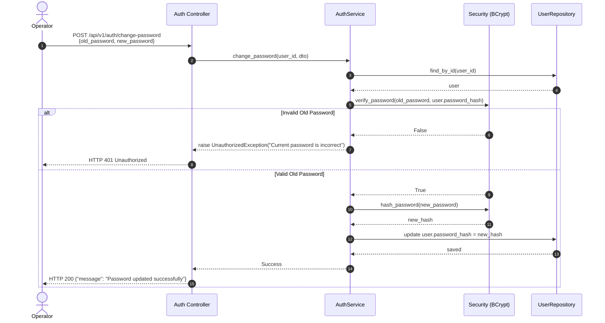

# Password Security Specification — RevenueRescueAI

## 1. Overview and Threat Model

Passwords represent the primary authentication secret for human operators in RevenueRescueAI. In financial recovery operations, compromised operator credentials could allow unauthorized workflow execution, spurious refund triggering, or data exfiltration.

RevenueRescueAI enforces rigorous password defense standards to resist:
- **Offline Hash Cracking:** Attacker gains read-only access to a database backup or dump.
- **Rainbow Table Attacks:** Precomputed hash lookups across common passwords.
- **Online Credential Stuffing & Brute Force:** Automated high-frequency password guessing.
- **Timing Analysis Attacks:** Measuring microsecond variance in string comparisons to deduce character matches.

---

## 2. Password Hashing Architecture

### 2.1 Selected Algorithm: BCrypt (Work Factor 12)
- **Standard:** OpenBSD BCrypt adaptive key derivation function based on the Blowfish cipher.
- **Implementation:** Python `bcrypt` library (C-extension binary binding).
- **Work Factor (Cost):** 12 ($2^{12} = 4,096$ iterations).
- **Salt Generation:** 128-bit cryptographically secure pseudorandom salt (`bcrypt.gensalt(rounds=12)`) generated per password hash.

```python
# app/core/security.py
def hash_password(password: str) -> str:
    pwd_bytes = password.encode("utf-8")
    salt = bcrypt.gensalt(rounds=12)
    hashed = bcrypt.hashpw(pwd_bytes, salt)
    return hashed.decode("utf-8")
```

### 2.2 Constant-Time Verification
To prevent micro-architectural timing attacks where execution time leaks partial password correctness, password verification uses constant-time byte comparisons via `bcrypt.checkpw`:

```python
# app/core/security.py
def verify_password(plain_password: str, hashed_password: str) -> bool:
    try:
        return bcrypt.checkpw(
            plain_password.encode("utf-8"),
            hashed_password.encode("utf-8")
        )
    except Exception:
        return False
```

---

## 3. Password Complexity & Validation Policy

RevenueRescueAI enforces length-centric, entropy-maximizing password policies aligned with NIST SP 800-63B (Digital Identity Guidelines):

1. **Minimum Length:** 8 characters minimum (enforced via Pydantic `Field(min_length=8)` in `UserRegisterRequestDTO` and `ChangePasswordRequestDTO`).
2. **Maximum Length:** 128 characters (protects against BCrypt 72-byte truncation issues and algorithmic complexity DoS attacks).
3. **No Character Set Composition Restrictions:** Avoid arbitrary requirements (e.g. mandatory punctuation) that encourage predictable patterns (`Password1!`); encourage longer passphrases.
4. **Rejection of Plaintext Storage:** Neither the application memory nor persistent storage caches plaintext passwords.
5. **Masking in Logs:** Request logging filters out authorization headers and request bodies containing `password` fields.

---

## 4. Verification and Change Password Workflow



---

## 5. Security Audit and Testing Evidence

Automated tests in [backend/tests/test_security_auth.py](file:///c:/Users/vanka/Downloads/RevenueRescueAI-main/RevenueRescueAI-main/backend/tests/test_security_auth.py) verify:
- **`test_password_hashing_and_verification`:** Verifies BCrypt generates distinct salted hashes for identical passwords and verifies correct matches while rejecting incorrect inputs.
- **`test_password_hash_never_returned`:** Ensures response DTOs, profile DTOs, and error responses never leak the BCrypt hash.
- **`test_change_password_workflow`:** Validates rejection of incorrect old passwords and successful update with verified new credentials.
