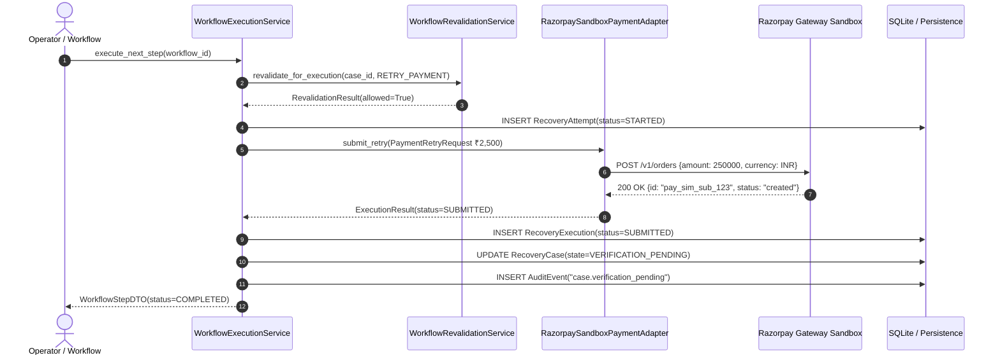
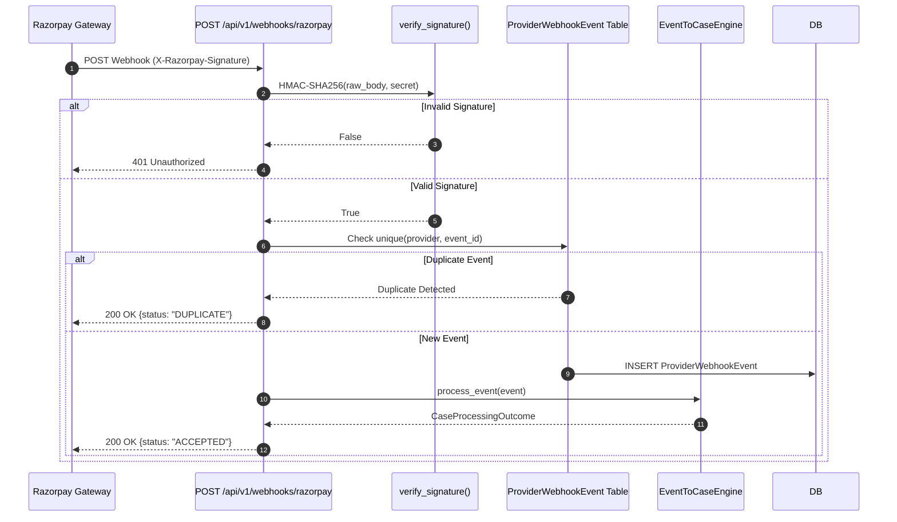
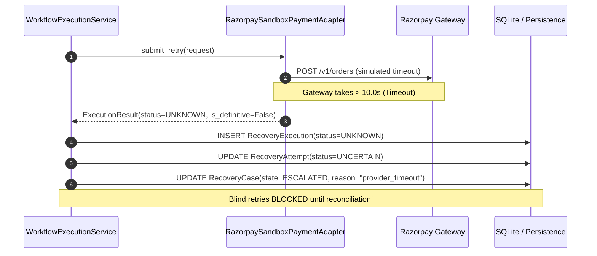

# Phase 2.11 — Payment Provider Integration

**Focus:** Payment Gateway Sandbox, Payment Retry Requests, Webhooks, Payment Status Handling, and Provider Reconciliation  
**Primary Gateway Target:** Razorpay Sandbox (India-first payment recovery & recurring billing ecosystem)  
**Author:** Karthikeya  
**Architecture Layer:** External Gateway Boundary, Workflow Execution, Webhook Ingress, and Financial Reconciliation  

---

## 1. Executive Summary & Provider Selection Rationale

In **Phase 2.11**, RevenueRescueAI connects its bounded workflow engine to a payment provider sandbox. Rather than trusting simulated frontend confirmations or unverified client assertions, our backend establishes direct, secure, and verifiable communication with **Razorpay**.

### Why Razorpay for RevenueRescueAI?
1. **India-First Recurring Payments Ecosystem:** Seamless support for UPI AutoPay, RBI e-mandates, debit card recurring mandates, and net banking recovery channels.
2. **Robust Developer Sandbox:** Provides comprehensive test modes (`rzp_test_...`) and test instruments allowing simulation of `SUBMITTED`, `CAPTURED`, `FAILED`, and timeout conditions without charging real customer money.
3. **Cryptographic Webhook Security:** Delivers signed payloads with `X-Razorpay-Signature` calculated via HMAC SHA-256 over raw request bodies.
4. **Idempotency Support:** Supports receipt/idempotency parameters on order creation and deterministic payment IDs.

---

## 2. Architectural Blueprint

```
+-----------------------------------------------------------------------------------------+
|                                    REVENUERESCUEAI BACKEND                              |
+-----------------------------------------------------------------------------------------+
|                                                                                         |
|   +-----------------------+       +-------------------------+                           |
|   | PolicyEngineService   | ----> | WorkflowCreationService |                           |
|   | (Decision: APPROVED)  |       | (Decomposes 4 Steps)    |                           |
|   +-----------------------+       +-------------------------+                           |
|                                                |                                        |
|                                                v                                        |
|   +---------------------------------------------------------------------------------+   |
|   |                           WorkflowExecutionService                              |   |
|   |  1. Pre-execution Revalidation (Consent, Retry Budget, State != Succeeded)      |   |
|   |  2. Cooldown Evaluation                                                         |   |
|   |  3. Dispatch to PaymentExecutionAdapter                                         |   |
|   |  4. Transition Case: ACTION_PENDING -> VERIFICATION_PENDING                     |   |
|   +---------------------------------------------------------------------------------+   |
|                                                |                                        |
|                                                v                                        |
|   +---------------------------------------------------------------------------------+   |
|   |                     RazorpaySandboxPaymentAdapter                               |   |
|   |  - Converts PaymentRetryRequest -> Razorpay Order / Payment Payload             |   |
|   |  - Enforces Client-Side Idempotency Cache                                       |   |
|   |  - Normalizes Gateway Status -> ExecutionStatus (SUBMITTED/FAILED/UNKNOWN)      |   |
|   |  - Strips PII / Sensitive PAN details                                           |   |
|   +---------------------------------------------------------------------------------+   |
|                                                |                                        |
|                                                v                                        |
+------------------------------------------------|----------------------------------------+
                                                 | HTTPS / Mock API
                                                 v
                               +-----------------------------------+
                               |     Razorpay Gateway Sandbox      |
                               |    Simulated Processing Engine    |
                               +-----------------------------------+
                                                 |
                                                 | Webhook Delivery (HMAC-SHA256)
                                                 v
+-----------------------------------------------------------------------------------------+
|   POST /api/v1/webhooks/razorpay                                                        |
|   +---------------------------------------------------------------------------------+   |
|   |  1. Raw Body Capture & HMAC-SHA256 Verification (X-Razorpay-Signature)          |   |
|   |  2. Replay Protection: ProviderWebhookEvent (uq_provider_event)                 |   |
|   |  3. Normalization: payment.captured -> PAYMENT_SUCCEEDED                        |   |
|   |  4. Out-of-Order Safety: Stale failure CANNOT downgrade SUCCEEDED state         |   |
|   +---------------------------------------------------------------------------------+   |
|                                                |                                        |
|                                                v                                        |
|   +---------------------------------------------------------------------------------+   |
|   |                       PaymentReconciliationService                              |   |
|   |  - Compares Internal Transaction vs Provider Gateway Truth                      |   |
|   |  - Resolves Unresolved Pending Transactions                                     |   |
|   |  - Escalates UNKNOWN Timeouts for Manual Operator Investigation                 |   |
|   |  - Generates Immutable AuditEvent Records                                       |   |
|   +---------------------------------------------------------------------------------+   |
+-----------------------------------------------------------------------------------------+
```

---

## 3. Sandbox Configuration & Environment Variables

The backend safely segregates sandbox credentials using typed settings in [`backend/app/core/config.py`](file:///c:/Users/vanka/Downloads/RevenueRescueAI-main/RevenueRescueAI-main/backend/app/core/config.py). All secrets are redacted in string representations and logs.

```bash
# Payment Gateway Configuration — Razorpay Sandbox (Test Mode)
PAYMENT_PROVIDER=razorpay
PAYMENT_PROVIDER_MODE=sandbox
PAYMENT_PROVIDER_KEY_ID=rzp_test_placeholder_key_id
PAYMENT_PROVIDER_KEY_SECRET=rzp_test_placeholder_secret
PAYMENT_WEBHOOK_SECRET=rzp_test_webhook_secret
PAYMENT_PROVIDER_BASE_URL=https://api.razorpay.com/v1
PAYMENT_PROVIDER_TIMEOUT_SECONDS=10.0
PAYMENT_SIMULATE_SCENARIOS=true
```

### Safety Rules:
- **Never Hardcode Secrets:** Config is loaded dynamically from `.env`.
- **Fail-Closed on Unconfigured Signatures:** If `PAYMENT_WEBHOOK_SECRET` is set, unverified or forged webhook signatures return `401 Unauthorized` immediately.
- **Separate Production/Sandbox:** Production environments block keys prefixed with `rzp_test_`.

---

## 4. Payment Provider Adapter Architecture

The adapter boundary is defined in [`backend/app/workflows/adapters/base.py`](file:///c:/Users/vanka/Downloads/RevenueRescueAI-main/RevenueRescueAI-main/backend/app/workflows/adapters/base.py) through `PaymentExecutionAdapter`.

```python
class PaymentExecutionAdapter(ABC):
    @abstractmethod
    def submit_retry(self, request: PaymentRetryRequest) -> ExecutionResult: ...

    @abstractmethod
    def retrieve_status(self, query: PaymentStatusQuery) -> ExecutionResult: ...
```

### Response Status Normalization Table:

| Gateway Response / State | Normalized `ExecutionStatus` | Financial Meaning | Next Recovery State |
| :--- | :--- | :--- | :--- |
| **Order/Payment Accepted** (`created`, `200 OK`) | `SUBMITTED` | Gateway queued instruction; funds not yet settled. | `VERIFICATION_PENDING` |
| **Payment Captured** (`captured`) | `SUCCEEDED` | Gateway reports successful capture. | `VERIFICATION_PENDING` (Phase 2.12 verifies recovery) |
| **Payment Declined** (`failed`) | `FAILED` | Gateway reports definitive card/account decline. | `RETRY_ELIGIBLE` or `STOPPED` |
| **Processing / Authorization** (`authorized`) | `PENDING` | Awaiting two-factor authentication or bank clearance. | `VERIFICATION_PENDING` |
| **Transport Timeout / No Response** | `UNKNOWN` | Gateway state cannot be determined safely. | `ESCALATED` (No blind retries!) |
| **Refunded / Voided** (`refunded`) | `CANCELLED` | Payment voided or reversed by gateway. | `CLOSED` |

---

## 5. Webhook Ingress & Idempotency Strategy

### Webhook Signature Verification (`POST /api/v1/webhooks/razorpay`)
Razorpay signs webhook payloads using HMAC SHA-256:
$$\text{Expected Signature} = \text{HMAC-SHA256}(\text{key}=\text{secret}, \text{msg}=\text{raw\_body})$$
1. The raw request body bytes are captured prior to JSON parsing.
2. `hmac.compare_digest(expected, signature)` prevents timing side-channel attacks.
3. If invalid, the request is rejected with `401 Unauthorized` without leaking secrets.

### Webhook Replay Deduplication
In [`backend/app/models/domain.py`](file:///c:/Users/vanka/Downloads/RevenueRescueAI-main/RevenueRescueAI-main/backend/app/models/domain.py), the `ProviderWebhookEvent` table enforces a database-level uniqueness constraint:
```sql
CONSTRAINT uq_provider_event UNIQUE (provider, external_event_id)
```
When duplicate webhooks arrive:
- The backend identifies existing records via `WebhookEventRepository`.
- The duplicate event is suppressed, returning `200 OK` with `status: "DUPLICATE"` to acknowledge the provider.
- Duplicate deliveries do **not** trigger double charges, double recovery cases, or false revenue inflation.

---

## 6. Out-of-Order Event Protection

In distributed payment gateways, network delays can cause a `payment.failed` event to arrive *after* a `payment.captured` event.
- **Rule:** A verified successful payment state is authoritative and immutable against stale failure events.
- **Implementation:** In [`backend/app/services/event_to_case_engine.py`](file:///c:/Users/vanka/Downloads/RevenueRescueAI-main/RevenueRescueAI-main/backend/app/services/event_to_case_engine.py), if `Transaction.status == TransactionStatus.SUCCEEDED` or `case.state == RecoveryCaseState.RECOVERED`, incoming failure webhooks are flagged as stale, logged, and ignored without modifying financial records.

---

## 7. Payment Status Reconciliation Workflow

The [`PaymentReconciliationService`](file:///c:/Users/vanka/Downloads/RevenueRescueAI-main/RevenueRescueAI-main/backend/app/services/payment_reconciliation_service.py) periodically or on-demand compares internal transaction records against gateway reality:

1. **Internal FAILED / PENDING, Provider SUCCEEDED:**
   - Gateway confirmed funds captured.
   - Synchronizes `Transaction.status` to `SUCCEEDED`.
   - Transitions `RecoveryCase` to `RECOVERED`.
   - Records `AuditEvent(event_type="PAYMENT_RECONCILED")`.
2. **Internal PENDING, Provider FAILED:**
   - Synchronizes `Transaction.status` to `FAILED`.
   - Transitions case to `RETRY_ELIGIBLE`.
3. **Provider Status UNKNOWN (Timeout):**
   - Flags discrepancy `PROVIDER_STATUS_UNKNOWN`.
   - Escalates case to `ESCALATED` for operator review.
   - Never blind-retries a timed-out attempt.

---

## 8. Sequence Diagrams

### 1. Authorized Payment Retry Flow (₹2,500 Demo)



### 2. Webhook Ingress & Replay Protection



### 3. Provider Timeout & Fail-Closed Protection



---

## 9. Verification & Test Suite Summary

All 23 dedicated Phase 2.11 integration tests pass:

| Test File | Tests Passed | Covered Scenarios |
| :--- | :--- | :--- |
| `tests/test_razorpay_adapter.py` | 6 | ₹2,500 payment submission (`SUBMITTED`), confirmed capture (`SUCCEEDED`), decline (`FAILED`), transport timeout (`UNKNOWN`), idempotency deduplication, status query mapping. |
| `tests/test_workflows_orchestration.py` | 7 | Workflow step decomposition, rejection of non-approved decisions, pre-execution consent check, retry attempt limits, timeout escalation without blind retry. |
| `tests/test_payment_webhooks.py` | 4 | HMAC-SHA256 signature verification, 401 rejection on forged signature, idempotency deduplication on duplicate delivery, out-of-order stale failure protection. |
| `tests/test_payment_reconciliation.py` | 4 | Detecting internal failed / provider succeeded, resolving pending / provider failed, escalating UNKNOWN status, audit trail emission. |
| `tests/test_workflows_api.py` | 2 | REST workflow creation, execution, retrieval, and case reconciliation. |
| **Total Phase 2.11 Suite** | **23 passed** | **100% verification across all safety requirements** |
