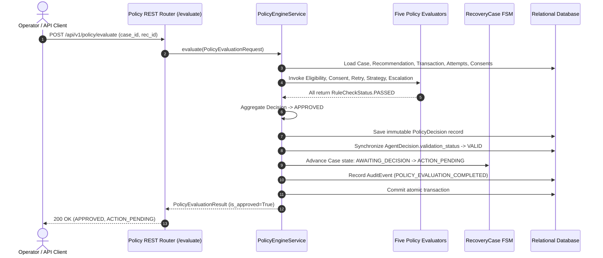
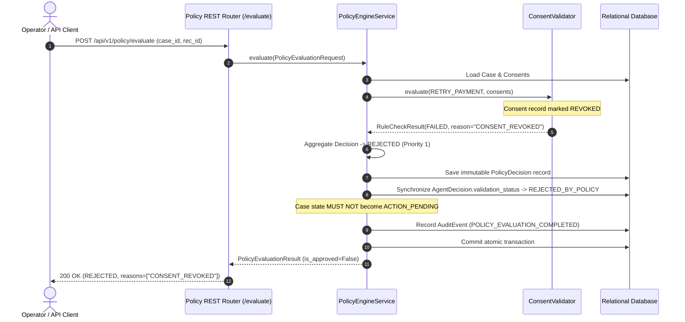

# Phase 2.9: Recovery Policy Engine and Guardrails

**Architectural Layer**: Policy Boundary & Action Authorization  
**Author**: Karthikeya & Antigravity AI  
**Status**: Completed and Fully Verified  

---

## 1. Executive Summary

In **Phase 2.8**, RevenueRescueAI introduced the Intelligence Layer, allowing AI/ML algorithms to analyze payment declines, predict recovery probabilities, and recommend optimal recovery strategies.

However, in financial systems, **an AI recommendation is merely a proposal, not an authorization**.

**Phase 2.9 (Recovery Policy Engine and Guardrails)** acts as the authoritative gatekeeper. It evaluates proposed actions against hard deterministic business rules, legal customer consent mandates, strict retry quotas, minimum cooldown intervals, and financial escalation thresholds.

```
+---------------------------+       Proposes Strategy
| AI Intelligence Engine    | ----------------------------+
| (Phase 2.8)               |                             |
+---------------------------+                             v
                                            +-----------------------------+
                                            | Recovery Policy Engine      |
                                            | (Phase 2.9)                 |
                                            +-----------------------------+
                                            | 1. Eligibility Evaluator    |
                                            | 2. Consent Validator        |
                                            | 3. Retry Limit Evaluator    |
                                            | 4. Strategy Validator       |
                                            | 5. Escalation Evaluator     |
                                            +-----------------------------+
                                                          |
                                      Determines Policy Decision Status
                                                          v
                                     +-------------------------------------------+
                                     | APPROVED / REJECTED / REQUIRES_REVIEW     |
                                     +-------------------------------------------+
                                                          |
                                            Synchronizes State (FSM)
                                                          v
                                     +-------------------------------------------+
                                     | Case: ACTION_PENDING / ESCALATED / STOPPED|
                                     | Decision: VALID / REJECTED_BY_POLICY      |
                                     | Audit: POLICY_EVALUATION_COMPLETED        |
                                     +-------------------------------------------+
                                                          |
                                           Passed to Workflow Engine
                                                          v
                                            +-----------------------------+
                                            | Workflow Engine Execution   |
                                            | (Phase 2.10)                |
                                            +-----------------------------+
```

---

## 2. Core Invariants & Architectural Rules

### A. Strict Financial Safety
The Policy Engine strictly evaluates and authorizes. It **never**:
1. Executes a payment retry or charges a card.
2. Calls an external payment gateway.
3. Dispatches customer emails or SMS messages.
4. Modifies `Transaction.status` or `recovered_revenue`.
5. Treats missing information as approval (always **fails closed**).

### B. Single Responsibility Principle (SRP)
Every evaluator has one, and only one, reason to change:
- `EligibilityEvaluator`: Validates case lifecycle states, customer ownership, and recommendation alignment.
- `ConsentValidator`: Validates legal customer consent (independent email vs SMS vs billing).
- `RetryLimitEvaluator`: Enforces retry budgets, minimum cooldown intervals, and duplicate attempt detection.
- `StrategyValidator`: Validates strategy feasibility, failure category compatibility, and prerequisites.
- `EscalationEvaluator`: Triggers human operator reviews for high-value exposures, low AI confidence, or fraud flags.

---

## 3. Four-Tier Decision Precedence

When the five evaluators produce their individual `RuleCheckResult` outcomes, the central `PolicyEngineService` aggregates them using a deterministic, 4-tier precedence matrix:

| Priority | Decision Status | Trigger Condition | FSM Case Transition | AgentDecision Status |
| :---: | :--- | :--- | :--- | :--- |
| **1** | **`REJECTED`** | **Any rule explicitly fails** (e.g. revoked consent, retry limit exceeded, case closed, permanent decline). | Retains state or transitions to `STOPPED` if terminal. | `REJECTED_BY_POLICY` |
| **2** | **`INSUFFICIENT_INFORMATION`** | No failure, but **mandatory information is missing** (e.g., missing AI confidence score, unavailable case context). | Remains in current non-actionable state. | `INVALID` |
| **3** | **`REQUIRES_REVIEW`** | No failure or missing info, but **human escalation is required** (e.g., exposure $\ge$ ₹1,000, AI confidence $< 0.60$, fraud flag). | Transitions to `ESCALATED`. | `NOT_VALIDATED` |
| **4** | **`APPROVED`** | **All 5 evaluators pass cleanly** without rejections, missing information, or review triggers. | Transitions to `ACTION_PENDING`. | `VALID` |

---

## 4. Sequence Diagrams

### A. Successful Evaluation Flow (`APPROVED`)



### B. Rejected Evaluation Flow (`REJECTED` via Revoked Consent)



---

## 5. Beginner-Friendly Concepts Guide

### 1. What is the Single Responsibility Principle (SRP)?
SRP states that a software component should have only one reason to exist and one reason to change. If one class checked consent, counted retries, checked case states, and handled currency conversions, any change to compliance laws could accidentally break the retry math! By separating them into five focused evaluators, each file is simple, understandable, and testable in isolation.

### 2. How does the Consent Validator work?
Consent represents legal authorization.
- When an action is `RETRY_PAYMENT`, it checks `RECURRING_BILLING` consent.
- When an action is `SEND_REMINDER`, it checks whether the channel is `email` or `sms`.
- **Independent Channels:** Having consent for email communication does **not** grant permission to send SMS text messages.
- **Fail-Closed:** If consent is missing, revoked, or past its expiration date (`expires_at`), it immediately rejects the action.

### 3. How is the retry count calculated?
In `PolicyConfig`, `max_retry_attempts = 3` represents **retries after the initial payment failure**.
- Initial failure (Attempt 1)
- Retry 1 (Attempt 2) $\rightarrow$ Permitted
- Retry 2 (Attempt 3) $\rightarrow$ Permitted
- Retry 3 (Attempt 4) $\rightarrow$ Permitted
- Retry 4 $\rightarrow$ **Blocked** (`RETRY_LIMIT_EXCEEDED`).
The maximum total payment attempts is therefore **4** (`max_total_attempts = 4`).

### 4. What is a cooldown period?
If a payment fails due to insufficient funds, retrying 10 seconds later will likely fail again and annoy the cardholder or trigger bank fraud filters. The cooldown period (`retry_cooldown_hours = 4`) mandates that at least 4 hours must pass after the previous attempt before another retry is allowed.

### 5. Why does currency matter for financial thresholds?
Amounts are stored as integers in "minor units" to avoid floating-point rounding bugs:
- In INR, `100,000` paise = ₹1,000.
- In USD, `100,000` cents = $1,000.
- In JPY, Yen has no minor units, so `150,000` = ¥150,000.
Comparing `amount_minor >= 100000` without looking at the currency code would treat ₹1,000 and $1,000 as identical! `PolicyConfig.is_high_value(amount, currency)` uses currency-aware mappings to ensure financial accuracy.

### 6. What is an Idempotency Key?
Networks can be unstable. If a client sends an evaluation request and the network drops before receiving the response, the client will retry. The `idempotency_key` ensures that RevenueRescueAI recognizes the duplicate request and returns the already-calculated decision without re-running rules or creating duplicate database records.

---

## 6. Real-World Execution Traces

### Trace 1: Successful Payment Retry
- **Context**: A ₹499 monthly subscription payment failed due to `insufficient_funds`.
- **AI Recommendation**: Phase 2.8 recommended `RETRY_LATER` with confidence `0.88`.
- **Evaluation**:
  1. `EligibilityEvaluator`: Case is in `AWAITING_DECISION` and matches recommendation. $\rightarrow$ **PASSED**
  2. `ConsentValidator`: Customer has active `RECURRING_BILLING` consent. $\rightarrow$ **PASSED**
  3. `RetryLimitEvaluator`: 0 prior retries executed; retry limit is 3. $\rightarrow$ **PASSED**
  4. `StrategyValidator`: `RETRY_LATER` is recognized and compatible with `insufficient_funds`. $\rightarrow$ **PASSED**
  5. `EscalationEvaluator`: Amount (₹499) is below ₹1,000 threshold; confidence (0.88) > 0.60. $\rightarrow$ **PASSED**
- **Outcome**: Decision is **`APPROVED`**. Case state transitions from `AWAITING_DECISION` $\rightarrow$ `ACTION_PENDING`. Agent decision marked `VALID`. Audit event recorded.

### Trace 2: Revoked Legal Consent
- **Context**: A ₹799 renewal failed, and AI recommended `RETRY_LATER`.
- **Evaluation**:
  1. `EligibilityEvaluator`: Case exists and is actionable. $\rightarrow$ **PASSED**
  2. `ConsentValidator`: Finds consent record, but `status == REVOKED` (customer revoked billing mandate yesterday). $\rightarrow$ **FAILED** (`CONSENT_REVOKED`)
  3. Other evaluators run for complete audit recording.
- **Outcome**: Precedence Priority 1 triggers **`REJECTED`**. Case state **does not become `ACTION_PENDING`**. Agent decision marked `REJECTED_BY_POLICY`. Audit event recorded. Zero payments executed.

---

## 7. Verification Summary

Across the 5 steps of Phase 2.9, **81 automated tests** were created and 100% verified:
- `test_policy_step1.py`: 19 tests (Enums, Config, ConsentRecord models)
- `test_policy_evaluators.py`: 46 tests (All 5 modular evaluators)
- `test_policy_engine_service.py`: 8 tests (Service orchestration, FSM transitions, precedence)
- `test_policy_api.py`: 4 tests (REST API endpoints & RBAC)
- `test_policy_concurrency_audit.py`: 4 tests (Idempotency, audit trail, stale state protection)
- **Total Suite**: 248 tests passing across the entire backend codebase.
