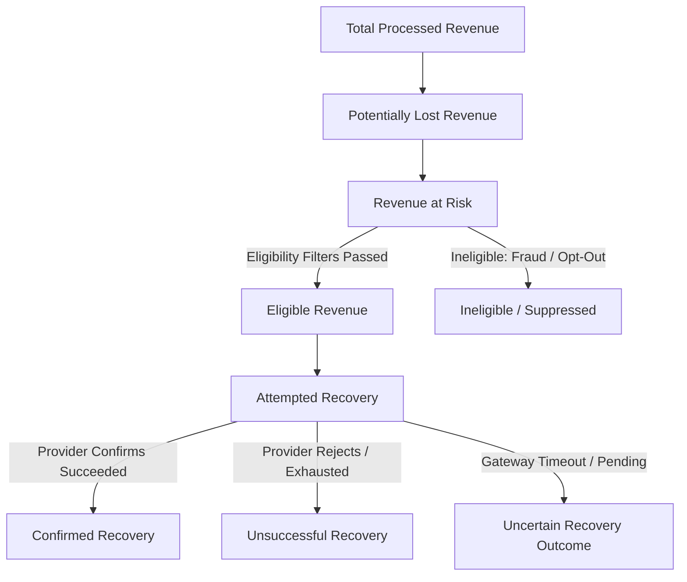
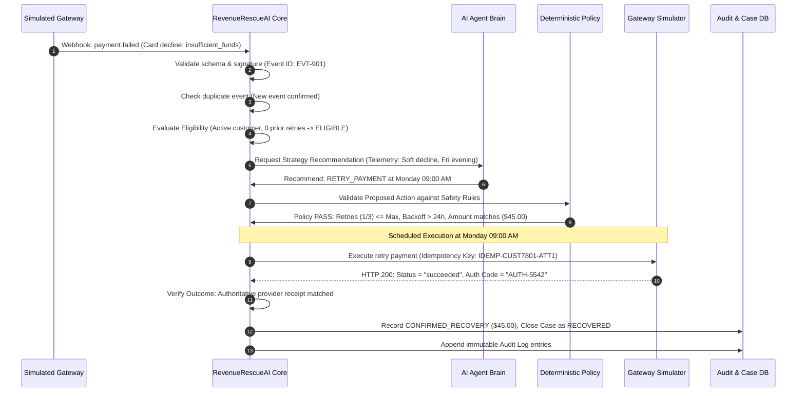
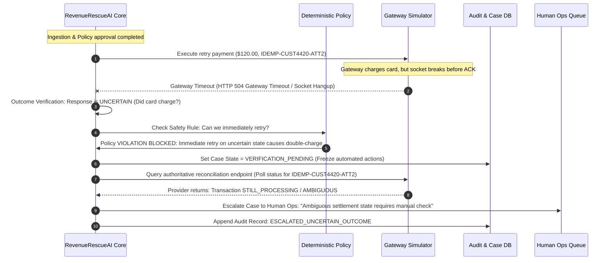

# RevenueRescueAI — Problem Analysis & Problem Definition

> **Document ID:** DOC-PA-001  
> **Phase:** 0.1 (Problem Analysis & Use-Case Selection)  
> **Status:** Approved Baseline  
> **Audience:** Product Engineering, Architecture, QA, Security, Beginner Developers  

---

## 1. Executive Summary

Businesses selling digital goods, SaaS subscriptions, and e-commerce services lose substantial revenue every day not because customers want to cancel, but because the payment rails fail silently. A customer's card may expire, a bank's server may experience temporary downtime, or a balance check may fail by a few dollars. In the industry, this is known as **involuntary revenue leakage**.

Traditional systems handle payment failures using one of two extremes:
1. **Dumb, rigid retries:** The billing system blindly re-attempts the charge every 24 hours until the customer's bank blocks the card for suspected fraud.
2. **Immediate cancellation:** The account is suspended immediately, irritating loyal customers and causing unnecessary churn.

**RevenueRescueAI** is conceived as an intelligent, bounded revenue recovery engine. It detects when revenue is at risk, gathers context, diagnoses the root cause, selects an allowable intervention, and executes that action through strict safety policies. 

Crucially, **RevenueRescueAI is not an unbounded autonomous AI agent** that can spend money or bombard customers at will. It treats artificial intelligence as an untrusted decision advisor:
- The AI proposes an intervention based on failure telemetry.
- A **deterministic policy gate** strictly approves or rejects the action based on hard business rules (e.g., maximum 3 retries, minimum 24-hour backoff, no retries if already successful).
- An **outcome verification mechanism** confirms whether money actually arrived before any revenue is declared "recovered."
- An **append-only audit log** records every single check and outcome.

This document establishes the formal business and engineering problem definition for Phase 0.1.

---

## 2. Plain-English Problem Explanation

To ensure clear understanding for developers, business analysts, and stakeholders, this section answers the ten core questions defining the problem.

### 2.1 What does revenue leakage mean in this project?
**Revenue leakage** is the unintentional loss of legitimate business income that should have been collected but was lost due to operational, technical, or systemic failures. In this project, revenue leakage refers specifically to money owed by a willing customer (e.g., for an active subscription, invoice, or completed checkout order) that fails to reach the merchant's bank account because of gateway errors, network timeouts, insufficient funds, or expired payment credentials.

### 2.2 What events can put revenue at risk?
Revenue is put at risk whenever an expected financial transition fails to complete successfully. Common triggering events include:
- A card processor returns a `soft_decline` (e.g., "temporary bank outage" or "insufficient funds").
- A card processor returns a `hard_decline` (e.g., "stolen card" or "account closed").
- A payment request times out without a definitive response (`stale_pending`).
- A recurring subscription renewal fails to charge on the billing cycle date.
- An e-mandate or UPI autopay debit is rejected by the issuing bank.
- A B2B invoice reaches its due date without incoming payment.

### 2.3 Why is identifying a problem insufficient?
Identifying a failure (e.g., emitting an alert saying "Payment #123 failed") does not solve the problem. If a merchant simply logs the failure:
- The customer loses service or experiences friction.
- The merchant loses money.
- No corrective action is taken.
Identifying a problem is merely observational. True revenue recovery requires active, compliant intervention to win the money back while protecting customer trust.

### 2.4 What is the difference between detection, diagnosis, decision, execution, and verification?
A robust recovery system must separate concerns into five distinct lifecycle phases:
1. **Detection:** Discovering that a failure occurred (e.g., parsing a `payment.failed` webhook).
2. **Diagnosis:** Analyzing why it failed (e.g., distinguishing between a temporary server glitch and an expired card).
3. **Decision:** Choosing the best permitted next step (e.g., "wait 48 hours and retry at 09:00 AM" vs. "request updated payment method" vs. "do not retry").
4. **Execution:** Carrying out the selected action through a controlled tool (e.g., calling the payment gateway API to initiate a retry).
5. **Verification:** Inspecting independent, authoritative provider evidence to determine whether the action succeeded, failed, or remains pending.

### 2.5 What does an AI-assisted recovery agent do?
The AI agent acts as a specialized analytical advisor. It ingests the case history (failure code, customer tenure, past payment patterns, time of day, retry count) and recommends the optimal recovery strategy. For example, rather than blindly retrying immediately, the agent might deduce: *"This error is a temporary balance shortfall at end-of-month; schedule retry on the 1st of the month."* However, the AI agent is strictly an advisor—it cannot independently execute financial operations without policy validation.

### 2.6 What makes its workflow bounded?
A workflow is **bounded** when its boundaries, operational limits, and allowable actions are constrained by non-negotiable rules:
- It can only select from a predefined, allow-listed set of actions (`RETRY_PAYMENT`, `SEND_UPDATE_LINK`, `ESCALATE_TO_HUMAN`, `HALT_RECOVERY`).
- It operates under strict ceilings (e.g., maximum 3 retries total).
- It cannot invent new tools, call unauthorized endpoints, or alter financial amounts.
- It cannot execute infinite loops.

### 2.7 Why must the system have stopping rules?
Stopping rules are safety guarantees. Without stopping rules, an automated recovery script could:
- Repeatedly charge an empty bank account, incurring expensive overdraft fees for the customer and processing fees for the merchant.
- Trigger anti-fraud alarms at Visa/Mastercard/Stripe, leading to merchant account suspension.
- Loop endlessly on permanent errors (e.g., attempting to charge a canceled card forever).
Stopping rules dictate the exact conditions where recovery must terminate immediately (e.g., hard decline received, max retries reached, 14-day window elapsed).

### 2.8 Why must it have escalation?
Not all failures can or should be resolved automatically. Escalation passes a case to a human operator when:
- The AI's recommendation has low confidence.
- High-value transactions exceed an automated risk threshold (e.g., an invoice over $10,000).
- The payment gateway returns an unexpected or ambiguous status code.
- The customer submits a dispute, chargeback, or opt-out request.
Escalation ensures humans retain control over anomalous, risky, or high-stakes edge cases.

### 2.9 Why is an audit trail necessary?
In financial engineering, an **audit trail** is a legal, operational, and technical necessity:
- **Financial reconciliation:** Accountants must match every recovered dollar to an authorized transaction.
- **Regulatory compliance:** Proof that the merchant followed payment scheme rules (e.g., card network retry guidelines).
- **Customer support:** If a customer asks "Why was my card charged on Tuesday?", support agents can view the exact sequence of events, diagnostic reasons, and policy approvals.
- **Debugging & observability:** Engineers can inspect exactly why the agent recommended an action and which policy approved it.

### 2.10 Why must recovery outcomes be measured rather than merely predicted?
Predictions are hypotheses; money is factual. An AI model can predict a "92% chance of recovery," but that prediction does not pay salaries or fund business operations. If a system claims success based on predictions:
- It may report phantom revenue that never cleared the bank.
- It may claim credit for transactions that the customer settled independently outside the workflow.
- It creates misleading financial statements.
True success must be proven by verified, authoritative settlement records from the payment provider.

---

## 3. Financial Concept Disambiguation

To eliminate ambiguity across development and reporting, the following terms are rigorously distinguished:

| Term | Plain-English Definition | Real-World Example |
|---|---|---|
| **Potentially Lost Revenue** | The gross value of all transactions that encountered any interruption or failure event before final settlement. | A customer clicks "Pay," but their Wi-Fi disconnects before the gateway responds ($100). |
| **Revenue at Risk** | The specific subset of failed revenue that remains uncollected and will be permanently lost unless an intervention occurs. Excludes self-healing transactions. | A subscription invoice of $50 fails at 03:00 AM due to `insufficient_funds`. No subsequent payment has occurred. |
| **Eligible Revenue** | The revenue at risk that passes all business, safety, and legal criteria for recovery intervention. | The $50 failed invoice where the customer account is in good standing, retry budget is not exhausted, and customer has not opted out. |
| **Attempted Recovery** | The dollar volume for which an automated recovery action (e.g., a payment retry or payment-method update link) was physically executed. | The system fires a payment retry call to the payment gateway for the $50 invoice. |
| **Confirmed Recovery** | Money that has been definitively verified as successfully captured and settled by an authoritative payment provider receipt matching the recovery action. | The gateway webhook confirms `$50.00 captured` with matching transaction ID within the allowed attribution window. |
| **Unsuccessful Recovery** | Revenue that the system attempted to recover, but all allowed interventions failed, stopping rules triggered, or the recovery window closed. | The system retried 3 times over 7 days; all attempts returned `insufficient_funds`. Case closed as unrecovered. |
| **Uncertain Recovery Outcome** | Revenue where a recovery action was initiated, but the authoritative provider has neither confirmed success nor definitive failure (e.g., network timeout, pending async bank transfer). | The retry was sent, but the gateway connection timed out after 30 seconds. The merchant does not know if the card was charged. |

---

## 4. Fictional Illustrative Walkthroughs

*(Note: The following examples use explicitly fictional characters, IDs, and financial values. They represent test simulations, not real customer records or measured production results.)*

### 4.1 Walkthrough 1: Successful Recovery Sequence

**Scenario:** Customer "Alex Doe" (Customer ID `CUST-7801`) has a monthly software subscription of **$45.00** (4,500 minor units). On the monthly billing date, the automated charge fails.

1. **Payment failure detected:** At 2026-11-01 18:30 UTC, simulated gateway sends webhook `evt_fail_101`: Card charge of $45.00 declined with raw code `insufficient_funds`.
2. **Event validated:** The ingestion pipeline verifies the HMAC webhook signature, validates that required fields (`amount`, `currency`, `customer_id`, `payment_id`) are present, and checks that `$45.00` equals 4,500 minor units (USD).
3. **Failure reason assessed:** The classifier maps `insufficient_funds` to classification `SOFT_DECLINE_TEMPORARY_BALANCE`.
4. **Recovery eligibility determined:** System checks customer status: Account is active, has had 0 retries on this invoice, no dispute flag, no communication opt-out. Eligibility status: `ELIGIBLE` ($45.00 at risk).
5. **Permitted intervention selected:** AI agent evaluates historical recovery curves for Friday evening soft declines. It recommends: `RETRY_PAYMENT` with a scheduled execution window on Monday morning (payday weekend effect).
6. **Safety policy checked:** Deterministic policy gate evaluates the recommendation against hard rules:
   - Is `RETRY_PAYMENT` an allow-listed action? **Yes.**
   - Has retry budget been exceeded? **No (Attempt 1 of 3 allowed).**
   - Has minimum backoff elapsed? **Yes (scheduled 60 hours later).**
   - Has customer already paid? **No.**
   - Decision: **APPROVED.**
7. **Simulated action executed:** On Monday at 09:00 UTC, the workflow worker invokes the simulated gateway adapter with idempotency key `idemp_case_882_att_1`.
8. **Payment outcome verified:** Gateway returns HTTP 200 with payload: `status: "succeeded"`, `transaction_id: "txn_recov_9901"`, `amount_captured: 4500`. Outcome verifier checks that amount, currency, and invoice ID match.
9. **Workflow stopped:** Goal achieved. Case state transitions from `ACTION_EXECUTED` to `RECOVERED`. No further retries are scheduled.
10. **Audit history updated:** Append-only audit log records the transition: `CASE_DETECTED` -> `POLICY_APPROVED` -> `ACTION_DISPATCHED` -> `VERIFIED_SUCCESS`.
11. **Recovery metrics updated:** Confirmed recovered revenue increases by $45.00. Case recovery count increments by 1. Safety violations = 0.

---

### 4.2 Walkthrough 2: Uncertain Outcome Sequence (Network Failure & Success Protection)

**Scenario:** Customer "Jordan Smith" (Customer ID `CUST-4420`) has an overdue invoice of **$120.00** (12,000 minor units).

1. **Payment failure detected:** Webhook signals initial debit failure for $120.00 (`generic_decline`).
2. **Event validated & Eligibility confirmed:** Case is valid, retry 2 of 3.
3. **Action approved & dispatched:** System issues `RETRY_PAYMENT` to simulated provider.
4. **Execution anomaly (Timeout):** The simulated provider initiates processing, but the network connection abruptly drops after 15 seconds. The client receives an HTTP 504 Gateway Timeout.
5. **Outcome verified as UNCERTAIN:** Crucially, the system **does NOT assume failure**. Assuming failure and immediately retrying would risk double-charging the customer if the bank actually approved the first charge.
6. **Safety policy enforced:** Deterministic policy mandates: *When transaction state is `UNKNOWN` or `PENDING_VERIFICATION`, no new payment-generating actions may be dispatched.*
7. **Reconciliation attempt:** The system enters a polling cooldown. After 15 minutes, it queries the provider's transaction ledger using the unique idempotency key.
8. **Ambiguity persists:** The provider simulator returns `status: "manual_review_hold"`.
9. **Escalation triggered:** Because automated verification cannot confirm settlement within the allowed timeout threshold (30 minutes), the automated engine **halts** and transitions the case to `ESCALATED_HUMAN_REVIEW`.
10. **Audit trail persisted:** Audit log notes: `DISPATCHED` -> `TIMEOUT_DETECTED` -> `VERIFICATION_UNCERTAIN` -> `ESCALATED_OPERATOR`.
11. **Metrics protection:** The $120.00 is **not** added to confirmed recovered revenue. It is recorded as `PENDING_VERIFICATION / ESCALATED`. Double-counting and premature claims are completely prevented.

---

## 5. Why Bounded Autonomous Recovery is Needed

Why not simply build an unrestricted AI agent using an LLM that reads customer data, writes emails, and calls APIs?

In financial technology, an unbounded autonomous agent represents unacceptable risk:

1. **Hallucination of Policy:** An LLM might decide: *"This customer seems very frustrated in their ticket history, so I will refund their last 6 months of payments and give them 1 year free."*
2. **Infinite Retry Storms:** Without rigid code-level counters, an autonomous loop could retry a card 50 times in 5 minutes, leading to immediate blacklisting by payment networks (Visa/Mastercard card-testing fraud rules).
3. **Legal & Compliance Breaches:** Debt collection and recurring payments are strictly governed by laws such as the US FDCPA, TCPA, European PSD2/SCA, and India's RBI e-mandate circulars. Autonomous agents that invent their own messaging or retry timings directly violate regulatory consent rules.
4. **Financial Double-Charging:** As shown in Walkthrough 2, network communication is inherently unreliable. An LLM cannot reason about network socket state; only a deterministic, idempotency-backed state machine can safely navigate distributed transaction uncertainty.

**Therefore, RevenueRescueAI enforces strict architectural boundaries:**
- AI is restricted to **contextual diagnosis and ranking recommendations**.
- Code (deterministic policy) holds the **keys to the vault**. Every single execution must pass a hard boolean validation in code before any external API is touched.

---

## 6. Visual Product Direction Analysis

The visual design requirements call for a **dark futuristic fintech command center**. This section analyzes the user experience and visual architecture principles required to make this interface functional, readable, and enterprise-grade.

### 6.1 Design Guidance & Palette
- **Surfaces & Backgrounds:** Deep navy (`#0B0F19`), rich dark charcoal (`#111827`), and obsidian surfaces (`#06090E`). High-contrast layering ensures visual depth without muddying text.
- **Accents & Glowing Highlights:** 
  - Cyan (`#06B6D4` / `#22D3EE`) for system telemetry, active flows, and live nodes.
  - Electric Blue (`#3B82F6` / `#60A5FA`) for links, primary controls, and data streams.
  - Purple/Magenta (`#A855F7` / `#EC4899`) for AI diagnostic badges and intelligence reasoning indicators.
  - Restrained neon glows (`box-shadow: 0 0 15px rgba(6, 182, 212, 0.25)`) reserved strictly for active alerts or hovered interactive cards.

### 6.2 Financial Information Hierarchy & Data Density
Financial operators do not need decorative fluff; they need rapid situational awareness. The dashboard layout must follow an executive-to-tactical visual hierarchy:
1. **Top KPI Strip (The High-Altitude Truth):**
   - *Total Revenue at Risk* (Gross problem size).
   - *Confirmed Recovered Revenue* (Authoritative financial win).
   - *Recovery Rate (%)* (Efficiency ratio).
   - *Active Interventions* (Current system load).
   - *Safety Violations Blocked* (Policy defense proof: must be 0 or 100% defended).
2. **Mid-Tier Visualizations (Trends & Pipelines):**
   - Time-series recovery curve (Baseline vs. AI-Assisted).
   - Funnel breakdown: Detected -> Eligible -> Actioned -> Verified.
3. **Tactical Operational Grid (Recovery Queue):**
   - High-density table with case ID, customer, amount (formatted in currency), failure reason, recommended action, policy status, outcome, and timestamp.
4. **Inspection Drawer / Trace Modal (Explainability):**
   - Clicking any case reveals the exact diagnostic trace: raw provider code, AI reasoning rationale, policy check log, and verified provider receipt.

### 6.3 Clear Distinction of Financial States
To prevent operator confusion or accidental misreporting, status badges must use unmistakable semantic styling:

| Financial / Workflow State | Color Coding | Visual Treatment | Operator Meaning |
|---|---|---|---|
| **Confirmed Recovered** | Emerald / Neon Green (`#10B981`) | Solid badge, subtle green border | Real money confirmed settled in bank. |
| **Revenue at Risk** | Amber / Warning Orange (`#F59E0B`) | Outlined amber badge | Uncollected money requiring intervention. |
| **Eligible for Recovery** | Cyan (`#06B6D4`) | Soft cyan fill | Validated cases queued for action. |
| **Pending / Uncertain** | Indigo / Pulsing Violet (`#6366F1`) | Pulsing animation indicator | Awaiting gateway settlement ACK. |
| **Unsuccessful / Closed** | Slate / Muted Gray (`#64748B`) | Neutral dark badge | All retries exhausted; case safely halted. |
| **Escalated to Operator** | Crimson / Rose (`#F43F5E`) | High-contrast red badge | System halted; human intervention mandatory. |

### 6.4 Avoiding Excessive Decoration
While neon and dark fintech aesthetics look sleek, accessibility and financial legibility take precedence:
- All financial numbers must use monospace tabular figures (`font-variant-numeric: tabular-nums`) so decimal points align vertically.
- Contrast ratios must meet WCAG 2.1 AA standards (minimum 4.5:1 for body text).
- Animations must be subtle and respect `prefers-reduced-motion`.
- Blinking or high-intensity glowing text is strictly prohibited on financial values.

---

## 7. Scope Boundaries & Recommended MVP

### 7.1 Scope Summary
- **Primary Domain:** Payment failure recovery in digital commerce and subscription billing.
- **Provider Environment:** Controlled, deterministic payment gateway simulator (no live payment credentials or external bank connections required).
- **Architecture Model:** Modest, maintainable modular monolith with clear domain separation (Ingestion -> Intelligence -> Policy -> Tools -> Verification -> Audit).
- **Core Value Proposition:** Proving that an AI-assisted engine can recover revenue with zero safety violations, verifiable settlement evidence, and reproducible baseline comparisons.

### 7.2 Document Navigation
- For detailed evaluation of candidate use cases: see [docs/use-case-comparison.md](use-case-comparison.md).
- For stakeholder personas and initial user stories: see [docs/stakeholders-and-user-stories.md](stakeholders-and-user-stories.md).
- For the full 15-step recovery lifecycle: see [docs/recovery-lifecycle.md](recovery-lifecycle.md).
- For the domain glossary: see [docs/domain-glossary.md](domain-glossary.md).
- For the strict MVP boundaries and post-MVP roadmap: see [docs/mvp-scope.md](mvp-scope.md).
- For mathematical metric specifications: see [docs/metrics-specification.md](metrics-specification.md).
- For the safety hazard analysis and risk register: see [docs/risk-register.md](risk-register.md).
- For the assumptions and open questions register: see [docs/assumptions-and-open-questions.md](assumptions-and-open-questions.md).
- For acceptance criteria of Phase 0.1: see [docs/phase-0.1-acceptance-checklist.md](phase-0.1-acceptance-checklist.md).
