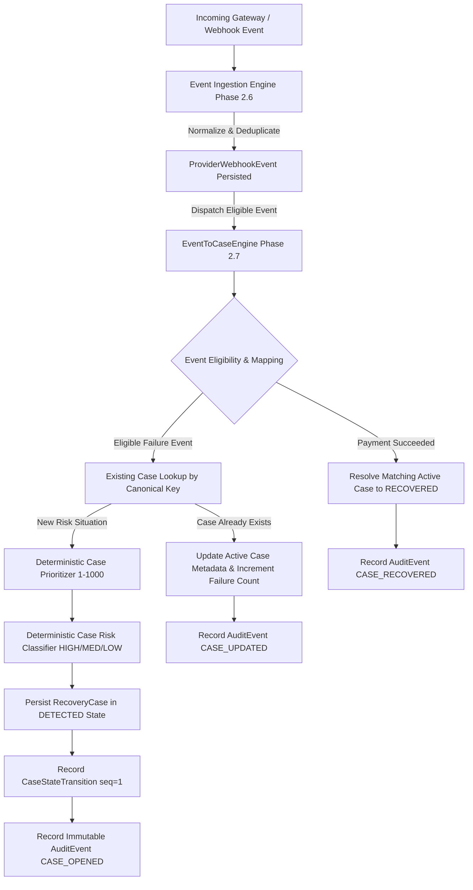

# Recovery Case Management Architecture

**Phase**: 2.7 — Recovery Case Management Engine  
**Author**: Karthikeya  
**Status**: APPROVED & VERIFIED  

---

## 1. Architectural Overview

The **Recovery Case Management Engine** is the core domain orchestrator of RevenueRescueAI. It transforms normalized, deduplicated revenue-risk events emitted by the Event Ingestion Engine (Phase 2.6) into structured, trackable, and auditable **Recovery Cases**.

While an event records a point-in-time failure occurrence, a **Recovery Case** encapsulates an active business revenue problem requiring tracking, operational prioritization, risk classification, and eventual recovery intervention.

---

## 2. Core Separation of Concerns

| Component | Responsibility | Boundary Rule |
| :--- | :--- | :--- |
| **Event Ingestion Engine** | Signature verification, normalization to `CanonicalEventDTO`, idempotency deduplication | Never modifies case state directly; acts strictly as ingress gatekeeper. |
| **EventToCaseEngine** | Evaluates event eligibility, resolves/provisions Customers & Transactions, derives `case_key`, orchestrates case creation/update/resolution | Pure domain coordination within single database transactions. |
| **CasePrioritizer** | Computes deterministic operational queue score `[1, 1000]` (lower integer = higher urgency) | Uses deterministic financial exposure, failure category, and elapsed age. No AI. |
| **CaseRiskClassifier** | Evaluates structural revenue-loss severity (`HIGH`, `MEDIUM`, `LOW`) independently of queue urgency | Answers: *How serious is the financial exposure and churn risk?* No AI. |
| **RecoveryCaseService** | Governs finite-state machine (FSM) transitions, updates, and audit queries | Enforces terminal state immutability (`RECOVERED`, `STOPPED`, `CLOSED`). |
| **AI Recommendation Engine** | *Phase 2.8 (Future)*: Generates optimal recovery interventions | Must consume open cases; strictly decoupled from case creation. |

---

## 3. High-Level Event-to-Case Pipeline

1. **Ingestion & Deduplication**: Provider webhook arrives, signature is validated, raw payload is normalized into `CanonicalEventDTO`, and uniqueness boundary on `(provider, external_event_id)` is evaluated.
2. **Handoff**: If the event is newly accepted (`duplicate == False`), `EventService` passes the canonical event to `EventToCaseEngine.process_event()`.
3. **Entity Resolution**:
   - Customer aggregate is resolved via `find_by_external_id(provider, customer_reference)` or provisioned.
   - Transaction aggregate is resolved via `find_by_external_id(provider, tx_ref)` or provisioned in `FAILED` status.
4. **Case Key Identity**: Canonical case key is synthesized based on business reference dimensions:
   - Subscription: `CASE-SUB-{subscription_ref}-{billing_period}`
   - Invoice: `CASE-INV-{invoice_ref}`
   - Checkout Session: `CASE-CHK-{session_id}`
   - Standard Transaction: `CASE-TX-{provider}-{payment_ref}`
5. **State Machine Execution**:
   - If case exists and is active, updates metadata, increments failure count, re-prioritizes, and appends `CASE_UPDATED` audit log.
   - If case exists and is terminal (`RECOVERED`/`CLOSED`), historical resolution is preserved.
   - If case does not exist, instantiates `RecoveryCase` in `DETECTED` state with sequence 1 `CaseStateTransition` and `CASE_OPENED` audit record.
6. **Mark Processed**: Event is flagged `processed = True` upon successful database commit.
