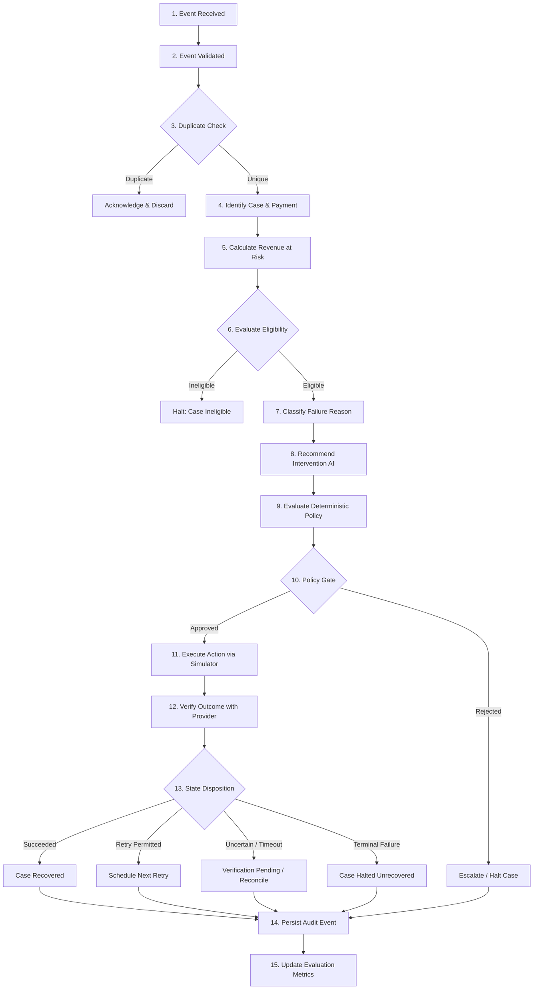

# RevenueRescueAI — End-to-End Recovery Lifecycle & Resilience Architecture

> **Document ID:** DOC-RL-004  
> **Phase:** 0.1 (Problem Analysis & Use-Case Selection)  
> **Status:** Approved Baseline  
> **Audience:** Product Engineering, Architecture, QA, Security, Beginner Developers  

---

## 1. Executive Summary

In financial systems, reliability is not an afterthought—it is the core feature. When an automated system attempts to recover revenue, a single unhandled network timeout or missing deduplication check can result in duplicate customer charges, chargeback disputes, or lost audit trails.

This document formally defines the 15-step end-to-end recovery lifecycle of RevenueRescueAI. It explicitly delineates which steps are deterministic code, which steps leverage AI advisory reasoning, and which steps depend on authoritative external evidence. Furthermore, it defines non-negotiable failure-handling behaviors across eleven critical operational failure modes.

---

## 2. The 15-Step End-to-End Recovery Lifecycle

The following sequence illustrates the complete journey of a recovery case from initial webhook receipt to verified financial settlement.



### Detailed Lifecycle Step Specifications

| Step # | Lifecycle Step | Classification | Description & Execution Authority |
|---|---|---|---|
| **1** | **Event Received** | Deterministic | Raw webhook payload ingested over HTTP endpoint (`POST /api/v1/webhooks/gateway`). Ingestion logs raw headers, source IP, and timestamp. |
| **2** | **Event Validated** | Deterministic | Cryptographic signature verified using HMAC-SHA256 and configured webhook secret. Schema validated against Pydantic schema (validates required fields: `id`, `event_type`, `amount`, `currency`, `timestamp`). |
| **3** | **Duplicate Event Checked** | Deterministic | Database queried for `event_id` or `idempotency_key`. If already processed, system returns HTTP 200 OK and halts further processing to prevent duplicate cases. |
| **4** | **Associated Payment & Case Identified** | Deterministic | System correlates incoming event with existing `payment_id`, `invoice_id`, and `customer_id`. If an existing case is open, updates it; otherwise, creates a new `RecoveryCase`. |
| **5** | **Potential Revenue at Risk Calculated** | Deterministic | Extracts nominal transaction amount in integer minor units (e.g., $45.00 -> 4,500 cents) and sets initial `revenue_at_risk`. Zero floating-point arithmetic allowed. |
| **6** | **Eligibility Evaluated** | Deterministic | Evaluates business rules: Is customer account active? Is invoice within eligible age (< 14 days)? Has customer opted out? Has payment already succeeded? If passed, case state = `ELIGIBLE`. |
| **7** | **Failure Reason Classified** | Deterministic / Heuristic | Maps raw gateway decline codes (e.g., `card_declined: 51`) into standardized taxonomy: `SOFT_DECLINE_TEMPORARY_BALANCE`, `HARD_DECLINE_STOLEN_CARD`, `TRANSIENT_NETWORK_ERROR`, etc. |
| **8** | **Intervention Recommended** | **AI Advisory** | Contextual agent (or versioned statistical classifier) inspects telemetry (decline code, attempt count, customer tenure, time-of-day) and recommends an allow-listed action and execution schedule (e.g., `RETRY_PAYMENT` at 09:00 AM on Monday). |
| **9** | **Deterministic Policy Evaluated** | Deterministic | Recommendation is passed to the non-negotiable Policy Engine. Engine checks hard rules: retry count <= 3, backoff >= 24h, zero prior successful payments, allow-listed tool intent. |
| **10** | **Action Authorized or Rejected** | Deterministic | If all policy rules pass, emits `PolicyDecision(status="APPROVED")`. If any rule fails, emits `PolicyDecision(status="REJECTED", reason="...")`. **AI is strictly forbidden from self-authorizing actions.** |
| **11** | **Action Executed via Simulator** | External Evidence / Simulator | System invokes the simulated payment provider adapter using an idempotency key (`idemp_{case_id}_{attempt_num}`). Simulator executes virtual card charge. |
| **12** | **Result Verified** | External Evidence / Provider | Verifier inspects provider response: checks HTTP status, parses provider transaction status (`succeeded`, `failed`, `pending`), and validates matching amount and currency. |
| **13** | **Workflow State Disposition** | Deterministic | Based on verification: If succeeded -> `RECOVERED`; if retryable and retries remain -> `RETRY_SCHEDULED`; if timeout/ambiguous -> `VERIFICATION_PENDING`; if hard fail -> `HALTED_UNRECOVERED`; if anomalous -> `ESCALATED_HUMAN`. |
| **14** | **Audit Event Persisted** | Deterministic | Append-only audit record written to relational database with timestamp, actor, transition state, payload hash, and correlation ID. Cannot be deleted or overwritten. |
| **15** | **Evaluation Metrics Updated** | Deterministic | System increments confirmed recovered revenue, case recovery counters, and safety verification tallies in the evaluation state or analytics warehouse. |

---

## 3. Separation of Responsibilities: Deterministic vs. AI vs. External Evidence

A critical architectural principle of RevenueRescueAI is the absolute boundary between decision components:

```text
+------------------------------------------------------------------------+
| 1. AI ADVISORY LAYER (Untrusted Proposer)                              |
|    - Evaluates noisy failure telemetry & behavioral context            |
|    - Suggests next best action (e.g., "Schedule retry in 48 hours")    |
|    - CANNOT execute tools, spend money, or alter database directly     |
+------------------------------------------------------------------------+
                                   |
                                   v (Proposed Intent)
+------------------------------------------------------------------------+
| 2. DETERMINISTIC POLICY LAYER (The Code Gatekeeper)                    |
|    - Evaluates mathematical invariants and business constraints        |
|    - Boolean pass/fail logic written in pure, testable Python code     |
|    - Has absolute veto power over any AI suggestion                    |
+------------------------------------------------------------------------+
                                   |
                                   v (Approved Execution Token)
+------------------------------------------------------------------------+
| 3. EXTERNAL EVIDENCE & VERIFICATION LAYER (Authoritative Settlement)  |
|    - Provider webhook with valid cryptographic signature               |
|    - Gateway transaction ledger receipt                                |
|    - Only authoritative external receipts can confirm recovery         |
+------------------------------------------------------------------------+
```

### The Non-Negotiable AI Rule
> **Under no circumstances does an AI model, LLM prompt, or autonomous heuristic have the authority to trigger a financial transaction or declare revenue recovered.** The AI's sole role is that of a diagnostic advisor proposing an intent. Code governs authorization; provider receipts govern verification.

---

## 4. Outcome-Verification Principles

To avoid phantom revenue claims and false recovery reporting, the system enforces three outcome-verification principles:

1. **The Principle of Independent Proof:** A recovery action is never considered successful simply because the system dispatched it. A payment retry is considered successful *only* when the external payment gateway simulator returns an authoritative receipt with status `succeeded` and a valid settlement transaction ID.
2. **The Principle of Exact Attribution:** A successful transaction is attributable to a recovery case *only* if:
   - The transaction amount in minor units matches the case amount exactly.
   - The currency code matches exactly.
   - The settlement timestamp falls strictly within the allowed **Attribution Window** (e.g., within 72 hours of the recovery action dispatch).
   - The transaction was initiated using the case's unique idempotency key.
3. **The Principle of Conservative Uncertainty:** If a provider response is ambiguous, times out, or returns a temporary server error, the system *must not* record a failure or retry immediately. It must classify the outcome as `UNCERTAIN` / `VERIFICATION_PENDING` and initiate a reconciliation inquiry.

---

## 5. Explicit Behavior Across Eleven Failure & Edge Modes

The following table specifies the required system response for every critical operational edge case:

| Failure / Edge Mode | System Detection Mechanism | Immediate Preventive Action | Resulting Workflow State | Audit & Notification Action |
|---|---|---|---|---|
| **1. Input data is invalid** | Pydantic schema validation fails or missing required fields (`amount`, `payment_id`). | Reject webhook immediately with HTTP 400 Bad Request; do not create database case. | None (Ingestion rejected) | Log warning with malformed payload hash and source IP. |
| **2. Event is duplicated** | Duplicate `event_id` or `idempotency_key` found in database index. | Return HTTP 200 OK immediately; bypass processing pipeline. | Existing state unchanged | Log duplicate event receipt; increment duplicate-event counter. |
| **3. Payment has already succeeded** | Gateway ledger or internal database shows payment status is already `SETTLED`. | Block any outgoing payment retry call immediately via policy check. | `CASE_RESOLVED_EXTERNAL` | Log success protection trigger; close case; prevent duplicate debit. |
| **4. Payment outcome is uncertain** | HTTP network timeout, TCP socket drop, or provider returns HTTP 504 / 502. | Do NOT retry immediately. Freeze automated actions to prevent double-charging. | `VERIFICATION_PENDING` | Log network timeout; schedule asynchronous reconciliation poll via idempotency key. |
| **5. Retry budget exhausted** | Case `attempt_count` reaches policy maximum (e.g., 3 retries). | Block further retry generation; terminate automated workflow. | `HALTED_MAX_RETRIES` | Log case termination; notify RevOps queue if high-value threshold met. |
| **6. Recovery window expired** | Case age exceeds maximum allowable recovery window (e.g., 14 days since initial failure). | Invalidate pending scheduled retries; close case. | `HALTED_EXPIRED` | Log window expiration; trigger final dunning or account suspension notice. |
| **7. Customer opted out** | Customer opt-out record received or `communication_opted_out == True`. | Suppress all automated email/SMS communications; allow only silent card retries if contractually permitted. | `COMMUNICATION_SUPPRESSED` | Log opt-out compliance event; enforce zero contact rule. |
| **8. Model is unavailable** | LLM API returns timeout, rate limit (HTTP 429), or 5xx server error. | Gracefully fall back to deterministic rule-based baseline strategy (e.g., standard 48-hour retry). | `FALLBACK_RULE_APPLIED` | Log model unavailability warning; record fallback execution in audit trail. |
| **9. Model returns invalid output** | Model response fails JSON parsing, hallucinated action name, or invalid schedule. | Reject model recommendation completely; fall back to deterministic baseline. | `FALLBACK_RULE_APPLIED` | Log invalid model output for prompt engineering review; do not execute invalid intent. |
| **10. Database is unavailable** | Relational database connection pool exhausted or connection refused. | Reject incoming webhooks with HTTP 503 Service Unavailable so upstream gateway retries webhook delivery later; halt in-flight workers. | In-flight operations roll back | Raise high-priority PagerDuty/SRE alert; preserve idempotency guarantees. |
| **11. Action provider times out** | Payment simulator adapter times out during retry execution call. | Treat as uncertain transaction state; do not trigger immediate secondary charge. | `VERIFICATION_PENDING` | Schedule status inquiry via unique idempotency key; escalate to operator if unverified after 30 minutes. |

---

## 6. Stopping Rules & Escalation Behavior

### 6.1 Non-Negotiable Stopping Rules
The recovery workflow engine must immediately cease automated processing on a case when any of the following conditions is met:
1. **Definitive Success:** Provider confirms payment capture (`RECOVERED`).
2. **Permanent Hard Decline:** Gateway reports permanent failure (`stolen_card`, `account_closed`, `fraudulent`).
3. **Retry Exhaustion:** Attempt counter reaches limit (default: 3).
4. **Temporal Expiration:** 14 calendar days have elapsed since initial failure event.
5. **Customer Cancellation:** Customer explicitly cancels subscription or dispute opened.
6. **Double-Action Danger:** Any condition where transaction state cannot be proven.

### 6.2 Escalation Triggers (Passing Control to Humans)
A case is automatically removed from autonomous execution and placed in the **Human Operator Queue** under the following conditions:
1. **High-Value Exposure:** The uncollected amount exceeds the automated threshold (e.g., >= $1,000 / 100,000 minor units).
2. **Persistent Uncertainty:** An ambiguous transaction state remains unverified after 3 automated reconciliation attempts.
3. **Low Model Confidence:** The AI recommendation confidence score falls below 0.60.
4. **Customer Dispute Alert:** Webhook reports an active chargeback or pre-arbitration claim.
5. **Repeated Policy Rejection:** The AI model repeatedly proposes invalid or policy-violating actions (> 2 consecutive rejections).
