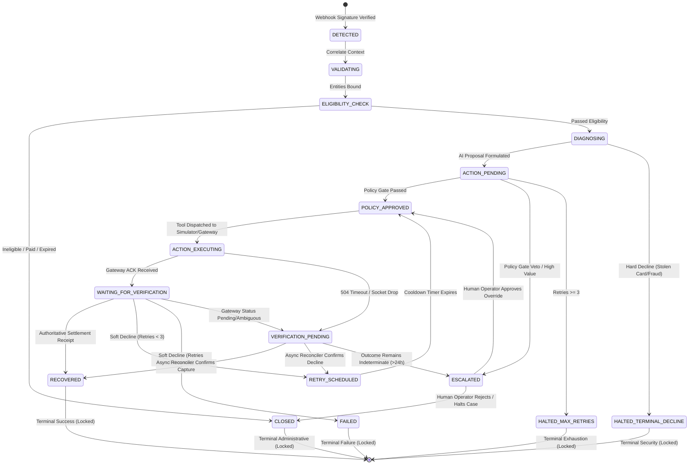

# RevenueRescueAI — Recovery State Machine Architecture & Transitions

## 1. Executive Summary & Core Invariant

The **Recovery State Machine (FSM)** is the deterministic backbone of RevenueRescueAI. In financial recovery operations, software must never allow ad-hoc or arbitrary state mutations. Every recovery episode must occupy exactly one unambiguous state at any given millisecond. 

### The Core Financial Invariant
> **"No Case Shall Ever Enter the RECOVERED State Without Cryptographically Verified External Proof."**

An AI recommendation, a policy approval, or the successful HTTP transmission of a payment retry does **NOT** equal revenue recovery. A case transitions to `RECOVERED` if and only if the Outcome Verification Service verifies an authoritative banking or gateway ledger settlement receipt matching the exact amount and currency.

---

## 2. Complete State Machine Lifecycle Diagram

The diagram below reflects the approved 14-state finite state machine governing all recovery cases.



---

## 3. Comprehensive State Transition Matrix

The table below catalogs every permitted state transition in the system. Any transition not explicitly listed in this table is strictly invalid and rejected at the database and application levels.

| # | Current State | Target State | Trigger Event | Responsible Component | Required Preconditions | Policy / Safety Checks | Database Mutation | Emitted Audit Event | Reversible? |
|---|:---|:---|:---|:---|:---|:---|:---|:---|:---|
| **T01** | `[*] (None)` | `DETECTED` | Webhook ingested | `EventIngestionFilter` | Valid HMAC signature; non-empty payload | Unique `provider_event_id` check | `INSERT INTO payment_events`, `INSERT INTO recovery_cases(state='DETECTED')` | `EVENT_INGESTED_SIGNATURE_VERIFIED` | No |
| **T02** | `DETECTED` | `VALIDATING` | Ingestion complete | `RecoveryCaseService` | Case initialized in DB | Merchant account active | `UPDATE recovery_cases SET state='VALIDATING'` | `CASE_CORRELATION_STARTED` | No |
| **T03** | `VALIDATING` | `ELIGIBILITY_CHECK` | Entity correlation succeeded | `RecoveryCaseService` | Customer & invoice resolved | Currency matches merchant standard | `UPDATE recovery_cases SET customer_id=..., invoice_id=..., state='ELIGIBILITY_CHECK'` | `ENTITIES_BOUND_TO_CASE` | No |
| **T04** | `ELIGIBILITY_CHECK` | `CLOSED` | Ineligibility detected | `EligibilityEvaluator` | Invoice already paid OR customer opted out OR >14d old | Non-eligible invariant | `UPDATE recovery_cases SET state='CLOSED', closed_at=NOW(), close_reason=...` | `CASE_CLOSED_INELIGIBLE` | No (Terminal) |
| **T05** | `ELIGIBILITY_CHECK` | `DIAGNOSING` | Eligibility verified | `EligibilityEvaluator` | Active subscription; unpaid balance; within age | Eligibility pass | `UPDATE recovery_cases SET state='DIAGNOSING'` | `CASE_ELIGIBILITY_CONFIRMED` | No |
| **T06** | `DIAGNOSING` | `HALTED_TERMINAL_DECLINE` | Hard decline identified | `DeclineClassifier` | Decline code is `stolen_card`, `lost_card`, or `fraudulent` | Fraud prevention invariant | `UPDATE recovery_cases SET state='HALTED_TERMINAL_DECLINE', closed_at=NOW()` | `CASE_HALTED_HARD_DECLINE` | No (Terminal) |
| **T07** | `DIAGNOSING` | `ACTION_PENDING` | AI proposal generated | `AIRecoveryAdvisor` | Valid LLM output or fallback rule applied | Action is in allow-listed tool enum | `INSERT INTO agent_decisions`, `UPDATE recovery_cases SET state='ACTION_PENDING'` | `AI_RECOMMENDATION_FORMULATED` | No |
| **T08** | `ACTION_PENDING` | `POLICY_APPROVED` | Policy Gate approves | `PolicyValidationEngine` | All 6 safety rules pass | Retries < 3; cooldown elapsed; quiet hours respected | `UPDATE agent_decisions SET is_policy_approved=true`, `UPDATE recovery_cases SET state='POLICY_APPROVED'` | `POLICY_GATE_PASSED` | No |
| **T09** | `ACTION_PENDING` | `ESCALATED` | Policy Gate vetoes action | `PolicyValidationEngine` | High-value case OR policy rule violated | Policy safety tripwire | `UPDATE agent_decisions SET is_policy_approved=false, rejection_reason=...`, `UPDATE recovery_cases SET state='ESCALATED'` | `POLICY_GATE_VETOED_ESCALATED` | Yes (Via human review) |
| **T10** | `ACTION_PENDING` | `HALTED_MAX_RETRIES` | Retry ceiling hit | `PolicyValidationEngine` | `case.attempt_count >= 3` | Hard retry cap invariant | `UPDATE recovery_cases SET state='HALTED_MAX_RETRIES', closed_at=NOW()` | `MAX_RETRIES_CEILING_HALT` | No (Terminal) |
| **T11** | `POLICY_APPROVED` | `ACTION_EXECUTING` | Tool dispatch initiated | `ToolExecutionRegistry` | Unique idempotency key generated | Pre-execution lock acquired | `INSERT INTO recovery_attempts(status='IN_PROGRESS')`, `UPDATE recovery_cases SET state='ACTION_EXECUTING'` | `RECOVERY_ATTEMPT_DISPATCHED` | No |
| **T12** | `ACTION_EXECUTING` | `WAITING_FOR_VERIFICATION` | Provider ACK received | `ToolExecutionRegistry` | HTTP 200 response with provider transaction ID | Valid transaction receipt structure | `UPDATE recovery_attempts SET status='ACK_RECEIVED'`, `UPDATE recovery_cases SET state='WAITING_FOR_VERIFICATION'` | `PROVIDER_EXECUTION_ACKNOWLEDGED` | No |
| **T13** | `ACTION_EXECUTING` | `VERIFICATION_PENDING` | Network timeout / drop | `ToolExecutionRegistry` | Gateway 504 Gateway Timeout or TCP socket break | Anti-blind-retry safety rule | `UPDATE recovery_attempts SET status='UNCERTAIN'`, `UPDATE recovery_cases SET state='VERIFICATION_PENDING'` | `NETWORK_TIMEOUT_OUTCOME_UNCERTAIN`| No |
| **T14** | `WAITING_FOR_VERIFICATION`| `RECOVERED` | Validated success receipt | `OutcomeVerificationService`| Provider status is `succeeded`; exact amount match; within 72h | Authoritative financial proof | `INSERT INTO recovery_evidence`, `UPDATE recovery_attempts SET status='SUCCEEDED'`, `UPDATE recovery_cases SET state='RECOVERED', recovered_amount_cents=amount_cents, closed_at=NOW()` | `REVENUE_RECOVERY_VERIFIED` | No (Terminal) |
| **T15** | `WAITING_FOR_VERIFICATION`| `RETRY_SCHEDULED` | Soft decline & budget left | `OutcomeVerificationService`| Decline code is `insufficient_funds`; `attempt_count < 3` | Backoff schedule valid | `UPDATE recovery_attempts SET status='FAILED'`, `UPDATE recovery_cases SET state='RETRY_SCHEDULED', next_retry_at=NOW() + INTERVAL '24h'` | `RETRY_SCHEDULED_SOFT_DECLINE` | No |
| **T16** | `WAITING_FOR_VERIFICATION`| `FAILED` | Soft decline & retries out | `OutcomeVerificationService`| Decline code is `insufficient_funds`; `attempt_count >= 3` | Exhaustion rule | `UPDATE recovery_attempts SET status='FAILED'`, `UPDATE recovery_cases SET state='FAILED', closed_at=NOW()` | `RECOVERY_TERMINAL_FAILURE` | No (Terminal) |
| **T17** | `WAITING_FOR_VERIFICATION`| `VERIFICATION_PENDING` | Ambiguous gateway status | `OutcomeVerificationService`| Provider returns `pending` or `processing` | Financial certainty invariant | `UPDATE recovery_cases SET state='VERIFICATION_PENDING'` | `GATEWAY_PENDING_OUTCOME_UNCERTAIN`| No |
| **T18** | `VERIFICATION_PENDING` | `RECOVERED` | Reconciliation capture | `VerificationReconciliationWorker` | Provider charge query returns `status = 'succeeded'` | Verified settlement proof | `INSERT INTO recovery_evidence`, `UPDATE recovery_cases SET state='RECOVERED', recovered_amount_cents=amount_cents, closed_at=NOW()` | `RECONCILIATION_VERIFIED_SUCCESS` | No (Terminal) |
| **T19** | `VERIFICATION_PENDING` | `RETRY_SCHEDULED` | Reconciliation decline | `VerificationReconciliationWorker` | Provider charge query returns `status = 'failed'`; retries < 3 | Backoff rule | `UPDATE recovery_cases SET state='RETRY_SCHEDULED', next_retry_at=...` | `RECONCILIATION_VERIFIED_DECLINE` | No |
| **T20** | `VERIFICATION_PENDING` | `ESCALATED` | Reconciliation timeout | `VerificationReconciliationWorker` | Provider charge status remains unknown for > 24 hours | Stale investigation tripwire | `UPDATE recovery_cases SET state='ESCALATED'` | `RECONCILIATION_STALE_ESCALATED` | Yes (Via human review) |
| **T21** | `RETRY_SCHEDULED` | `POLICY_APPROVED` | Timer expiry | `SchedulerWorker` | `NOW() >= case.next_retry_at` | Safety rules re-evaluated | `UPDATE recovery_cases SET state='POLICY_APPROVED'` | `SCHEDULED_TIMER_TRIGGERED` | No |
| **T22** | `ESCALATED` | `POLICY_APPROVED` | Operator manual approval | `AdminCaseReviewController` | Operator provides valid JWT with `CASE_OVERRIDE` role | Operator override logged | `UPDATE recovery_cases SET state='POLICY_APPROVED'` | `OPERATOR_OVERRIDE_APPROVED` | No |
| **T23** | `ESCALATED` | `CLOSED` | Operator manual dismissal| `AdminCaseReviewController` | Operator selects dismiss/halt | Valid dismissal rationale provided | `UPDATE recovery_cases SET state='CLOSED', closed_at=NOW(), close_reason=...` | `OPERATOR_DISMISSED_CASE` | No (Terminal) |

---

## 4. Catalog of Explicitly Invalid Transitions

To prevent catastrophic financial errors, the database layer (via SQL `CHECK` constraints or ORM lifecycle hooks) and domain service layers must reject the following illegal transitions:

| Invalid Transition Attempt | Why It Is Strictly Prohibited | System Protection Level |
| :--- | :--- | :--- |
| `DETECTED` → `RECOVERED` | Bypasses all validation, AI diagnosis, policy gates, and payment execution. Completely fraudulent. | Database constraint & Domain Exception |
| `ACTION_PENDING` → `ACTION_EXECUTING` | Bypasses the Policy Gate. The AI cannot execute tools without deterministic approval. | Domain Rule Violation (`PolicyGateBypassedError`) |
| `ACTION_EXECUTING` → `RECOVERED` | Bypasses verification. A payment call returning HTTP 200 is only an ACK; it requires ledger verification. | Domain Rule Violation (`UnverifiedAttributionError`) |
| `RECOVERED` → `*` (Any State) | `RECOVERED` is a terminal financial state. Once money is verified as recovered, the case is sealed. | Database Terminal Lock (`ImmutableTerminalStateError`) |
| `CLOSED` → `ACTION_EXECUTING` | Attempting to charge a customer after a case is closed violates payment network agreements and card scheme rules. | Database Terminal Lock |
| `FAILED` → `RETRY_SCHEDULED` | Once retries are exhausted and terminal failure declared, automatic re-opening is prohibited. | Domain Rule Violation |
| `VERIFICATION_PENDING` → `ACTION_EXECUTING` | Cannot retry an operation whose previous status is still unknown (prevents double charging). | Safety Invariant Lock (`ConcurrentAttemptLockedError`) |

---

## 5. Terminal State Invariant Enforcement

When a recovery case enters any of the **5 Terminal States**:
1. `RECOVERED` (Verified recovered revenue)
2. `FAILED` (Failed after exhausting all retry budgets)
3. `CLOSED` (Administrative close, duplicate, or ineligible)
4. `HALTED_TERMINAL_DECLINE` (Hard decline, lost/stolen card)
5. `HALTED_MAX_RETRIES` (Reached ceiling of 3 attempts)

The database sets `closed_at = CURRENT_TIMESTAMP`. A database trigger enforces that any subsequent `UPDATE` statement attempting to alter the `state` column throws a SQL exception:
```sql
CREATE OR REPLACE FUNCTION enforce_terminal_state_lock()
RETURNS TRIGGER AS $$
BEGIN
    IF OLD.state IN ('RECOVERED', 'FAILED', 'CLOSED', 'HALTED_TERMINAL_DECLINE', 'HALTED_MAX_RETRIES') THEN
        RAISE EXCEPTION 'Financial Safety Violation: Cannot mutate recovery case % in terminal state %', OLD.id, OLD.state;
    END IF;
    RETURN NEW;
END;
$$ LANGUAGE plpgsql;
```
This guarantees mathematical certainty that closed financial records remain permanent and tamper-proof.
