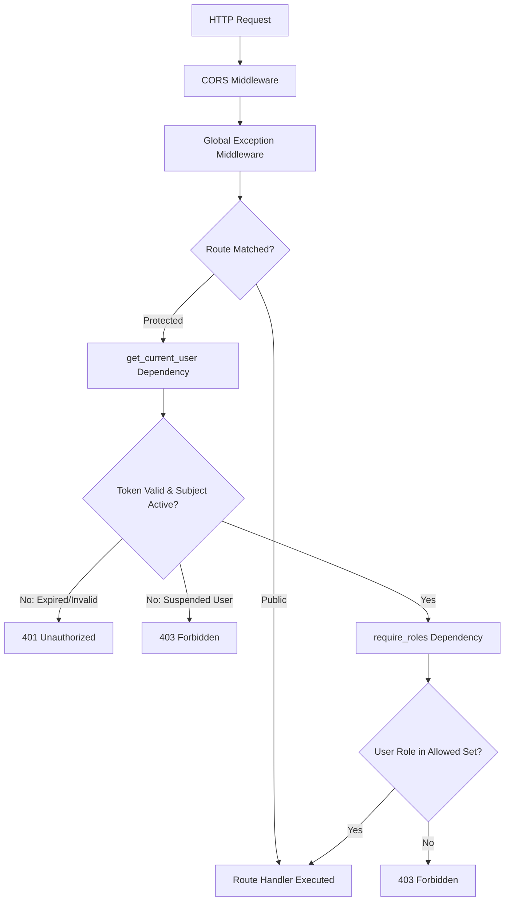

# Security Configuration — RevenueRescueAI

## 1. Overview and Security Architecture

RevenueRescueAI establishes a defense-in-depth security perimeter using FastAPI middleware, dependency injection guards, and strict HTTP transport controls.

The configuration enforces:
- Explicit Cross-Origin Resource Sharing (CORS) rules.
- Stateless, CSRF-immune bearer token authentication.
- Centralized exception mapping adhering to the standard error contract.
- Role-based authorization filters denying access by default.

---

## 2. CORS (Cross-Origin Resource Sharing) Configuration

Configured in [app/main.py](file:///c:/Users/vanka/Downloads/RevenueRescueAI-main/RevenueRescueAI-main/backend/app/main.py):

```python
app.add_middleware(
    CORSMiddleware,
    allow_origins=settings.CORS_ORIGINS,  # ["http://localhost:3000", "http://127.0.0.1:3000"]
    allow_credentials=True,
    allow_methods=["GET", "POST", "PUT", "PATCH", "DELETE", "OPTIONS"],
    allow_headers=["*"],
)
```

### Security Considerations:
- **No Wildcard Origins:** Wildcards (`*`) with `allow_credentials=True` are explicitly rejected by browsers and forbidden in this configuration. Only vetted frontend domains (e.g. `localhost:3000` in development, production domain in production) are permitted.
- **Preflight Support:** HTTP `OPTIONS` requests are handled automatically, validating requested headers and methods before allowing cross-origin calls.

---

## 3. CSRF (Cross-Site Request Forgery) Policy

### Analysis:
- Traditional CSRF vulnerabilities occur when browsers automatically attach ambient credentials (such as session cookies or HTTP Basic Auth headers) to cross-site requests initiated by malicious third-party origins.
- RevenueRescueAI uses **Stateless Bearer Tokens (`Authorization: Bearer <JWT>`)**.
- Browsers **do not** automatically append `Authorization` headers to cross-site requests (e.g., from `<form>` submissions or image tags). The frontend script must deliberately read the token from application memory and inject the header into `fetch()` or `axios`.
- **Verdict:** Because the platform relies on explicit `Authorization` headers rather than ambient cookies for MVP API transactions, it is inherently immune to standard CSRF attacks, and a CSRF token filter is not required.

---

## 4. Endpoint Protection Classification

Every API route is classified into one of four security zones:

| Zone | Authentication | Permitted Roles | Target Routes |
| :--- | :--- | :--- | :--- |
| **Public / Unauthenticated** | None | Public | `GET /api/v1/health`<br/>`POST /api/v1/auth/register`<br/>`POST /api/v1/auth/login`<br/>`POST /api/v1/auth/refresh`<br/>`POST /api/v1/auth/logout` |
| **Authenticated (General)** | Valid Bearer JWT | Any authenticated role | `GET /api/v1/auth/me`<br/>`PATCH /api/v1/auth/me`<br/>`POST /api/v1/auth/change-password` |
| **Role-Restricted (Operator)**| Valid Bearer JWT | `ROLE_OPERATOR`, `ROLE_ADMIN` | Recovery workflow APIs, case management (Phases 2.5+) |
| **Role-Restricted (Admin)** | Valid Bearer JWT | `ROLE_ADMIN` strictly | `GET /api/v1/users`<br/>`PATCH /api/v1/users/{id}/role`<br/>`PATCH /api/v1/users/{id}/status` |

---

## 5. Security Filter Pipeline / Dependency Injection

FastAPI evaluates endpoint guards in a deterministic execution chain:



### Defense by Default:
All routes under `/api/v1/users` explicitly require `require_admin`. Any missing or invalid authorization header immediately halts execution at the dependency boundary before invoking service or database layers.
