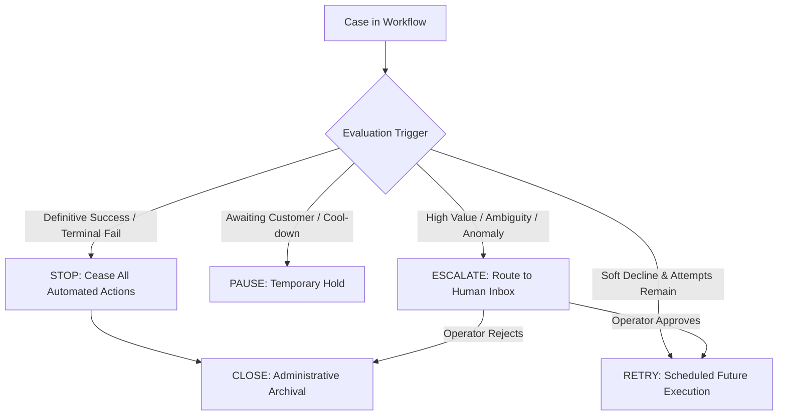

# RevenueRescueAI — Stopping, Escalation, and Operational Disposition Policy

> **Document ID:** DOC-POL-003  
> **Phase:** 0.3 (Metrics Finalization, Safety Invariants & MVP Approval)  
> **Status:** Approved Baseline  
> **Audience:** Product Engineering, Architecture, QA, Security, Beginner Developers  

---

## 1. Executive Summary

A critical weakness in naive automated recovery agents is the absence of rigorous stopping rules. When an automation engine does not know when to stop, it creates infinite retry storms, pesters opted-out customers, and wastes computational and financial resources. Conversely, when an engine cannot distinguish between a temporary pause, an escalation to human review, and permanent case closure, operational workflows become chaotic.

This document establishes the formal Stopping and Escalation Policy for RevenueRescueAI. It explicitly defines the boundaries between five core operational dispositions (STOP, PAUSE, RETRY, ESCALATE, CLOSE) and provides a comprehensive specification across eleven operational stopping conditions.

---

## 2. Disambiguation of the Five Operational Dispositions

To prevent operational ambiguity, the system enforces strict semantic separation across these five terms:

| Operational Disposition | Definition & Meaning | Action Permitted? | Resumable? | Human Required? |
|---|---|:---:|:---:|:---:|
| **STOP** | Immediate, permanent termination of automated recovery actions due to definitive success, hard decline, budget exhaustion, or window expiration. | **NO** | Only under exceptional manual review | No |
| **PAUSE** | Temporary suspension of automated actions while waiting for an external event (e.g., customer updating expired card, cool-down window). | **NO (Frozen)**| **YES (Auto-resumes on event)** | No |
| **RETRY** | Automated scheduling of a subsequent payment attempt under deterministic backoff rules (>= 24 hours). | **YES (Scheduled)**| Active in scheduler | No |
| **ESCALATE** | Removal of case from autonomous automation and routing to the Human Recovery Operator queue for manual investigation. | **NO (Human only)**| **YES (Upon human approval)** | **YES (Mandatory)** |
| **CLOSE** | Final administrative and accounting state marking the conclusion of the case lifecycle. Archived for compliance audit. | **NO (Terminal)** | **NO (Permanent Sink)** | No |

---

## 3. Comprehensive Stopping Conditions Matrix (11 Conditions)

The following matrix governs system behavior across all critical operational stopping and escalation triggers:

| # | Triggering Condition | Expected Workflow State | Action Permitted? | Human Required? | Verification Needed? | Required Audit Event | Reopenability Rules |
|---|---|---|:---:|:---:|:---:|---|---|
| **1** | **Payment Confirmed Successful** | `RECOVERED` | **NO** | No | Yes (Receipt Verified) | `SETTLEMENT_VERIFIED` | **NEVER.** Terminal state lock. |
| **2** | **Payment Outcome Uncertain / Timeout**| `VERIFICATION_PENDING` | **NO (Frozen)** | Yes (If reconciliation fails)| **YES (Mandatory Inquiry)**| `GATEWAY_TIMEOUT_PENDING` | Auto-resumes upon reconciliation; escalates after 3 failed polls. |
| **3** | **Retry Budget Exhausted (3 Attempts)** | `HALTED_MAX_RETRIES` | **NO** | Optional (Review only) | No | `RETRY_BUDGET_EXHAUSTED` | Can be reopened once by operator with verified new payment token. |
| **4** | **Recovery Window Expired (14 Days)** | `HALTED_EXPIRED` | **NO** | No | No | `RECOVERY_WINDOW_EXPIRED` | **NEVER.** Expired past statutory dunning window. |
| **5** | **Customer Opt-Out Active** | `COMMUNICATION_SUPPRESSED`| Silent Retry Only | No | No | `COMMUNICATION_SUPPRESSED` | Reopens notifications only if customer explicitly re-opts in. |
| **6** | **Customer Metadata Unavailable** | `VALIDATING_PENDING` | **NO (Frozen)** | Yes (Data triage) | No | `METADATA_UNAVAILABLE_HOLD` | Resumes automatically once customer metadata syncs. |
| **7** | **Invalid Payment / Card Information** | `HALTED_TERMINAL_DECLINE`| **NO** | No | No | `HARD_DECLINE_TERMINATED` | Reopens only if customer attaches a brand new payment method. |
| **8** | **Provider Unavailable (5xx Outage)** | `RETRY_SCHEDULED` | **NO (Queued)** | No (Unless outage > 24h)| No | `PROVIDER_OUTAGE_BACKOFF` | Resumes automatically via exponential backoff queue. |
| **9** | **AI Decision Unavailable / Invalid** | `FALLBACK_RULE_APPLIED` | **YES (Rule-based)**| No | No | `MODEL_FALLBACK_APPLIED` | Transparently transitions to deterministic rule execution. |
| **10**| **High-Value Exposure (>= $1,000)** | `ESCALATED_HUMAN_REVIEW` | **NO (Operator only)**| **YES (Mandatory)** | No | `HIGH_VALUE_ESCALATED` | Resumes upon operator click "Approve Retry" or "Halt Case". |
| **11**| **Case Manually Closed by Operator** | `CLOSED` | **NO** | Yes (Operator action) | No | `OPERATOR_MANUAL_CLOSE` | **NEVER.** Explicit operator administrative sink. |

---

## 4. Detailed Specification of Critical Stopping Behaviors

---

### Condition 1: Payment Confirmed Successful (Terminal Stopping)
- **Operational Trigger:** Outcome Verifier validates an authoritative provider receipt with `status: "succeeded"`.
- **System Behavior:**
  1. Case transitions immediately to state `RECOVERED`.
  2. All scheduled retry cron jobs and dunning reminders associated with `case_id` are canceled in the scheduler.
  3. The authoritative invoice status in the billing ledger is updated to `PAID`.
  4. The terminal state lock is applied: the case can never transition to an active recovery state again (INV-001, INV-007).
  5. Confirmed Recovered Revenue metrics are incremented.
- **Audit Logging:** Emits `SETTLEMENT_VERIFIED` with transaction ID, amount, and provider timestamp.
- **Reopenability:** Strictly prohibited.

---

### Condition 2: Payment Outcome Uncertain (Timeout Freeze)
- **Operational Trigger:** Network socket drop, client timeout, or gateway HTTP 504 during tool dispatch.
- **System Behavior:**
  1. Outcome Verifier flags outcome as `UNCERTAIN`.
  2. Case transitions to `VERIFICATION_PENDING`.
  3. Automated actions are strictly frozen; attempt counter is **not** incremented.
  4. An asynchronous reconciliation job is scheduled for 15 minutes later.
  5. The reconciliation job queries the provider ledger using the unique idempotency key.
     - *If provider confirms charge succeeded:* Transitions to `RECOVERED`.
     - *If provider confirms charge failed:* Transitions to `RETRY_SCHEDULED`.
     - *If provider remains ambiguous after 3 reconciliation attempts:* Transitions to `ESCALATED_HUMAN_REVIEW`.
- **Audit Logging:** Emits `GATEWAY_TIMEOUT_PENDING` and subsequent `RECONCILIATION_ATTEMPT`.
- **Reopenability:** Self-resolving through automated reconciliation.

---

### Condition 3: Retry Budget Exhausted (Operational Halt)
- **Operational Trigger:** Attempt counter reaches 3 and the third attempt returns a soft decline.
- **System Behavior:**
  1. Workflow increments counter to 3.
  2. Policy Gate evaluates rule `attempt_count >= 3`.
  3. Case transitions to `HALTED_MAX_RETRIES`.
  4. Automated tool dispatch is disabled permanently.
  5. Invoice ledger marks case as `UNCOLLECTIBLE_MAX_RETRIES`.
- **Audit Logging:** Emits `RETRY_BUDGET_EXHAUSTED` with failure history.
- **Reopenability:** A human Recovery Operator may manually authorize an exception attempt if the customer explicitly contacts support and requests a final retry.

---

### Condition 10: High-Value Exposure Escalation (Human-in-the-Loop)
- **Operational Trigger:** Nominal revenue at risk >= 100,000 minor units ($1,000.00) or AI diagnostic confidence score < 0.60.
- **System Behavior:**
  1. Policy Gate intercepts case prior to tool execution.
  2. Autonomous dispatch is blocked in code.
  3. Case state transitions to `ESCALATED_HUMAN_REVIEW`.
  4. Case is inserted into the Operator Escalation Inbox in the dashboard.
  5. Workflow engine waits passively for an operator mutation:
     - *Operator clicks "Approve Retry":* Case transitions to `POLICY_APPROVED` and dispatches via simulator.
     - *Operator clicks "Halt Recovery":* Case transitions to `CLOSED`.
- **Audit Logging:** Emits `HIGH_VALUE_ESCALATED` and subsequent `OPERATOR_RESOLUTION_LOGGED` with `operator_id`.
- **Reopenability:** Governed by operator action.
