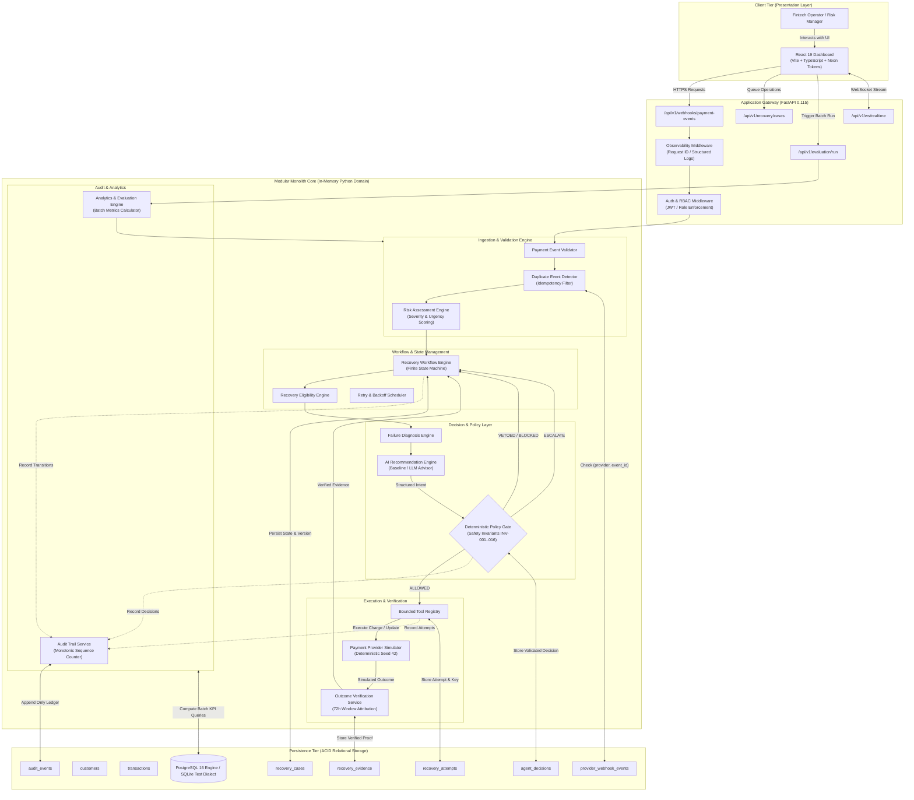
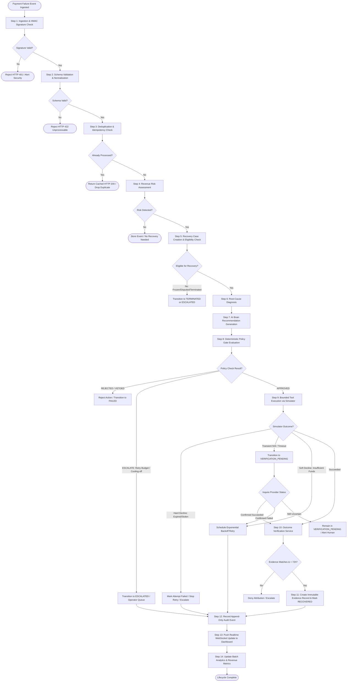
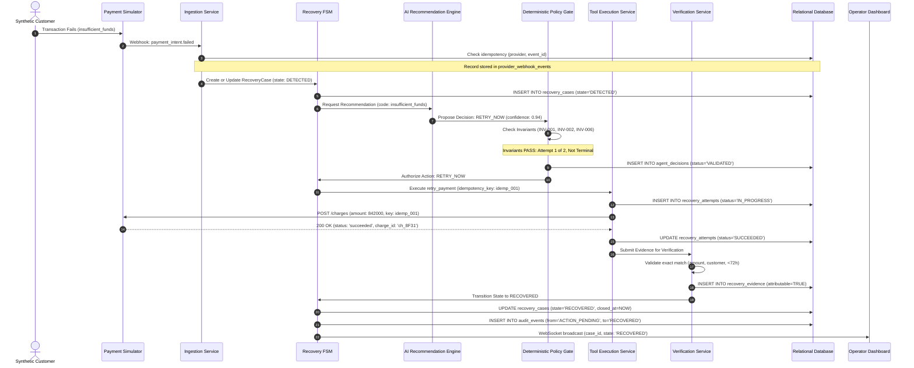
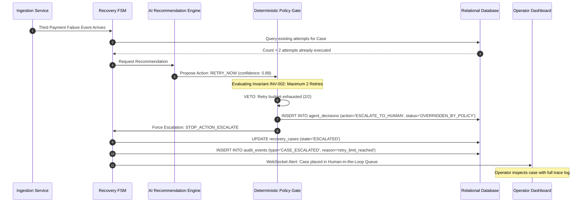
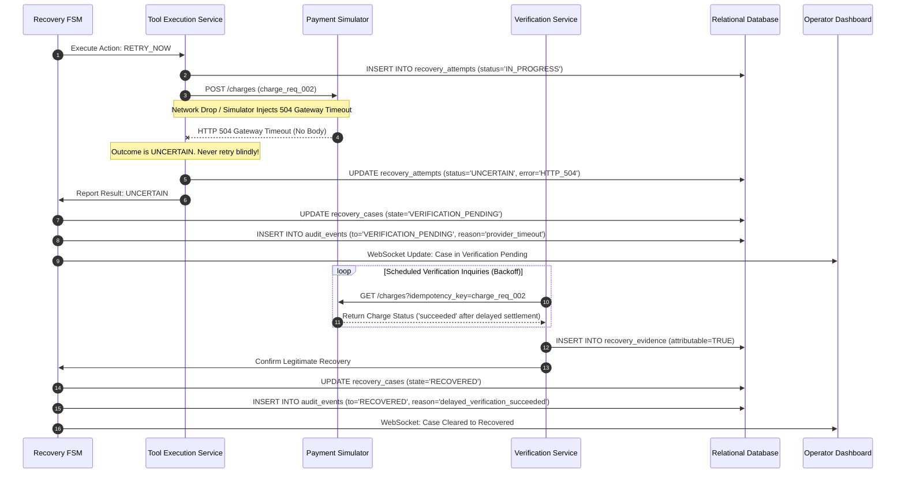

# RevenueRescueAI — System Architecture Diagrams
## Phase 1.1: Visual Architecture, Data Flows, and Sequence Models

**Document Version:** 1.0.0  
**Status:** Approved Architectural Diagrams  
**Format:** GitHub Flavored Markdown with Native Mermaid Syntax  

---

## 1. High-Level System Architecture Diagram

This diagram visualizes the modular monolith architecture of RevenueRescueAI, showing the flow of control from the user interface down through the API gateway, core processing engines, policy security boundary, and the persistent relational database ledger.

---

## 2. End-to-End Data Flow Diagram

This flow diagram illustrates the end-to-end journey of an at-risk payment transaction through every processing stage, showing normal recovery, policy veto, provider timeout, and compliant escalation paths.

---

## 3. Sequence Diagrams: Critical Interaction Flows

### 3.1 Normal Recovery Flow (Soft Decline with Successful Recovery)

### 3.2 Safety Escalation Flow (Retry Budget Exceeded — INV-002)

### 3.3 Uncertain Outcome & Verification Handshake (Timeout — INV-008)

---

## 4. Deployment Architecture

This diagram contrasts the local development environment against the containerized production deployment topology.

```mermaid
graph TB
    subgraph LocalDev["Local Development Environment"]
        ViteDev["Vite Dev Server (Port 5173)\nReact 19 + HMR"]
        UvicornDev["Uvicorn ASGI Server (Port 8000)\nFastAPI Application with Reload"]
        SQLiteDB[("SQLite Database File\n(revenuerescue.db)\nFK Enforced & Thread-Safe")]
        InMemSim["In-Memory Payment Simulator\nDeterministic Seed 42"]

        ViteDev <-->|"Proxy /ws & /api"| UvicornDev
        UvicornDev <-->|"SQLAlchemy 2.0 Sessions"| SQLiteDB
        UvicornDev <-->|"In-Memory Function Calls"| InMemSim
    end

    subgraph ProductionDeployment["Production / Staging Container Architecture"]
        subgraph Internet["Public Ingress"]
            ClientBrowser["Client Browser / Mobile"]
            ProviderWebhook["Payment Gateway Webhook"]
        end

        subgraph ReverseProxy["Ingress Tier (Nginx / Cloudflare)"]
            Nginx["Nginx Reverse Proxy & SSL Termination\nRate Limiting & Static Asset Hosting"]
        end

        subgraph ContainerCluster["Docker Container Network"]
            BackendApp["FastAPI ASGI Container (Gunicorn + Uvicorn Workers)\nStateless Modular Monolith"]
            PostgresContainer[("PostgreSQL 16 Alpine Container\n(Persistent Volume: postgres-data)\nStrict Schema Constraints & Indexes")]
        end

        subgraph ExternalAPIs["External AI Provider (Optional)"]
            OpenAIAPI["OpenAI API (GPT-4o-mini)\nStrict JSON Schema Contract\nZero PCI / Masked Metadata"]
        end

        ClientBrowser -->|"HTTPS (Port 443)"| Nginx
        ProviderWebhook -->|"HTTPS Webhook POST"| Nginx
        Nginx -->|"Serve Precompiled SPA"| ClientBrowser
        Nginx -->|"Proxy API & WebSocket (Port 8000)"| BackendApp
        BackendApp <-->|"psycopg 3 Connection Pool"| PostgresContainer
        BackendApp -.->|"HTTPS Structured Advice (Optional)"| OpenAIAPI
    end
```

