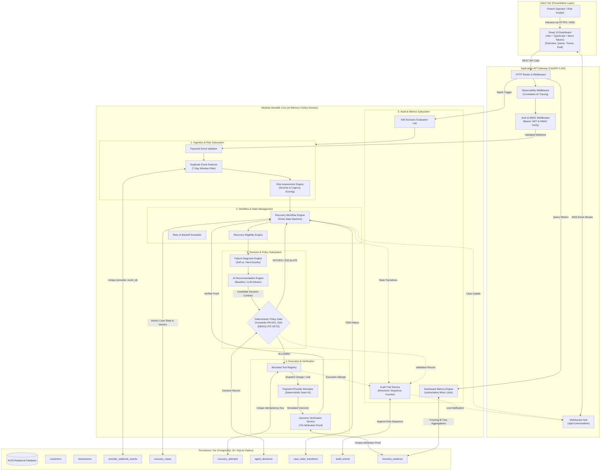

# RevenueRescueAI — Consolidated System Architecture Overview
## Phase 1.4: System Architecture Validation and End-to-End Component Topology

**Document Version:** 1.0.0  
**Status:** Approved Architectural Blueprint  
**Primary Authors:** Senior Software Architect, System Designer, Technical Reviewer  
**Target Audience:** Engineering Team, System Architects, Technical Interviewers, Novice Developers  

---

## 1. Executive Summary & Core Architectural Paradigm

RevenueRescueAI is an autonomous, bounded, and auditable revenue recovery platform designed to detect payment failures in subscription and transactional commerce, diagnose root causes, recommend recovery actions, strictly enforce financial safety invariants, and verify recovery outcomes.

The platform is designed around the architectural doctrine of **Deterministic Policy Supremacy with Zero-Trust AI Intelligence**:
- **The AI Recommends; It Never Executes:** The AI agent is an untrusted external reasoning component that outputs structured candidate intent. It possesses zero execution permissions and zero tool-calling authority.
- **The Policy Engine Holds Absolute Veto Power:** Deterministic Python business rules validate all actions against hardcoded safety invariants (INV-001 through INV-016), retry budgets (max 2 retries), and customer cooling-off periods before any financial tool can be touched.
- **Execution is Strictly Bounded and Idempotent:** Every recovery action against the payment simulator carries a deterministic, unique `Idempotency-Key` preventing duplicate charges.
- **Outcomes Require Hard Verification:** A case cannot transition to `RECOVERED` based on optimistic expectations; it requires matching transaction evidence settled within 72 hours.
- **Single Deployable Modular Monolith:** Packaged into cleanly segregated internal domain modules running in one process with atomic ACID database transactions, avoiding the network latency and distributed transaction hazards of premature microservices.

---

## 2. Consolidated System Architecture Diagram

The following Mermaid diagram visualizes the complete end-to-end topology of RevenueRescueAI, showing communication paths between user actors, client applications, API gateways, internal engines, policy gates, persistent storage, and the payment simulator.

---

## 3. Communication Patterns & Information Flow

The architecture defines six explicit communication streams:

| Stream Type | Origin $\to$ Destination | Communication Style | Protocol | Guarantees |
| :--- | :--- | :--- | :--- | :--- |
| **User Requests** | Operator $\to$ Frontend $\to$ Backend | Request-Response | HTTPS REST | TLS 1.3, Bearer JWT Auth, Idempotency-Key on POSTs |
| **Realtime Push**| Backend $\to$ Frontend Dashboard | Persistent Streaming | WSS WebSocket | Low-latency updates (<100ms), automatic backoff reconnect |
| **Internal Domain**| Router $\to$ Services $\to$ Policy $\to$ FSM | In-Memory Function Calls | Python Native Types | Sub-millisecond latency, zero serialization, typed contracts |
| **Database Operations**| Domain Repositories $\to$ Database | Transactional Queries | psycopg / SQLAlchemy | ACID transactions, row-level locking, foreign key integrity |
| **AI Intelligence**| Diagnosis $\to$ AI Engine $\to$ Policy Gate | Structured JSON Contract | Pydantic Schema | Zero execution privileges; pure intent proposal |
| **External Simulation**| Tool Registry $\to$ Payment Simulator | Emulated Banking Rails | In-Memory Adapter | Deterministic Seed 42, fault injection, idempotency cache |

---

## 4. Component Responsibility Breakdown

1. **Frontend Dashboard:** Renders the dark neon fintech interface, symmetrical 152px KPI cards, recovery queues, and agent journey timelines. Never computes authoritative metrics locally.
2. **Backend API Gateway:** Validates request formats, enforces authentication/RBAC, extracts correlation IDs, formats RFC 7807 error envelopes, and terminates TLS.
3. **Ingestion & Deduplication:** Catches inbound webhooks, verifies HMAC signatures, checks 7-day deduplication windows via `uq_provider_event`, and logs receipts.
4. **Revenue Risk Engine:** Evaluates transaction amounts and decline codes to score urgency and calculate at-risk minor units.
5. **AI Recommendation Engine:** Generates candidate decision proposals using the deterministic baseline or an external LLM advisor.
6. **Deterministic Policy Gate:** Holds supreme authority over execution. Evaluates Invariants INV-001 through INV-016 and vetoes unauthorized actions.
7. **Recovery Workflow Engine (FSM):** Manages atomic lifecycle transitions across nine explicit case states with monotonic sequence numbering and optimistic concurrency versioning.
8. **Payment Provider Simulator:** Emulates card charges, soft/hard declines, and network timeouts with 100% reproducible outcomes under Seed 42.
9. **Outcome Verification Service:** Proves legitimate recovery attribution against matching evidence within 72 hours before cases can transition to `RECOVERED`.
10. **Audit Service:** Maintains a permanent, append-only chronological event ledger with monotonically increasing sequence numbers and zero update/delete permissions.
11. **Dashboard Metrics Service:** Computes authoritative financial KPIs directly from the relational database using exact integer minor units.
