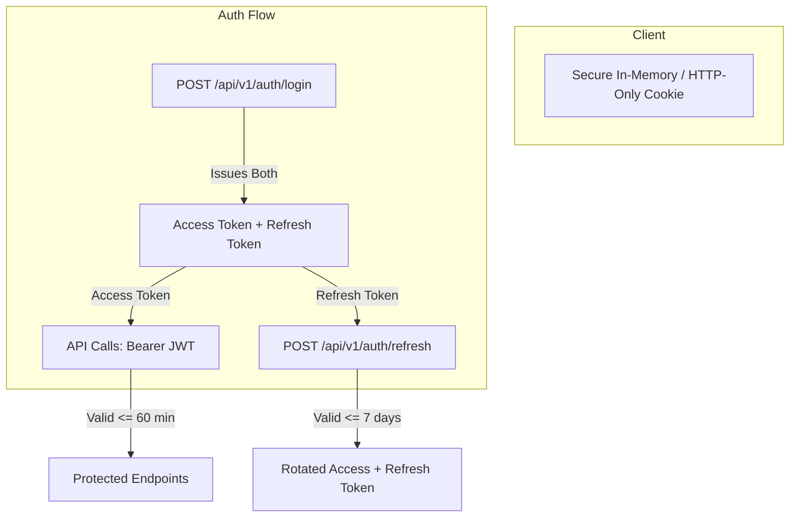

# Token and Session Lifecycle — RevenueRescueAI

## 1. Overview

RevenueRescueAI uses stateless JSON Web Token (JWT) bearer authentication for API operations. Stateless tokens eliminate server-side session state bottlenecks, support clean decoupling between frontend clients and backend microservices, and enable fine-grained Role-Based Access Control (RBAC).

---

## 2. Token Architecture and Specifications

Dual-token architecture is employed to balance user convenience with tight security windows:

### 2.1 Access Token Specifications
- **Type:** Bearer JWT (RFC 7519)
- **Signature Algorithm:** HMAC-SHA256 (`HS256`)
- **TTL (Time-to-Live):** 60 minutes (`ACCESS_TOKEN_EXPIRE_MINUTES = 60`)
- **Claims Structure:**
  - `sub`: User ID (`UUID` v4 string)
  - `email`: Normalized user email address
  - `role`: Role string (`ROLE_ADMIN`, `ROLE_OPERATOR`, `ROLE_AUDITOR`, `ROLE_INGESTOR`)
  - `token_type`: `"access"`
  - `jti`: Unique JWT ID (`UUID` v4 string) preventing token collision within identical second timestamps
  - `exp`: Expiration timestamp (UTC epoch seconds)
  - `iat`: Issued-at timestamp (UTC epoch seconds)

### 2.2 Refresh Token Specifications
- **Type:** Bearer JWT
- **Signature Algorithm:** HMAC-SHA256 (`HS256`)
- **TTL (Time-to-Live):** 7 days (`REFRESH_TOKEN_EXPIRE_DAYS = 7`)
- **Claims Structure:**
  - `sub`: User ID (`UUID` v4 string)
  - `token_type`: `"refresh"`
  - `jti`: Unique JWT ID (`UUID` v4 string)
  - `exp`: Expiration timestamp (UTC epoch seconds)
  - `iat`: Issued-at timestamp (UTC epoch seconds)

---

## 3. Token Lifecycle Sequence

### 3.1 Initial Login
1. Client submits credentials to `POST /api/v1/auth/login`.
2. Backend verifies credentials against database hash using BCrypt.
3. Backend verifies user account is `UserStatus.ACTIVE`.
4. Backend issues:
   - `access_token` (expires in 60 min)
   - `refresh_token` (expires in 7 days)
   - `token_type`: `"bearer"`
   - `expires_in`: `3600` (seconds)

### 3.2 Authenticated Request Flow
1. Client adds header: `Authorization: Bearer <access_token>`.
2. Backend dependency `get_current_user` extracts and cryptographically validates the token:
   - Verifies signature using server secret key.
   - Validates `exp > now`.
   - Validates `token_type == "access"`.
   - Verifies subject user exists in database and has status `ACTIVE`.
3. Injects authenticated `User` entity into endpoint parameter.

### 3.3 Token Refresh Flow (Sliding Session)
1. When access token expires (or prior to expiry), client submits refresh token to `POST /api/v1/auth/refresh`.
2. Backend validates signature, expiration, and ensures `token_type == "refresh"`.
3. Backend fetches user and verifies `ACTIVE` status.
4. Backend issues a fresh `access_token` AND a new `refresh_token` (refresh token rotation).

### 3.4 Logout Flow
1. Client sends `POST /api/v1/auth/logout`.
2. In stateless JWT authentication, the client discards the stored access and refresh tokens.
3. Backend returns `HTTP 200 OK` with `{"message": "Logged out successfully"}`.
4. For high-assurance environments, a Redis token blacklist or token version counter in the `users` table may be integrated in subsequent phases for immediate revocation prior to natural expiration.

---

## 4. Key Rotation & Security Guidelines

1. **Secret Key Management:** The JWT signing key is injected via the `JWT_SECRET_KEY` environment variable. In production, this must be a cryptographically random 256-bit key generated via `openssl rand -hex 32`.
2. **Protection Against Token Storage Attacks:**
   - On web clients, tokens should ideally be placed in memory (e.g. React application state) with refresh tokens held in `HttpOnly`, `Secure`, `SameSite=Strict` cookies.
   - Bearer tokens must never be appended to URL query parameters where they could be recorded in browser histories, proxy logs, or Referer headers.
3. **Defense Against Algorithm Confusion:** The decoding function explicitly specifies `algorithms=["HS256"]`, defeating attacks where malicious tokens specify `alg: "none"` or RSA public keys.
