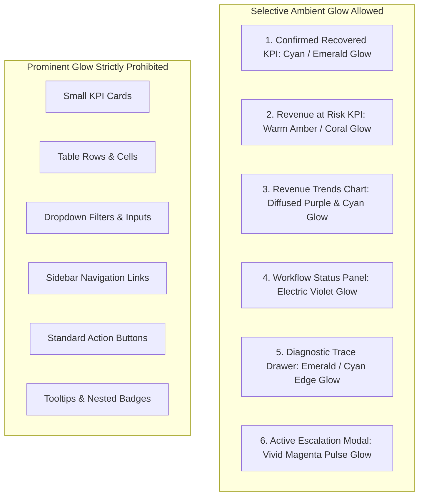

# RevenueRescueAI — Premium UI/UX Design Specification: Dark Neon Fintech Command Center

> **Document ID:** DOC-UIR-003  
> **Phase:** 0.3 (Metrics Finalization, Safety Invariants & MVP Approval)  
> **Status:** Approved Baseline  
> **Audience:** Product Engineering, Frontend Architecture, UI/UX Designers, Beginner Developers  

---

## 1. Executive Summary & Design Vision

The user experience of RevenueRescueAI must evoke the feeling of entering a high-security, mission-critical **Fintech Command Center in 2030**. A financial recovery operator monitoring millions of dollars in uncollected cash flow does not want a generic, cookie-cutter SaaS template or an ordinary collection of unstyled white boxes; they require an interface that is visually stunning, impeccably symmetrical, and ergonomically engineered for high-density financial data comprehension.

This document establishes the definitive UI/UX Design Specification for RevenueRescueAI. It translates the design guidance from reference mockups into strict engineering rules for layout symmetry, elevation depth, selective multi-colour ambient glow, typography scales, responsive behaviors, and chart visualization standards.

*(Note: This is an exhaustive design specification for frontend engineers. No UI components are implemented in this phase.)*

---

## 2. Overall Design Identity & Aesthetic Foundation

```text
+------------------------------------------------------------------------+
| DESIGN IDENTITY ATTRIBUTES:                                            |
| - Atmosphere:       Futuristic, Intelligent, Mission-Critical, Trustworthy|
| - Visual Tone:      Dark Neon Command Center with Restrained Elegance  |
| - Polish Level:     Enterprise-Grade Symmetrical Alignment             |
| - Data Density:     High Information Density with Generous Whitespace  |
+------------------------------------------------------------------------+
| CORE COLOR PALETTE:                                                    |
| - Canvas Base:      Deep Void Black             (#06090E)              |
| - Primary Surface:  Deep Midnight Navy          (#0B0F19)              |
| - Elevated Cards:   Rich Dark Charcoal / Slate  (#111827)              |
| - Table Alternate:  Obsidian Charcoal           (#0E1420)              |
| - Accent Primary:   Electric Cyan               (#06B6D4 / #22D3EE)    |
| - Accent Secondary: Royal Blue                  (#3B82F6 / #60A5FA)    |
| - Intelligence Glow:Vivid Purple                (#A855F7)              |
| - Escalation Alert: High-Contrast Magenta       (#EC4899)              |
| - Financial Win:    Emerald Green               (#10B981)              |
| - Financial Risk:   Amber / Warm Coral          (#F59E0B / #F97316)    |
| - Terminal Stop:    Crimson Rose                (#F43F5E)              |
+------------------------------------------------------------------------+
```

### Aesthetic Philosophy
The visual direction balances **futuristic aesthetic excitement** with **fintech credibility**:
1. **Intelligent and Professional:** Vibrant neon accents are used as purposeful data signals, not chaotic decorations.
2. **Financially Trustworthy:** Financial figures are rendered in crisp, high-contrast monospace tabular typography that inspires total accounting confidence.
3. **Ergonomically Balanced:** Layout dimensions, margins, and gutters follow an unyielding mathematical grid, ensuring total visual harmony.

---

## 3. Layout Symmetry, Grid Architecture, and Proportions

A strict, symmetrical layout hierarchy eliminates visual friction. Every component adheres to an 8-point spatial grid system.

```mermaid
graph TD
    subgraph Master Application Shell [Max Width: 1600px Centered]
        SIDEBAR[Fixed Sidebar: 260px] --- TOPNAV[Fixed Header: 64px Height]
        TOPNAV --- CONTENT[Main Content Canvas: Padding 32px]
        
        subgraph Symmetrical Content Canvas
            KPIGRID[1. Symmetrical KPI Strip: 5 Equal Cards, 152px Height]
            ANALYTICS[2. Balanced Analytics Tier: 65% Chart Panel | 35% Workflow Panel]
            OPERATIONAL[3. High-Density Operational Grid: Case Queue & Audit Table]
        end
        CONTENT --- KPIGRID
        KPIGRID --- ANALYTICS
        ANALYTICS --- OPERATIONAL
    end
```

### 3.1 Application Shell Dimensions
- **Desktop Sidebar:** Fixed width of `260px` (`w-64` equivalent); collapsible to `72px` icon-only mode on smaller displays.
- **Top Navigation Bar:** Fixed height of `64px` (`h-16`); sticky at `top: 0`; `z-index: 40`. Contains breadcrumbs, global search, notification bell, and operator role badge.
- **Content Workspace:** Responsive container with `max-width: 1600px` centered; horizontal padding `32px` on desktop, `20px` on tablet/mobile.
- **Uniform Gutter & Gap:** A non-negotiable uniform gap of `24px` (`gap-6`) separates all major panels, cards, and grid columns.

### 3.2 Symmetrical KPI Card Grid Rules
All KPI cards within the primary summary row must have **strictly identical dimensions**:
- **Grid Layout:** 5 equal-width columns on desktop (`grid-template-columns: repeat(5, minmax(0, 1fr))`).
- **Uniform Card Height:** Every KPI card is locked to an exact height of `152px`.
- **Uniform Internal Padding:** Exactly `20px` (`p-5`) on all four sides.
- **Symmetrical Hierarchy:**
  - *Top Row:* Card Title (13px uppercase tracking-wider muted gray) aligned left; Icon container (36px × 36px rounded-lg) aligned right.
  - *Middle Row:* Primary Metric Figure (28px font-bold tabular-nums white) aligned left.
  - *Bottom Row:* Contextual Delta Badge (12px rounded-full with arrow) aligned left; secondary comparison text aligned right.
- **No Random Sizing:** Cards with uneven heights or arbitrary widths are strictly prohibited.

### 3.3 Balanced Analytics Tier (Chart vs. Workflow Panel)
The primary analytical tier pairs the time-series revenue chart with the workflow status distribution:
- **Coordinated Height:** Both the Revenue Trend Chart panel and the Workflow Status panel must have **identical heights of `380px`**.
- **Balanced Horizontal Ratio:**
  - *Revenue Trends Chart Container:* Occupies exactly `65%` of horizontal width (`col-span-8` on 12-col grid). Provides expansive horizontal space for time-series dates.
  - *Workflow Status Distribution Panel:* Occupies exactly `35%` of horizontal width (`col-span-4` on 12-col grid). Renders funnel/donut distributions cleanly without feeling cramped.
- **Aligned Edges:** Top and bottom bounding borders must align seamlessly on the desktop viewport.

### 3.4 Operational Grid & Audit Table Sizing
- **Table Container:** Spans full width of content canvas (`col-span-12`).
- **Row Height:** Uniform row height of `48px` with vertically centered text.
- **Header Height:** `40px` with uppercase muted gray typography.
- **Column Sizing:** Fixed proportional column widths (e.g., Case ID: `140px`, Customer: `220px`, Amount: `140px`, State: `160px`, Timestamp: `180px`, Actions: `80px`). Prevents jarring layout shifts during pagination.

### 3.5 Responsive Breakpoints & Reflow Behavior
The layout adapts gracefully without breaking symmetry:
- **Desktop (>= 1280px):** 5-column KPI grid, 65/35 analytics split, fixed 260px sidebar.
- **Laptop (1024px – 1279px):** 3-column / 2-column wrapped KPI grid, 60/40 analytics split, 72px icon sidebar.
- **Tablet (768px – 1023px):** 2-column KPI grid, vertically stacked analytics panels (chart 340px, workflow 300px), off-canvas hamburger drawer sidebar.
- **Mobile (< 768px):** 1-column stacked cards, horizontal swipeable charts with touch tooltips, compact table cards. Zero horizontal document scrolling allowed (`overflow-x: hidden`).

---

## 4. Elevated and Floating Card Appearance

Cards must not appear flat, nor should they appear cartoonishly inflated. The visual design establishes a refined, tactile floating effect:

```text
+------------------------------------------------------------------------+
| FLOATING ELEVATION SPECIFICATION:                                      |
| - Base Panel Background:    rgba(17, 24, 39, 0.85) (Frosted Dark Charcoal)
| - Backdrop Filter:          blur(12px) (Subtle Glassmorphism)         |
| - Layered Ambient Shadow:   0 10px 25px -5px rgba(0, 0, 0, 0.6),      |
|                             0 8px 10px -6px rgba(0, 0, 0, 0.5)        |
| - Surface Highlight:        Linear gradient 180deg:                    |
|                             rgba(255, 255, 255, 0.04) at 0% to        |
|                             rgba(255, 255, 255, 0.00) at 100%         |
+------------------------------------------------------------------------+
```

### Micro-Interactive Hover Elevation
When a user hovers over an interactive card (such as a KPI card or case row):
- **Smooth Translation:** `transform: translateY(-2px);` using `transition: all 250ms cubic-bezier(0.16, 1, 0.3, 1);`.
- **Shadow Expansion:** Layered shadow expands to `0 14px 28px -4px rgba(0, 0, 0, 0.75)`.
- **Zero Layout Disruption:** Moving the card slightly via `translateY` never alters or expands surrounding DOM elements.
- **Resting Stability:** Resting cards remain rock-solid and stable.

---

## 5. Selective Multicolour Glow Architecture

> **CRITICAL DESIGN MANDATE:**  
> A common beginner error is making every small box, icon, and button glow with neon outlines. This creates an unreadable, garish visual mess.  
> **RevenueRescueAI enforces strict selective glow discipline.** Prominent, soft ambient glows are restricted strictly to six high-value containers. Smaller components must remain visually clean and muted.



### 5.1 The Six Containers Permitted to Receive Glow
1. **Confirmed Recovered Revenue KPI Card:** Soft ambient **Electric Cyan / Emerald glow** (`rgba(6, 182, 212, 0.18)`), reinforcing authoritative financial victory.
2. **Revenue at Risk KPI Card:** Soft ambient **Warm Amber / Coral glow** (`rgba(245, 158, 11, 0.16)`), reinforcing financial urgency without alarmism.
3. **Main Revenue Trends Chart Container:** Diffused **Dual Gradient glow** (Subtle Purple `#A855F7` fading to Cyan `#06B6D4` at `0.12` opacity), elevating the central analytical artifact.
4. **Primary Workflow Status Distribution Panel:** Soft ambient **Royal Violet glow** (`rgba(168, 85, 247, 0.14)`).
5. **Case Diagnostic Trace Drawer (When Active):** Luminous **Electric Cyan border glow** (`box-shadow: -10px 0 30px rgba(6, 182, 212, 0.20)`).
6. **High-Priority Escalation Alert Modal:** Pulsing **Vivid Magenta glow** (`rgba(236, 72, 153, 0.25)`), demanding operator intervention.

### 5.2 Clean Components (Glow Prohibited)
Prominent glows are **strictly banned** on:
- Everyday table rows and cells.
- Standard form inputs, search bars, and dropdown filters.
- Navigation links and breadcrumbs.
- Tooltips, small nested status chips, and ordinary utility buttons.
*Rationale: Keeping secondary controls clean preserves visual contrast and allows the prominent containers to command attention naturally.*

### 5.3 Diffused Ambient Glow Implementation Standard
Glows must be soft and diffused, never harsh solid neon lines:
```css
/* Example: Prominent Glow on Confirmed Recovered KPI Card */
.kpi-card-recovered {
  background: rgba(17, 24, 39, 0.90);
  border: 1px solid rgba(6, 182, 212, 0.35);
  box-shadow: 
    0 10px 25px -5px rgba(0, 0, 0, 0.6),
    0 0 25px -2px rgba(6, 182, 212, 0.18); /* Soft ambient aura */
  transition: all 250ms cubic-bezier(0.16, 1, 0.3, 1);
}

.kpi-card-recovered:hover {
  border-color: rgba(6, 182, 212, 0.60);
  box-shadow: 
    0 14px 28px -4px rgba(0, 0, 0, 0.75),
    0 0 35px 0 rgba(6, 182, 212, 0.28);
}
```

---

## 6. Border System & Focus Ring Architecture

### 6.1 Border Sizing & Hierarchy
- **Standard Surface Borders:** Ultra-thin `1px` solid slate (`#1E293B`). Blends smoothly into the dark canvas.
- **Major Panel Accent Borders:** `1px` solid with semi-transparent accent color matching panel aura (e.g., `rgba(6, 182, 212, 0.30)` for analytics panels).
- **Border Radii System:**
  - Micro controls & badges: `rounded-md` (`6px`).
  - Standard cards & tables: `rounded-xl` (`12px`).
  - Main chart & drawer containers: `rounded-2xl` (`16px`).

### 6.2 High-Visibility Accessible Focus Indicators
To meet WCAG 2.1 AA accessibility standards for keyboard users:
- Interactive elements focused via `Tab` key must display a high-contrast **2px Electric Cyan outline with 2px offset**:
```css
:focus-visible {
  outline: 2px solid #06B6D4;
  outline-offset: 2px;
}
```

---

## 7. Typography Scale & Financial Formatting Standards

### 7.1 Font Families
- **Interface Body & Headings:** `Inter` or `Outfit` (sans-serif, clean modern geometric geometry).
- **Monospace Financial Numbers:** `JetBrains Mono` or `Roboto Mono` with `font-variant-numeric: tabular-nums`.

### 7.2 Strict Typographic Hierarchy
| Typographic Level | Font Size | Line Height | Weight | Color | Usage |
|---|---|---|---|---|---|
| **Display Header** | `32px` (`text-3xl`) | `38px` | `700` (Bold) | `#FFFFFF` | Main Page Titles |
| **Section Header** | `20px` (`text-xl`) | `28px` | `600` (Semibold)| `#F1F5F9` | Panel Titles ("Revenue Trends") |
| **KPI Monospace Value**| `28px` (`text-2xl`) | `34px` | `700` (Bold) | `#FFFFFF` | Tabular Currency Figures |
| **Card Header** | `13px` (`text-xs`) | `18px` | `600` (Semibold)| `#94A3B8` | Uppercase Tracking-Wider Labels|
| **Table Body Text** | `14px` (`text-sm`) | `20px` | `400` (Regular) | `#E2E8F0` | Customer Names, Timestamps |
| **Table Monospace** | `14px` (`text-sm`) | `20px` | `500` (Medium) | `#FFFFFF` | Table Amount Values |
| **Muted Metadata** | `12px` (`text-xs`) | `16px` | `400` (Regular) | `#64748B` | Secondary Dates, Correlation IDs|

### 7.3 Financial Number Scannability
- All monetary values must align to the **right** in table columns.
- Monospace tabular numerals ensure that decimal points align vertically across all rows without jitter.
- Negative numbers or fees must use standard minus signs and muted coral styling; positive recoveries use green.

---

## 8. Dashboard Composition & Viewport Layout Wireframe

```text
+-------------------------------------------------------------------------------------------------------+
| TOPBAR: [RevenueRescueAI Logo]   | [Search Cases / Invoices...]            | (🔔 2)  [Analyst Mode ▾] |
+-------------------------------------------------------------------------------------------------------+
| SIDEBAR    | WORKSPACE CANVAS: Command Center Overview                                                |
|            |------------------------------------------------------------------------------------------|
| [Dashboard]| KPI STRIP (Equal Width & 152px Height Grid):                                             |
| [At-Risk]  | +----------------+ +----------------+ +----------------+ +----------------+ +------------|
| [Workflows]| |RECOVERED REVENUE| |REVENUE AT RISK | |RECOVERY RATE % | |ACTIVE CASES   | |DEFENSE RATE|
| [Audit Log]| |  $9,808.87     | |  $21,632.00    | |    45.34%      | |      400      | |   100.00%  |
| [Analytics]| | (+12.4% MoM) 🟢| | (400 cases) 🟠 | | (vs 32% dumb)🔵| | (90 escal) 🟣 | | (0 errors) |
| [Settings] | +----------------+ +----------------+ +----------------+ +----------------+ +------------|
|            |                                                                                          |
|            | ANALYTICS TIER (Coordinated 380px Height):                                               |
|            | +--------------------------------------------------+ +----------------------------------+|
|            | | REVENUE TRENDS (65% Width Panel)                | | WORKFLOW DISTRIBUTION (35%)      ||
|            | | Cumulative Recovered vs Cumulative At-Risk      | | Funnel: Ingested -> Actioned ->  ||
|            | | [=== Interactive Time-Series SVG Chart ===]     | | Recovered (182) | Halted (128)   ||
|            | | (Cyan: Recovered | Amber: At-Risk Trajectory)   | | [=== Donut Distribution ===]     ||
|            | +--------------------------------------------------+ +----------------------------------+|
|            |                                                                                          |
|            | OPERATIONAL TIER:                                                                        |
|            | +---------------------------------------------------------------------------------------+|
|            | | ACTIVE RECOVERY QUEUE & CASE INSPECTOR (Filter: State ▾ | Failure Code ▾ | Search)     ||
|            | |---------------------------------------------------------------------------------------||
|            | | CASE ID    | CUSTOMER          | AMOUNT      | FAILURE REASON     | STATUS   | ACTIONS  ||
|            | | case_001   | Alex Doe (SaaS)   |   $45.00    | Insufficient Funds | RECOVERED| [Inspect]||
|            | | case_002   | Acme Corp (B2B)   | $1,250.00   | Gateway Timeout    | VERIFYING| [Inspect]||
|            | | case_003   | Jane Smith        |   $89.00    | Expired Card       | ESCALATED| [Inspect]||
|            | +---------------------------------------------------------------------------------------+|
+-------------------------------------------------------------------------------------------------------+
```

---

## 9. Chart Visualization Standards

- **Theme Alignment:** Charts render directly on dark slate surfaces (`#111827`) with transparent canvas backgrounds.
- **Grid Lines:** Ultra-faint horizontal grid lines (`rgba(255, 255, 255, 0.05)`); zero vertical grid lines to avoid visual noise.
- **Color Coding:**
  - Recovered Cash Flow Line: Solid Electric Cyan (`#06B6D4`) with soft glow area fill gradient (`rgba(6, 182, 212, 0.15)` fading to transparent).
  - Revenue-at-Risk Trajectory: Dashed Warm Amber line (`#F59E0B`).
  - Baseline Comparison Line: Dotted Muted Slate line (`#64748B`).
- **Interactive Tooltips:** Dark frosted glass tooltip (`background: rgba(15, 23, 42, 0.95); border: 1px solid #334155; padding: 10px 14px; border-radius: 8px; box-shadow: 0 10px 20px rgba(0,0,0,0.5);`). Shows exact date, minor unit converted to currency, and case count.
- **Zero Fabricated Charts:** Charts in final implementation query live backend aggregation endpoints; no hardcoded SVG mock paths.

---

## 10. UI Quality & Symmetrical Design Checklist

Prior to final acceptance of any frontend implementation, the interface must pass this thirteen-point quality gate:

1. [ ] **Symmetry:** All 5 KPI cards in the desktop row have strictly identical height (`152px`) and identical width.
2. [ ] **Alignment:** Top and bottom bounding edges of the Revenue Chart and Workflow Panel align perfectly on desktop.
3. [ ] **Consistent Gaps:** A uniform `24px` gap separates all major panels and columns.
4. [ ] **Selective Glow:** Soft multi-colour ambient glow is visible **only** on the 6 designated prominent containers.
5. [ ] **Clean Secondary Elements:** Table rows, search bars, dropdown filters, and nav links have zero distracting glow.
6. [ ] **Restrained Elevation:** Cards appear subtly elevated above the dark void canvas without ballooning.
7. [ ] **Hover Restraint:** Card hover lifts card smoothly by `2px` with zero surrounding DOM layout shift.
8. [ ] **Monospace Financials:** 100% of currency values use tabular monospace numerals and right-alignment.
9. [ ] **Semantic Status Badges:** Status badges adhere strictly to semantic color mapping (Green=Recovered, Amber=Risk, Cyan=Eligible, Violet=Verifying, Magenta=Escalated).
10. [ ] **High Contrast:** All text meets or exceeds WCAG 2.1 AA 4.5:1 contrast against dark surfaces.
11. [ ] **Keyboard Focus:** Tabbing through interactive elements displays a distinct 2px electric cyan outline.
12. [ ] **Responsive Reflow:** Mobile viewport stacks gracefully with zero horizontal scrollbars.
13. [ ] **Reduced Motion:** If `prefers-reduced-motion` is active, all pulse animations and hover translations are disabled.
