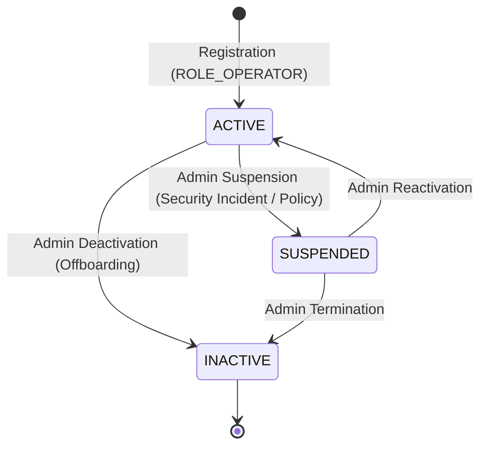

# User Account Management — RevenueRescueAI

## 1. Overview and Purpose

User Account Management governs the creation, retrieval, modification, and lifecycle transitions of operator and administrative accounts in RevenueRescueAI. In a financial recovery operations platform, account management must strictly preserve identity integrity, enforce least privilege, prevent self-elevation of privilege, and log critical security state transitions.

---

## 2. User Account Domain Model

The `User` entity is defined in [app/models/domain.py](file:///c:/Users/vanka/Downloads/RevenueRescueAI-main/RevenueRescueAI-main/backend/app/models/domain.py) and mapped to the PostgreSQL/SQLite `users` table:

```python
class User(Base, UUIDPrimaryKeyMixin, TimestampMixin):
    __tablename__ = "users"

    email: Mapped[str] = mapped_column(String(255), unique=True, nullable=False, index=True)
    password_hash: Mapped[str] = mapped_column(String(255), nullable=False)
    name: Mapped[str] = mapped_column(String(100), nullable=False)
    role: Mapped[UserRole] = mapped_column(
        Enum(UserRole, name="user_role_enum", native_enum=False),
        nullable=False,
        default=UserRole.ROLE_OPERATOR,
        index=True
    )
    status: Mapped[UserStatus] = mapped_column(
        Enum(UserStatus, name="user_status_enum", native_enum=False),
        nullable=False,
        default=UserStatus.ACTIVE,
        index=True
    )
    last_login_at: Mapped[Optional[datetime]] = mapped_column(DateTime(timezone=True), nullable=True)
```

### Invariants:
1. **Identifier Strategy:** UUID v4 primary key automatically generated server-side.
2. **Email Canonicalization:** Email addresses are trimmed and converted to lower case (`email.strip().lower()`) before database lookup or persistence to guarantee uniqueness across letter cases.
3. **Password Confidentiality:** Plaintext passwords are never persisted or cached. Only salted BCrypt hashes with work factor 12 are stored.
4. **Audit Timestamps:** UTC timestamps (`created_at`, `updated_at`, `last_login_at`) tracked with timezone precision.

---

## 3. Account Lifecycle State Machine



### Lifecycle Rules:
- **`ACTIVE`:** User is eligible to authenticate, generate JWTs, refresh tokens, and execute authorized recovery operations.
- **`SUSPENDED`:** Temporary lock applied by an Administrator. All authentication requests are blocked with HTTP 403 Forbidden. Existing JWTs fail upon renewal; revocation is immediately enforced at the security boundary.
- **`INACTIVE`:** Soft-deleted or permanently terminated account. Authentication is unconditionally rejected.

---

## 4. Self-Service vs. Administrative Capabilities

| Action | Allowed Actor | Endpoint | Security Rules |
| :--- | :--- | :--- | :--- |
| **Self-Registration** | Public | `POST /api/v1/auth/register` | Client role inputs are discarded; server assigns `ROLE_OPERATOR` and `ACTIVE`. |
| **Get Own Profile** | Any Authenticated User | `GET /api/v1/auth/me` | User ID extracted strictly from JWT claims in Security Context. |
| **Update Own Profile** | Any Authenticated User | `PATCH /api/v1/auth/me` | Only mutable profile fields (`name`) may be changed. |
| **Change Own Password** | Any Authenticated User | `POST /api/v1/auth/change-password`| Requires existing password verification before accepting new password. |
| **List All Users** | `ROLE_ADMIN` | `GET /api/v1/users` | Supports pagination (`skip`, `limit`). Non-admins receive HTTP 403. |
| **Update User Role** | `ROLE_ADMIN` | `PATCH /api/v1/users/{id}/role` | Cannot be performed via self-service profile APIs. Audit log recorded. |
| **Update User Status**| `ROLE_ADMIN` | `PATCH /api/v1/users/{id}/status` | Admin-controlled activation, suspension, or deactivation. |

---

## 5. Security & Defensive Controls

1. **Self-Elevation Prevention:** A regular operator cannot elevate themselves to `ROLE_ADMIN`. The `UpdateProfileRequestDTO` only exposes the `name` attribute. Role and status fields are non-existent in this DTO, preventing parameter pollution and mass-assignment vulnerabilities.
2. **Context-Derived Identity:** In `GET /api/v1/auth/me` and `PATCH /api/v1/auth/me`, the backend extracts `user_id` strictly from `token_data.sub` parsed from the validated JWT bearer header. Clients cannot pass arbitrary `user_id` parameters to inspect or mutate another user's profile (IDOR defense).
3. **Data Sanitization:** The entity mapper `UserMapper.to_response()` projects `User` into `UserResponseDTO`, which contains no password hash or secret attributes.
