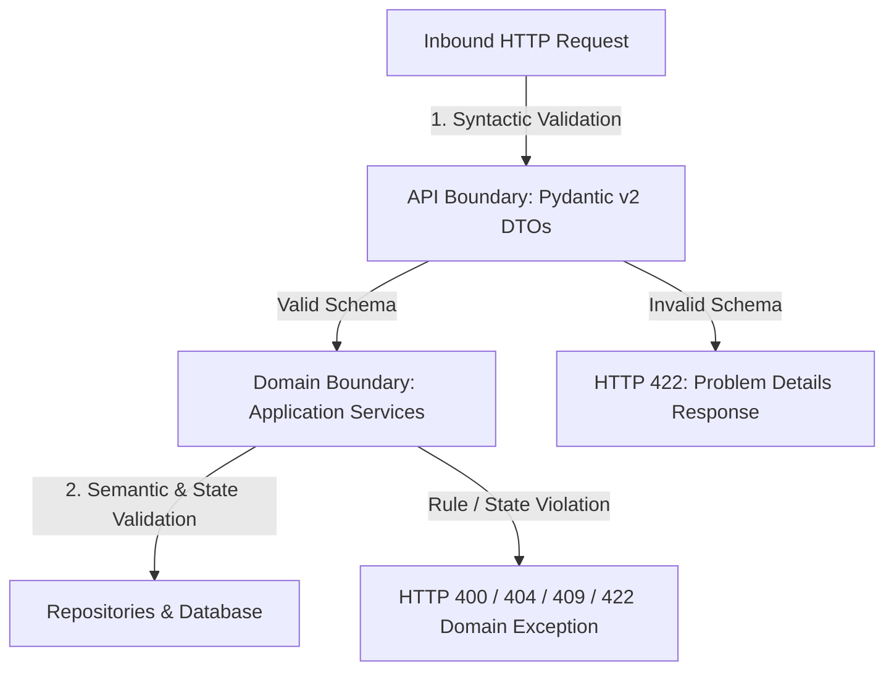

# RevenueRescueAI — Validation & Exception Strategy
## Phase 2.3: Two-Tier Input Validation and RFC-7807 Problem Handling

**Document Version:** 1.0.0  
**Status:** Approved Architectural Standard  
**Author:** Senior Backend Architect, API Engineer  

---

## 1. Two-Tier Validation Strategy

Validation in RevenueRescueAI operates at two strict boundaries:



### Tier 1: API Boundary Validation (Syntactic & Type Safety)
Handled declaratively by Pydantic v2 DTOs in [`app/schemas/`](file:///c:/Users/vanka/Downloads/RevenueRescueAI-main/RevenueRescueAI-main/backend/app/schemas):
- **Missing Required Fields:** Automatically rejected with field-level details.
- **String Lengths & Patterns:** Emails checked against regex; currencies checked against `^[A-Z]{3}$`.
- **Numeric & Financial Bounds:** `amount_minor: int` enforced with `ge=0`; floating-point numbers rejected.
- **Extra Attribute Injections:** Enforces `extra="forbid"` to prevent mass-assignment vulnerabilities.
- **Pagination Constraints:** Minimum page `1`, maximum limit `100`.

### Tier 2: Domain Boundary Validation (Semantic & State Safety)
Handled programmatically by Application Services in [`app/services/`](file:///c:/Users/vanka/Downloads/RevenueRescueAI-main/RevenueRescueAI-main/backend/app/services):
- **Referential Integrity:** Verifies customer exists before associating a transaction; verifies transaction exists before opening a case.
- **Uniqueness & Idempotency:** Detects duplicate provider transaction references or idempotency key reuse.
- **State Machine Legality:** Verifies whether a transition is permitted by the Recovery FSM; strictly blocks transitions out of terminal states (`RECOVERED`, `STOPPED`, `CLOSED`).
- **Financial Status Trust:** Never trusts client-submitted assertions such as `{"recovered": true}`. Financial status is derived exclusively from verified provider evidence.

---

## 2. Standardized RFC-7807 Error Response Format

All error responses adhere strictly to RFC-7807 (Problem Details for HTTP APIs), configured in [`app/core/errors.py`](file:///c:/Users/vanka/Downloads/RevenueRescueAI-main/RevenueRescueAI-main/backend/app/core/errors.py):

```json
{
  "success": false,
  "error_code": "RESOURCE_NOT_FOUND",
  "message": "Customer with identifier 'c65fae3e-4d45-42cf-9fae-d4c3ab871101' not found.",
  "request_id": "req_847291a9b",
  "timestamp": "2026-10-31T05:15:39.123456Z",
  "details": [
    {
      "field": "id",
      "message": "Resource does not exist",
      "code": "NOT_FOUND"
    }
  ]
}
```

---

## 3. Custom Domain Exception Hierarchy

```text
RevenueRescueException (Base Domain Exception)
├── EntityNotFoundException (HTTP 404 - RESOURCE_NOT_FOUND)
├── DuplicateEntityException (HTTP 409 - DUPLICATE_ENTITY)
├── IdempotencyConflictException (HTTP 409 - IDEMPOTENCY_CONFLICT)
├── InvalidStateTransitionException (HTTP 400 - INVALID_STATE_TRANSITION)
├── MalformedRequestException (HTTP 400 - MALFORMED_REQUEST)
├── UnauthorizedException (HTTP 401 - UNAUTHORIZED)
├── ForbiddenException (HTTP 403 - FORBIDDEN)
├── PolicyViolationException (HTTP 422 - POLICY_VIOLATION)
└── DatabaseConnectionException (HTTP 503 - DATABASE_UNAVAILABLE)
```

---

## 4. Security Rules for Error Exposure

1. **No Stack Traces:** Stack traces are logged internally at `ERROR` level along with correlation IDs, but are **never returned** in client JSON payloads.
2. **No Raw SQL Leakage:** Database syntax errors, constraint names, or table internals are intercepted by global handlers and mapped to generic, safe error summaries.
3. **No Credential Echo:** Passwords, API secrets, and webhook signatures are masked or omitted in error responses and log outputs.
