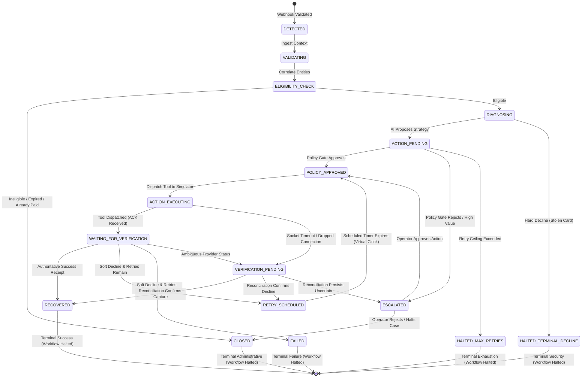

# RevenueRescueAI — Workflow State Machine & State Transition Requirements

> **Document ID:** DOC-WSR-006  
> **Phase:** 0.2 (User Stories, Functional Requirements & Acceptance Criteria)  
> **Status:** Approved Baseline  
> **Audience:** Product Engineering, Architecture, QA, Security, Beginner Developers  

---

## 1. Executive Summary

In distributed recovery systems, explicit finite state machines (FSM) are essential to prevent race conditions, orphaned tasks, and illegal operations (such as charging a customer after a case has been closed). A state machine guarantees that every case occupies exactly one well-defined state at any instant in time, and can only transition to another state through validated, audited triggers.

This document formally specifies the fourteen lifecycle states of RevenueRescueAI, establishes the complete state-transition matrix, catalogs illegal transitions, and defines the exact mechanisms for success-based halting and timeout uncertainty preservation.

---

## 2. Complete State Machine Diagram

---

## 3. Detailed Specifications of the Accepted States

---

### 1. `DETECTED`
- **Meaning:** A payment failure event has been ingested and cryptographically authenticated, and the initial case entity has been instantiated.
- **Entry Conditions:** Valid `payment.failed` webhook ingested; unique `event_id` confirmed.
- **Allowed Next States:** `VALIDATING`, `CLOSED` (if duplicate).
- **Disallowed Transitions:** `POLICY_APPROVED`, `ACTION_EXECUTING`, `RECOVERED` (cannot jump ahead).
- **Exit Conditions:** Ingestion payload bound to internal database record.
- **Action Permitted?** **NO.** Strictly passive state.
- **Human Intervention Required?** **NO.**

---

### 2. `VALIDATING`
- **Meaning:** System is correlating raw payload references against internal customer repositories and invoice ledgers.
- **Entry Conditions:** Transition from `DETECTED`.
- **Allowed Next States:** `ELIGIBILITY_CHECK`, `CLOSED` (if entity resolution fails permanently).
- **Disallowed Transitions:** `ACTION_EXECUTING`, `RECOVERED`.
- **Exit Conditions:** Customer, invoice, and nominal amount minor units fully resolved.
- **Action Permitted?** **NO.**
- **Human Intervention Required?** **NO.**

---

### 3. `ELIGIBILITY_CHECK`
- **Meaning:** Evaluating business eligibility rules (active customer, invoice age <= 14 days, opt-out status, unpaid invoice).
- **Entry Conditions:** Correlation complete in `VALIDATING`.
- **Allowed Next States:** `DIAGNOSING` (if eligible), `CLOSED` (if ineligible, expired, or already paid).
- **Disallowed Transitions:** `ACTION_EXECUTING`, `RETRY_SCHEDULED`.
- **Exit Conditions:** All eligibility boolean rules evaluated.
- **Action Permitted?** **NO.**
- **Human Intervention Required?** **NO.**

---

### 4. `DIAGNOSING`
- **Meaning:** Analyzing raw decline telemetry and classifying root cause (soft vs. hard decline taxonomy).
- **Entry Conditions:** Case evaluated as `ELIGIBLE`.
- **Allowed Next States:** `ACTION_PENDING`, `HALTED_TERMINAL_DECLINE` (if stolen/fraudulent card).
- **Disallowed Transitions:** `ACTION_EXECUTING`, `RECOVERED`.
- **Exit Conditions:** Failure class, severity, and confidence score assigned.
- **Action Permitted?** **NO.**
- **Human Intervention Required?** **NO.**

---

### 5. `ACTION_PENDING`
- **Meaning:** Decision Engine (AI) has formulated an `InterventionProposal` which is queued for Policy Gate evaluation.
- **Entry Conditions:** Diagnosis complete; proposal generated.
- **Allowed Next States:** `POLICY_APPROVED`, `ESCALATED`, `HALTED_MAX_RETRIES`.
- **Disallowed Transitions:** `ACTION_EXECUTING` (must pass policy gate first!).
- **Exit Conditions:** Policy Gate evaluation completes.
- **Action Permitted?** **NO.**
- **Human Intervention Required?** **NO.**

---

### 6. `POLICY_APPROVED`
- **Meaning:** The deterministic Policy Gate has verified and approved the proposed intervention. Execution token is active.
- **Entry Conditions:** `PolicyDecision(status="APPROVED")` emitted by code.
- **Allowed Next States:** `ACTION_EXECUTING`.
- **Disallowed Transitions:** `RECOVERED`, `FAILED` (cannot claim outcome before dispatch).
- **Exit Conditions:** Outbound adapter call initiated with idempotency key.
- **Action Permitted?** **YES.** Ready for tool dispatch.
- **Human Intervention Required?** **NO.**

---

### 7. `ACTION_EXECUTING`
- **Meaning:** The recovery tool call is currently in-flight to the Simulated Payment Provider adapter.
- **Entry Conditions:** Outbound call dispatched.
- **Allowed Next States:** `WAITING_FOR_VERIFICATION`, `VERIFICATION_PENDING` (on socket timeout).
- **Disallowed Transitions:** `DETECTED`, `DIAGNOSING`, `POLICY_APPROVED`.
- **Exit Conditions:** Adapter call returns response or times out.
- **Action Permitted?** **NO.** Dispatch already active.
- **Human Intervention Required?** **NO.**

---

### 8. `WAITING_FOR_VERIFICATION`
- **Meaning:** Provider adapter returned an HTTP acknowledgment; system is verifying authoritative settlement receipt.
- **Entry Conditions:** Tool dispatch completed; receipt token received.
- **Allowed Next States:** `RECOVERED` (success), `RETRY_SCHEDULED` (soft fail), `FAILED` (exhausted), `VERIFICATION_PENDING` (ambiguous).
- **Disallowed Transitions:** `ACTION_EXECUTING` (cannot re-execute while verifying).
- **Exit Conditions:** Outcome Verifier completes receipt analysis.
- **Action Permitted?** **NO.**
- **Human Intervention Required?** **NO.**

---

### 9. `RETRY_SCHEDULED`
- **Meaning:** Previous attempt failed with a retryable soft decline; case is queued for future execution under backoff timer.
- **Entry Conditions:** Soft decline verified; attempt count < 3; backoff timer calculated.
- **Allowed Next States:** `POLICY_APPROVED` (when timer expires), `CLOSED` (if customer pays organically in interim).
- **Disallowed Transitions:** `ACTION_EXECUTING` (must wait for timer and re-validate policy).
- **Exit Conditions:** Virtual Clock advances past `scheduled_execution_time`.
- **Action Permitted?** **NO.** Waiting in scheduler queue.
- **Human Intervention Required?** **NO.**

---

### 10. `VERIFICATION_PENDING`
- **Meaning:** Three-valued uncertainty state: provider call timed out or returned pending; automated actions are frozen pending reconciliation.
- **Entry Conditions:** Network socket timeout (HTTP 504), connection drop, or provider `status: "pending"`.
- **Allowed Next States:** `RECOVERED` (reconciled success), `RETRY_SCHEDULED` (reconciled decline), `ESCALATED` (ambiguity persists).
- **Disallowed Transitions:** `ACTION_EXECUTING` (immediate retry strictly prohibited!).
- **Exit Conditions:** Reconciliation poller resolves transaction or escalation threshold met.
- **Action Permitted?** **NO.** Actions strictly frozen.
- **Human Intervention Required?** **YES (if automated polling times out).**

---

### 11. `ESCALATED`
- **Meaning:** Case has been removed from autonomous automation and placed in the Human Recovery Operator inbox.
- **Entry Conditions:** High value (>= $1,000), low model confidence (< 0.60), policy rejection anomaly, or unresolved timeout.
- **Allowed Next States:** `POLICY_APPROVED` (operator approves retry), `CLOSED` (operator halts case).
- **Disallowed Transitions:** `ACTION_EXECUTING` (must route through policy approval).
- **Exit Conditions:** Operator logs resolution decision in UI.
- **Action Permitted?** **NO.** Autonomous actions frozen.
- **Human Intervention Required?** **YES (Mandatory human-in-the-loop).**

---

### 12. `RECOVERED` (Terminal Success)
- **Meaning:** Payment capture definitively verified by authoritative provider receipt matching transaction ID, amount, and currency.
- **Entry Conditions:** Outcome Verifier cryptographically validates settlement receipt.
- **Allowed Next States:** `CLOSED` (Administrative archival).
- **Disallowed Transitions:** Any active execution or retry state.
- **Exit Conditions:** None. Terminal state.
- **Action Permitted?** **NO.** Workflow completely terminated.
- **Human Intervention Required?** **NO.**

---

### 13. `FAILED` (Terminal Failure)
- **Meaning:** All permitted recovery attempts have been exhausted without success, or case has expired past the 14-day window.
- **Entry Conditions:** Attempt count reaches 3 and final attempt fails; or recovery window expires.
- **Allowed Next States:** `CLOSED`.
- **Disallowed Transitions:** Any active execution state.
- **Exit Conditions:** None. Terminal state.
- **Action Permitted?** **NO.** Workflow completely terminated.
- **Human Intervention Required?** **NO.**

---

### 14. `CLOSED` (Terminal Administrative)
- **Meaning:** Case lifecycle has formally concluded. Case is archived for compliance audit.
- **Entry Conditions:** Ineligible at ingestion, resolved externally, operator rejected, or archived post-terminal.
- **Allowed Next States:** None. Final sink state.
- **Disallowed Transitions:** All.
- **Exit Conditions:** None.
- **Action Permitted?** **NO.**
- **Human Intervention Required?** **NO.**

---

## 4. State-Transition Matrix

The following matrix formally defines all permitted transitions. Rows represent the current state; columns represent the target state:

| Current State \ Target | DET | VAL | ELG | DIA | ACT_P | POL_A | ACT_E | WAIT_V | RET_S | VER_P | ESC | REC | FAI | CLO |
|---|:---:|:---:|:---:|:---:|:---:|:---:|:---:|:---:|:---:|:---:|:---:|:---:|:---:|:---:|
| **DETECTED** | - | **YES**| - | - | - | - | - | - | - | - | - | - | - | **YES**|
| **VALIDATING** | - | - | **YES**| - | - | - | - | - | - | - | - | - | - | **YES**|
| **ELIGIBILITY_CHECK** | - | - | - | **YES**| - | - | - | - | - | - | - | - | - | **YES**|
| **DIAGNOSING** | - | - | - | - | **YES**| - | - | - | - | - | - | - | - | **YES**|
| **ACTION_PENDING** | - | - | - | - | - | **YES**| - | - | - | - | **YES**| - | - | **YES**|
| **POLICY_APPROVED** | - | - | - | - | - | - | **YES**| - | - | - | - | - | - | - |
| **ACTION_EXECUTING** | - | - | - | - | - | - | - | **YES**| - | **YES**| - | - | - | - |
| **WAITING_FOR_VERIFICATION**| - | - | - | - | - | - | - | - | **YES**| **YES**| - | **YES**| **YES**| - |
| **RETRY_SCHEDULED** | - | - | - | - | - | **YES**| - | - | - | - | - | - | - | **YES**|
| **VERIFICATION_PENDING** | - | - | - | - | - | - | - | - | **YES**| - | **YES**| **YES**| - | - |
| **ESCALATED** | - | - | - | - | - | **YES**| - | - | - | - | - | - | - | **YES**|
| **RECOVERED (Terminal)**| - | - | - | - | - | - | - | - | - | - | - | - | - | **YES**|
| **FAILED (Terminal)** | - | - | - | - | - | - | - | - | - | - | - | - | - | **YES**|
| **CLOSED (Terminal)** | - | - | - | - | - | - | - | - | - | - | - | - | - | - |

*(Legend: **YES** = Legal Transition; `-` = Illegal Transition, throws `InvalidStateTransitionException`)*

---

## 5. Critical Lifecycle Mechanics

### 5.1 Success Stopping Mechanism
When an authoritative receipt confirms payment capture:
1. `WAITING_FOR_VERIFICATION` immediately transitions to `RECOVERED`.
2. The Workflow Engine cancels any active scheduler cron jobs or timers associated with the `case_id`.
3. The invoice status in the authoritative ledger is updated to `PAID`.
4. The case state machine enters a permanent terminal lock: no subsequent event can transition the case out of `RECOVERED` (except administrative archival to `CLOSED`).
5. Any subsequent webhook arriving for this payment is absorbed cleanly without action (BR-001).

### 5.2 Timeout & Uncertainty Preservation Mechanism
When an HTTP timeout (HTTP 504) occurs during `ACTION_EXECUTING`:
1. The Workflow Engine catches the socket timeout.
2. It explicitly **does NOT** transition to `FAILED` or `RETRY_SCHEDULED`.
3. It transitions to `VERIFICATION_PENDING`.
4. The attempt counter is frozen; no new idempotency token is generated.
5. An asynchronous reconciliation job is scheduled for 15 minutes later.
6. The reconciliation job queries the provider's transaction ledger using `idemp_{case_id}_{attempt_num}`.
   - If the provider confirms the charge settled -> transitions to `RECOVERED`.
   - If the provider confirms the charge was rejected -> transitions to `RETRY_SCHEDULED`.
   - If the provider has no record or remains pending after 3 attempts -> transitions to `ESCALATED`.
